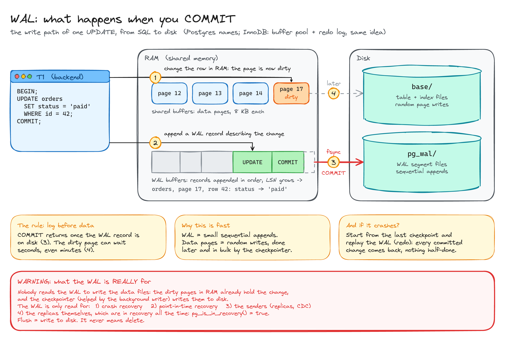
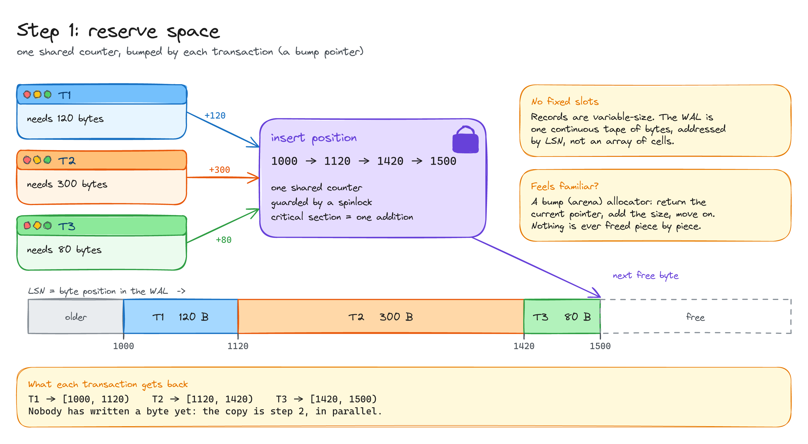
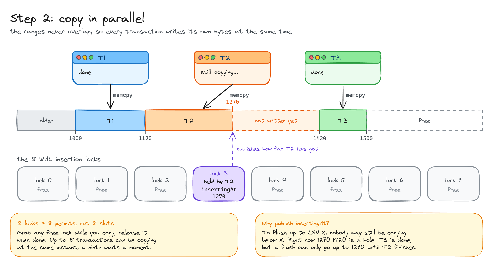
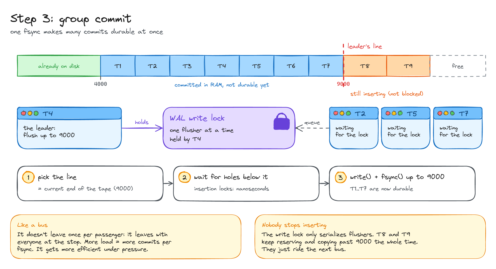
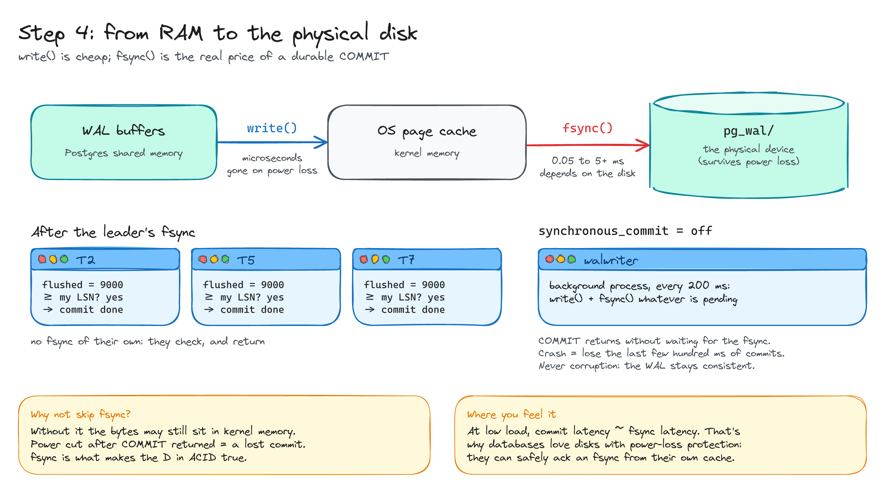
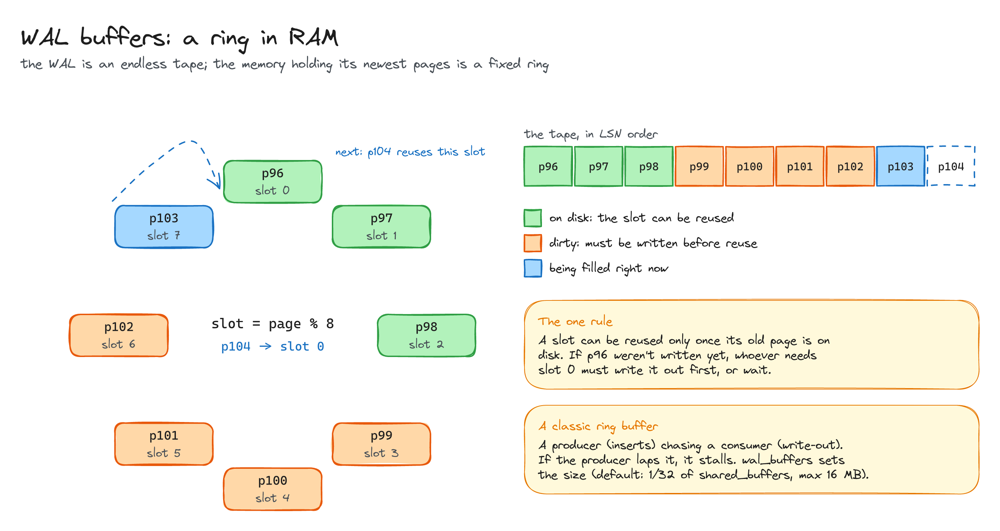
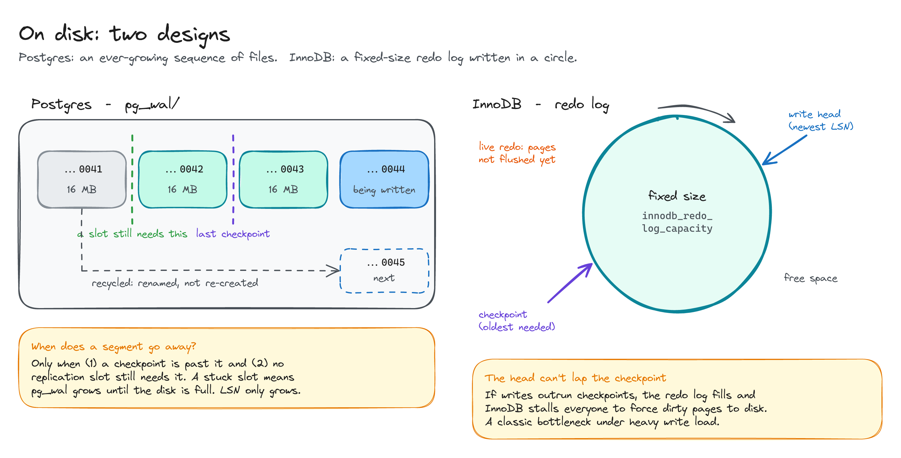

# The WAL: how a write becomes durable

> What happens inside a database between `COMMIT;` and "your data is safe", and why it's fast.

**What you'll learn**

- Why a database writes every change twice, and why that makes it *faster*.
- How many transactions append to one log at the same time without fighting over it.
- What group commit is, and why `fsync` is the real cost of a commit.
- How the WAL is kept in memory and on disk, in Postgres and in InnoDB.

**Before reading**: nothing. This is the starting point.

Names are Postgres ones. InnoDB works the same way with other names: buffer pool instead of shared buffers, redo log instead of WAL.

---

## 0. The write path

An `UPDATE` touches two things in RAM:

1. The **data page** that holds the row. It's modified in memory and becomes *dirty*.
2. The **WAL buffers**, where a record describing the change is appended.

`COMMIT` only waits for the WAL record to reach disk. The dirty page is written much later, by the checkpointer.

That's the whole trick: **log before data**. The WAL is small sequential appends, which are cheap. Data pages are random writes, which are expensive, so they're postponed and done in bulk. If the server crashes, it replays the WAL from the last checkpoint and every committed change comes back.

> [!CAUTION]
> **What the WAL is REALLY for.** Nobody reads the WAL to write the data files: the dirty pages in RAM already hold the change, and the checkpointer (helped by the background writer) writes them to disk. The WAL is only read for:
>
> 1. **Crash recovery**: replay from the last checkpoint.
> 2. **Point-in-time recovery**: a base backup + archived WAL, replayed up to the second you choose (say, just before a `DELETE` without a `WHERE`).
> 3. **The senders**: walsenders / binlog dump threads ship it to replicas and CDC tools.
> 4. **The replicas themselves**, which are in recovery *all the time*: `SELECT pg_is_in_recovery();` returns `true` on a standby. Promoting one in a failover literally means "finish recovery and start accepting writes".
>
> Flush = write to disk. It never means delete.

## 1. Reserve space: a bump pointer

The WAL is one continuous tape of bytes. Each position on it is an **LSN** (log sequence number), which only grows. Records are variable-size, so there are no fixed slots.

To insert, a transaction asks a shared counter for N bytes. The counter moves forward by N under a spinlock and the transaction gets back its exact range, for example `[1000, 1120)`. The critical section is a single addition.

It's the same idea as a bump (arena) allocator: return the current pointer, add the size, move on.

## 2. Copy in parallel

Reserved ranges never overlap, so every transaction copies its record into its own range at the same time.

Postgres has **8 WAL insertion locks**. They're permits to be copying, not slots in the file. Each one publishes `insertingAt`, how far its holder has written. That's how a flusher finds the first **hole**: in the diagram T3 is done, but nothing past 1270 can be flushed until T2 finishes copying.

## 3. Group commit

A committing transaction needs the WAL on disk *up to its own LSN*:

1. If someone already flushed past it, it's done without touching the disk.
2. Otherwise it competes for the **WAL write lock**. Only one flusher at a time.
3. The winner (the leader) draws a line at the current end of the tape, waits for the holes below it to close, and flushes everything up to that line in one go.
4. The others were waiting for the lock. When they get it, they see the flush already covers them and leave.

It works like a bus that leaves with everyone at the stop: the more load, the more commits per `fsync`. Inserting never stops while this happens; only flushers are serialized.

## 4. write() vs fsync()

- `write()` copies bytes into the kernel's page cache. Microseconds, but lost on a power cut.
- `fsync()` forces them onto the physical device and waits for it to confirm. This is the real price of a durable commit, and the reason group commit exists.

With `synchronous_commit = off`, `COMMIT` returns before the `fsync`, and the background **walwriter** flushes every 200 ms. A crash can lose the last few hundred milliseconds of commits, but it never corrupts anything.

## 5. WAL buffers: a ring in RAM

The tape is endless, but the memory holding its newest pages is a fixed **ring** (`wal_buffers`). Page `p` lives in slot `p % N`. A slot can only be reused once its old page has been written out; if it hasn't, whoever needs the slot has to write it first or wait. A producer chasing a consumer, like any ring buffer.

## 6. On disk: two designs

- **Postgres** keeps the WAL as a growing sequence of 16 MB segment files in `pg_wal/`. A segment can go once a checkpoint is past it *and* no replication slot needs it. Old files are recycled (renamed) instead of re-created. The LSN only grows.
- **InnoDB** writes its redo log **in a circle**, with a fixed capacity. The write head can never lap the checkpoint: if writes outrun checkpoints, InnoDB stalls everyone to force dirty pages to disk.

All diagrams on one canvas: [`diagrams/wal-how-it-works.excalidraw`](diagrams/wal-how-it-works.excalidraw).

---

## Key takeaways

- A commit is durable when its **WAL record** is on disk, not its data pages.
- Inserting into the WAL is two steps: **reserve** (one addition under a spinlock) and **copy** (in parallel).
- **Group commit** turns many commits into one `fsync`. It gets more efficient under load.
- `fsync` is the expensive part; `write()` alone isn't durable.
- In RAM the WAL lives in a **ring**; on disk it's segment files (Postgres) or a circular redo log (InnoDB).

## Interview cheat sheet

**Q: Why doesn't a database write the data page on every commit?**
A: Data pages are random writes. It appends a small sequential WAL record instead, fsyncs that, and writes the pages later in bulk. After a crash it replays the WAL.

**Q: What does `COMMIT` actually wait for?**
A: The `fsync` of the WAL up to its commit record, usually shared with other commits through group commit.

**Q: How do many transactions write to one log concurrently?**
A: They reserve byte ranges with an atomic bump of a shared position, then copy their records into those ranges in parallel. A flush only goes up to the first hole.

**Q: What's a checkpoint for?**
A: Writing all dirty pages up to a point, so older WAL isn't needed for recovery and can be recycled. It also bounds how long recovery takes.

## Further reading

- [Postgres docs: Reliability and the Write-Ahead Log](https://www.postgresql.org/docs/current/wal.html)
- *Designing Data-Intensive Applications* (Kleppmann), chapter 3: storage and retrieval.
