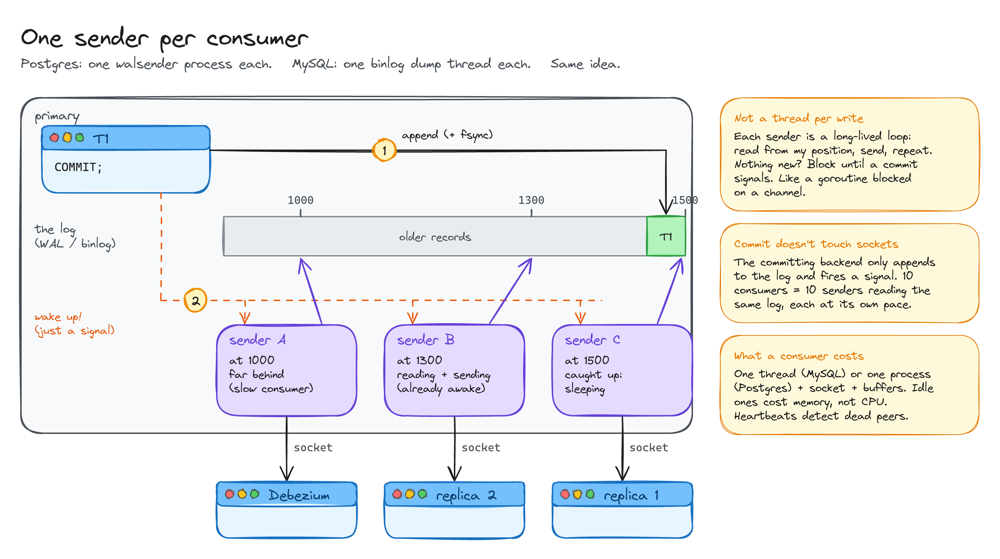
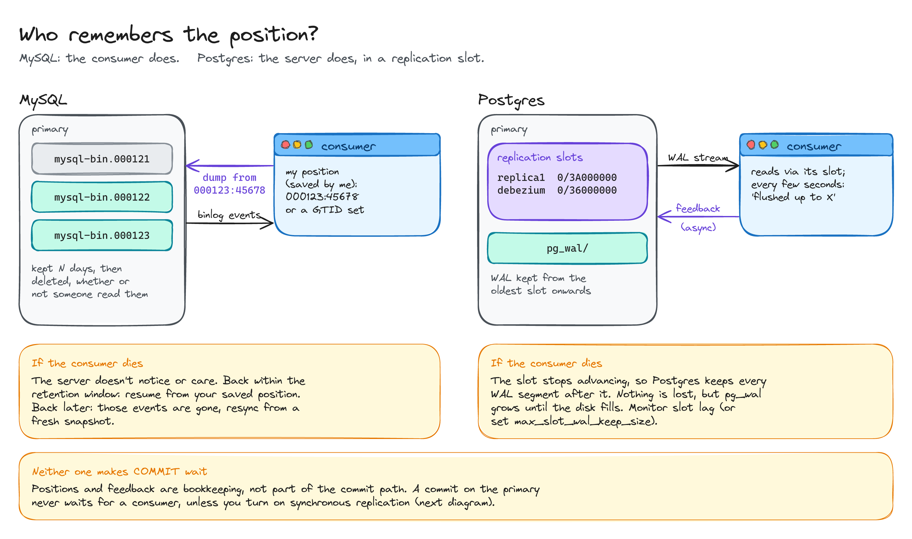
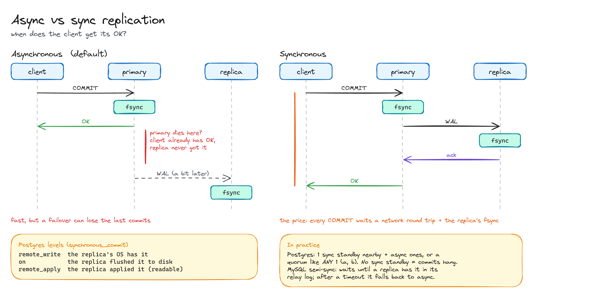
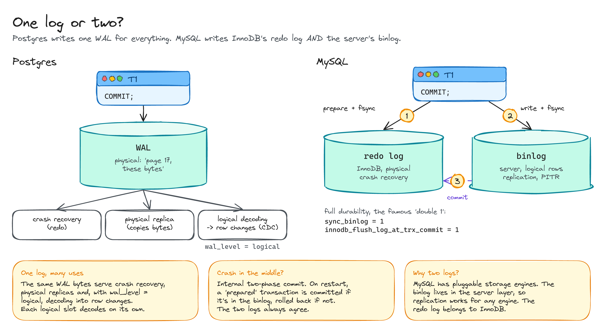
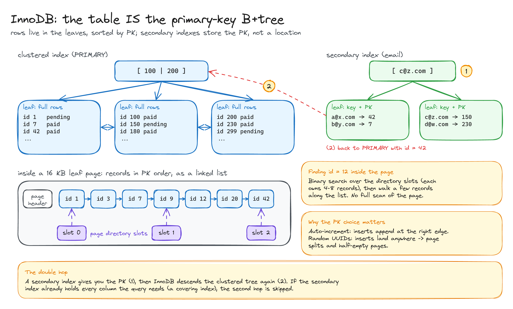
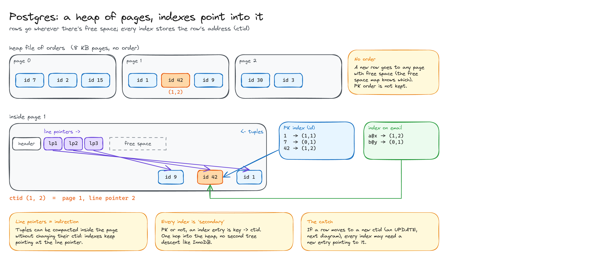
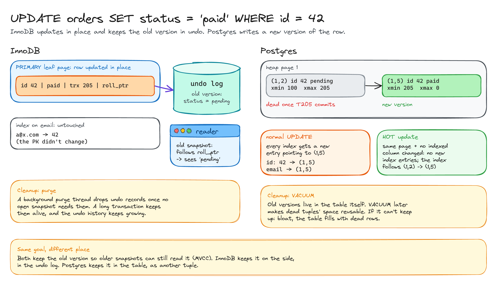

# MySQL vs Postgres: replication and storage

> How the two databases ship their changes to other machines, and how they lay rows out on disk.

**What you'll learn**

- What actually runs on the primary for each replica or CDC tool connected to it.
- Who keeps track of how far each consumer has read, and what happens when one disappears.
- Why MySQL writes two logs and Postgres only one.
- Clustered index vs heap: where a row lives, and what an `UPDATE` really does.

**Before reading**: [The WAL](../01-wal/README.md).

---

## Replication

### 1. One sender per consumer

Every connected replica or CDC tool gets its own long-lived sender: a **binlog dump thread** in MySQL, a **walsender process** in Postgres. It loops forever: read from *its own* position, send, and when it catches up, block until a commit signals new data. It doesn't die between writes; think of a goroutine blocked on a channel.

The committing transaction never writes to a socket. It appends to the log and fires a signal. Ten consumers means ten senders reading the same log, each at its own pace. While idle, each one costs memory (a thread or process, plus buffers), not CPU.

### 2. Who remembers the position?

- **MySQL**: the consumer stores its own position (`file:offset` or a GTID set) and asks for "everything from here" when it reconnects. The server deletes binlogs on a timer, whether or not anyone read them. Come back too late and you need a fresh snapshot.
- **Postgres**: the server stores each consumer's position in a **replication slot**, and keeps all the WAL the slowest slot still needs. Nothing is lost, but a dead consumer makes `pg_wal` grow until the disk is full.

In both, the consumer's feedback is asynchronous bookkeeping. A commit never waits for it, unless you turn on synchronous replication.

### 3. Async vs sync replication

By default replication is **asynchronous**: the client gets its OK after the local `fsync`, and the replica gets the change a bit later. If the primary dies in between, a failover loses that commit.

**Synchronous** replication makes the commit wait for a replica's ack: nothing lost on failover, at the cost of a network round trip plus the replica's `fsync` on every commit. More in [Sync vs async replication](../03-sync-vs-async-replication/README.md).

### 4. One log or two?

Postgres has a single physical WAL that serves crash recovery, physical replicas and, with `wal_level = logical`, decoding into row changes.

MySQL writes **two** logs: InnoDB's physical **redo log** and the server's logical **binlog**. An internal two-phase commit keeps them in agreement: prepare in the redo log, write the binlog, commit in the redo log. After a crash, a prepared transaction is committed if it made it into the binlog and rolled back if it didn't. The binlog lives in the server layer because MySQL supports pluggable storage engines.

---

## Storage

### 5. InnoDB: the table is the primary-key B+tree

The rows themselves live in the leaves of the primary-key B+tree, sorted by PK, and the leaves are linked to each other. Inside a 16 KB page, records form a linked list in PK order, and a **page directory** of slots (each owning 4 to 8 records) allows a binary search.

Secondary indexes store the **PK**, not a location. A lookup by email finds the PK, then descends the clustered tree again: the double hop, unless the index covers the query. The choice of PK matters: auto-increment appends at the right edge of the tree, random UUIDs cause page splits.

### 6. Postgres: a heap, and indexes that point into it

The table is a **heap**: pages of rows in no particular order. A new row goes wherever there's free space. Each row has an address, its **ctid** `(page, line pointer)`. Line pointers add a level of indirection inside the page, so tuples can be compacted without changing their ctid.

Every index, including the PK, maps a key to a ctid: one hop into the heap.

### 7. UPDATE and MVCC

Both databases keep the old version of a row so that older snapshots can still read it, but in different places:

- **InnoDB** updates the row in place and pushes the old version into the **undo log**, reachable through the row's roll pointer. Secondary indexes don't change unless an indexed column does. A purge thread cleans up undo once no snapshot needs it.
- **Postgres** writes a **new tuple** and marks the old one as dead (`xmax`). Normally every index gets a new entry pointing to the new ctid. A **HOT update** (same page, no indexed column changed) avoids that. VACUUM reclaims dead tuples later; if it can't keep up, the table bloats.

All diagrams on one canvas: [`diagrams/mysql-vs-postgres.excalidraw`](diagrams/mysql-vs-postgres.excalidraw).

---

## Key takeaways

- Replication is **one long-lived sender per consumer**, woken by a signal. Commits don't touch sockets.
- **MySQL**: the consumer tracks its position, the server deletes logs on a timer. **Postgres**: slots track positions and retain WAL, so a dead consumer fills the disk.
- MySQL = redo log + binlog, glued by an internal two-phase commit. Postgres = one WAL for everything.
- **InnoDB**: the table is the PK B+tree, secondary indexes point to the PK. **Postgres**: the table is a heap, every index points to a ctid.
- Old row versions: **undo log** in InnoDB, **dead tuples in the table** in Postgres (hence VACUUM).

## Interview cheat sheet

**Q: A CDC consumer on Postgres has been down for a day. What's the risk?**
A: Its replication slot stops advancing, so Postgres keeps every WAL segment after it and `pg_wal` grows until the disk fills. Monitor slot lag, or cap it with `max_slot_wal_keep_size`.

**Q: Why is a secondary index lookup slower in InnoDB?**
A: The secondary index stores the PK, so after finding it you descend the clustered index again. A covering index avoids the second hop.

**Q: Why can updates be expensive in Postgres?**
A: An update writes a new tuple with a new ctid, so every index may need a new entry. HOT updates avoid it when the row stays on the same page and no indexed column changes.

**Q: Why random UUIDs as a primary key in InnoDB are a bad idea?**
A: Rows are stored in PK order, so random keys insert all over the tree: page splits and half-empty pages. Sequential IDs (or UUIDv7) append at the end.

## Further reading

- [Postgres docs: Log-shipping standby servers](https://www.postgresql.org/docs/current/warm-standby.html)
- [MySQL docs: Replication](https://dev.mysql.com/doc/refman/8.0/en/replication.html)
- *Designing Data-Intensive Applications* (Kleppmann), chapter 3 (storage) and chapter 5 (replication).
