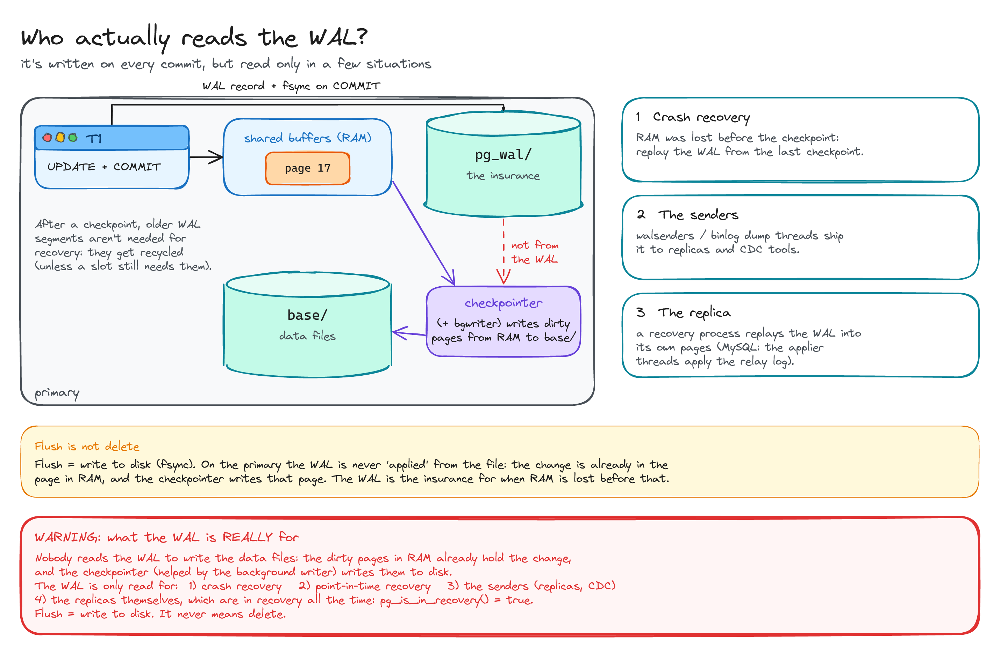
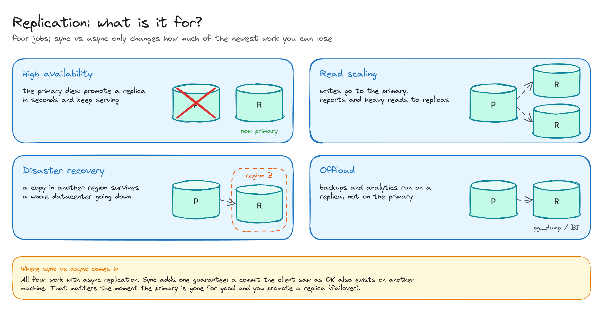
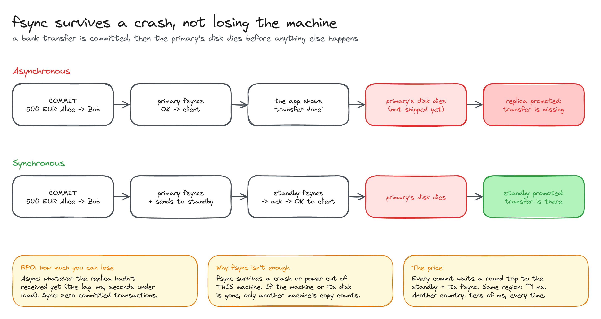
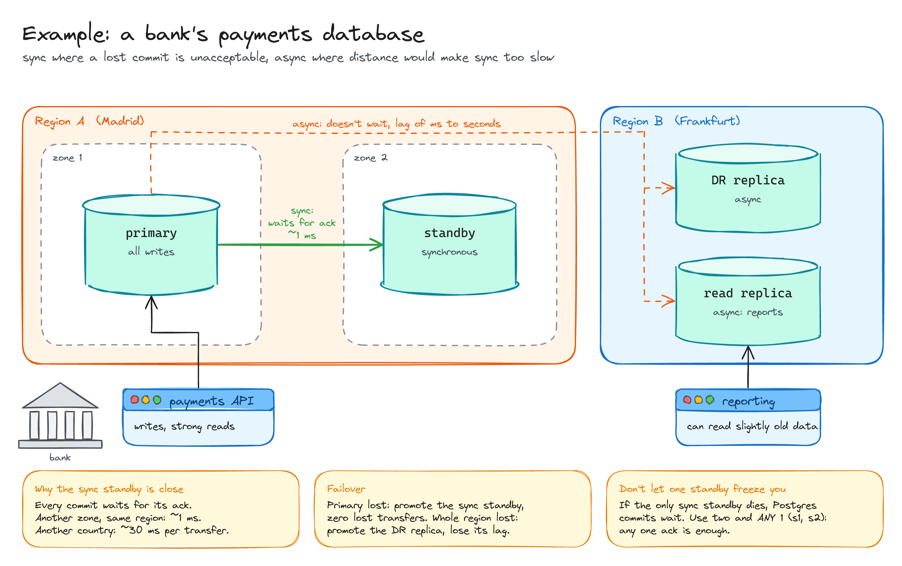
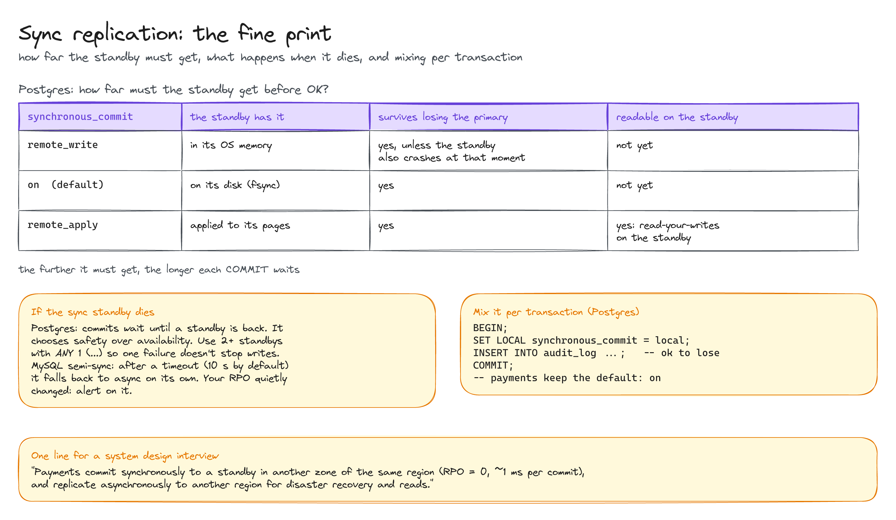

# Sync vs async replication

> What replication is for, what synchronous replication actually buys you, and how a bank would lay it out.

**What you'll learn**

- Who reads the WAL, and who doesn't.
- The four jobs of replication.
- Why `fsync` alone isn't enough to never lose a commit.
- A real-world layout: sync standby nearby, async replicas far away.

**Before reading**: [The WAL](../01-wal/README.md) and [MySQL vs Postgres](../02-mysql-vs-postgres/README.md).

---

## 1. Who actually reads the WAL?

On the primary, the WAL is never "applied" from the file. The change already lives in the page in RAM, and the **checkpointer** writes that page to the data files. The WAL is the insurance for the case where RAM is lost before that happens. Old segments are recycled once a checkpoint has passed them and no slot needs them.

> [!CAUTION]
> **What the WAL is REALLY for.** Nobody reads the WAL to write the data files: the dirty pages in RAM already hold the change, and the checkpointer (helped by the background writer) writes them to disk. The WAL is only read for:
>
> 1. **Crash recovery**: replay from the last checkpoint.
> 2. **Point-in-time recovery**: a base backup + archived WAL, replayed up to the second you choose (say, just before a `DELETE` without a `WHERE`).
> 3. **The senders**: walsenders / binlog dump threads ship it to replicas and CDC tools.
> 4. **The replicas themselves**, which are in recovery *all the time*: `SELECT pg_is_in_recovery();` returns `true` on a standby. Promoting one in a failover literally means "finish recovery and start accepting writes".
>
> Flush = write to disk. It never means delete.

## 2. What is replication for?

1. **High availability**: the primary dies, a replica is promoted in seconds.
2. **Read scaling**: writes go to the primary, reports and heavy reads to replicas.
3. **Disaster recovery**: a copy in another region survives a whole datacenter going down.
4. **Offload**: backups and analytics run on a replica instead of the primary.

All four work with async replication. Sync adds one guarantee: **a commit the client saw as OK also exists on another machine**.

## 3. fsync survives a crash, not losing the machine

`fsync` makes a commit survive a crash or power cut of *that* machine. If the machine or its disk is gone for good, only another machine's copy counts.

- **Async**: a transfer the customer already saw as "done" can vanish after a failover, because it was committed but not shipped yet. You lose the replication lag.
- **Sync**: the OK only comes after a standby has the commit on its disk, so the promoted standby has the transfer. You lose nothing.

This is the **RPO** (recovery point objective): async = the lag, sync = zero. The price is that every commit waits a round trip to the standby plus its `fsync`.

## 4. Example: a bank's payments database

- The **primary** in zone 1 takes every write.
- A **sync standby** in zone 2 of the *same region*: about 1 ms per commit, zero lost transfers if the primary dies.
- **Async replicas** in another region, for disaster recovery and reporting. They don't slow down commits; if the whole region is lost, you lose at most their lag.

With a single sync standby, its failure stops every commit in Postgres. Use two and `ANY 1 (s1, s2)`, so either ack is enough.

## 5. The fine print

- Postgres lets you choose how far the standby must get: `remote_write` (its OS has it), `on` (on its disk) or `remote_apply` (applied, so readable there). The further, the slower each commit.
- If the sync standby dies, Postgres waits: safety over availability. MySQL semi-sync falls back to async after a timeout, so the RPO changes silently. Alert on it.
- In Postgres it can be set **per transaction**: payments stay synchronous, audit logs can use `synchronous_commit = local`.

All diagrams on one canvas: [`diagrams/sync-vs-async-replication.excalidraw`](diagrams/sync-vs-async-replication.excalidraw).

---

## Key takeaways

- The WAL is insurance plus a replication stream. Dirty pages are written from RAM by the checkpointer.
- A replica is a server in permanent recovery.
- `fsync` protects you from a crash of the machine; only replication protects you from **losing** the machine.
- Async: RPO = lag, no cost per commit. Sync: RPO = 0, one round trip per commit.
- Keep the sync standby **close** (same region), the async ones **far** (disaster recovery).

## Interview cheat sheet

**Q: Design the database layer for payments. How do you make sure a confirmed payment is never lost?**
A: Payments commit synchronously to a standby in another zone of the same region: RPO 0 for about 1 ms per commit. Two standbys with a quorum (`ANY 1`) so one failure doesn't block writes. Async replicas in another region for disaster recovery and reporting.

**Q: Why not make every replica synchronous?**
A: Every commit would wait for the slowest one, and cross-region round trips add tens of milliseconds to each commit. And any replica failing would block or degrade writes.

**Q: What's the difference between `fsync` and sync replication?**
A: `fsync` makes data survive a crash of the same machine. Sync replication makes it survive losing the machine, by having another one confirm it first.

**Q: What does it mean to promote a replica?**
A: The replica is replaying WAL all the time (it's in recovery). Promoting it means it finishes recovery and starts accepting writes.

## Further reading

- [Postgres docs: Synchronous replication](https://www.postgresql.org/docs/current/warm-standby.html#SYNCHRONOUS-REPLICATION)
- [MySQL docs: Semisynchronous replication](https://dev.mysql.com/doc/refman/8.0/en/replication-semisync.html)
- *Designing Data-Intensive Applications* (Kleppmann), chapter 5: replication.
