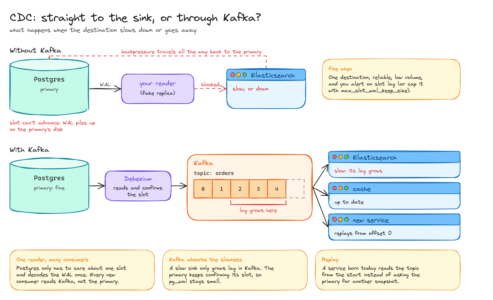
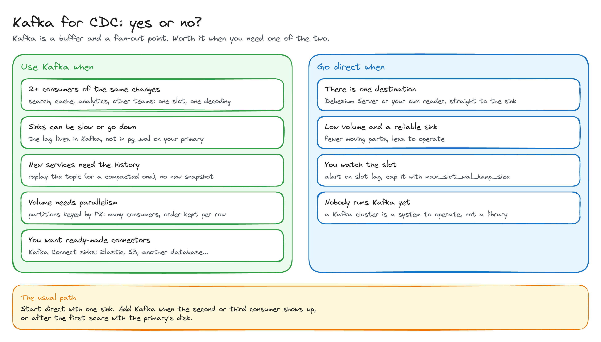
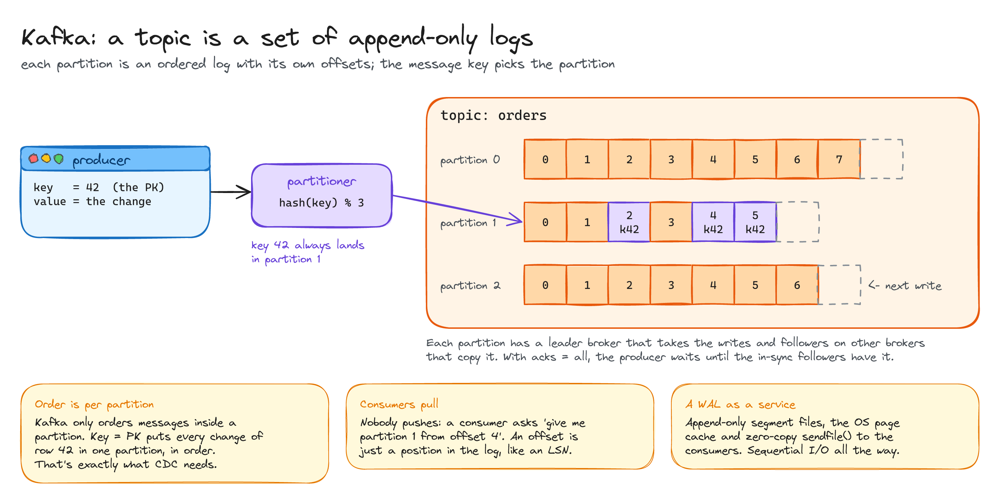
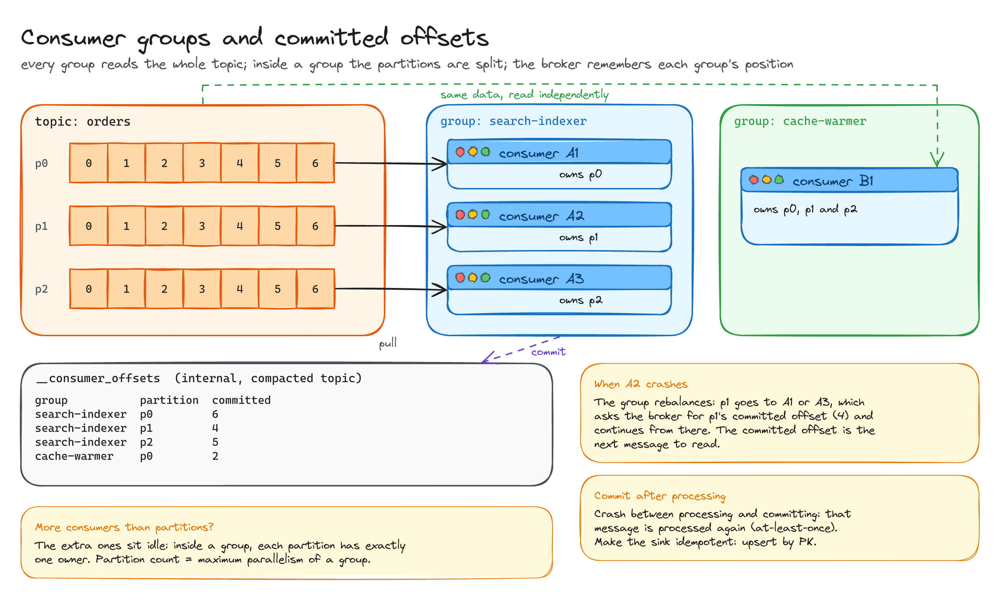
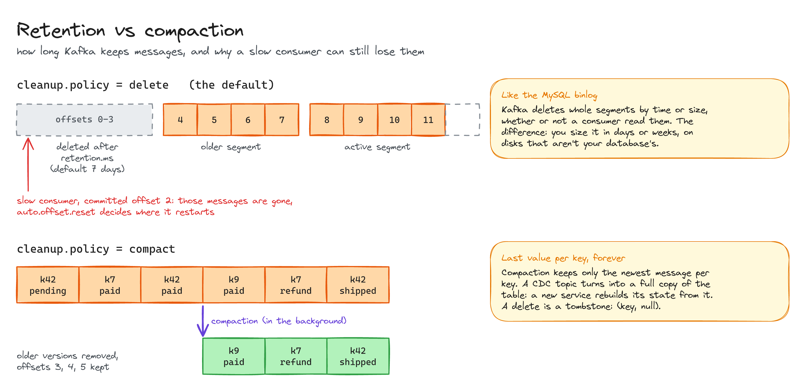

# CDC and Kafka

> Why most CDC pipelines put Kafka between the database and its consumers, when you can skip it, and how Kafka itself works.

**What you'll learn**

- What goes wrong when CDC writes straight to a slow sink.
- When Kafka is worth running, and when going direct is better.
- Topics, partitions, keys and ordering.
- Consumer groups, committed offsets and at-least-once delivery.
- Retention vs compaction.

**Before reading**: [MySQL vs Postgres](../02-mysql-vs-postgres/README.md), especially replication slots.

---

## 1. Straight to the sink, or through Kafka?

Reading the replication stream and writing straight to Elasticsearch works until the sink slows down. Then your reader can't advance, the replication slot can't advance, and the WAL piles up **on the primary's disk**: a search engine puts your main database at risk.

With Kafka in the middle, Debezium keeps reading and confirming the slot. A slow sink only grows its lag inside Kafka. Postgres has one slot and decodes the WAL once, however many consumers there are, and a new service can replay the topic instead of asking the primary for a fresh snapshot.

## 2. Yes or no?

Kafka is a **buffer** (it absorbs the speed difference between producer and consumers) and a **fan-out point** (one reader, many consumers). It's worth running when you need one of the two.

With a single reliable sink and low volume, going direct (Debezium Server or your own reader) is simpler, as long as you watch the slot. The usual path: start direct, add Kafka when the second or third consumer appears, or after the first scare with the primary's disk.

## 3. Topics and partitions

A topic is split into **partitions**. Each partition is an append-only log with its own offsets, like a WAL. The producer's key decides the partition: `hash(key) % partitions`.

Kafka only guarantees order **inside a partition**, so CDC uses the **primary key as the key**: every change of row 42 lands in the same partition, in order.

Consumers **pull** ("partition 1 from offset 4"); nobody pushes. Each partition has a leader broker that takes the writes and followers on other brokers that copy it. Underneath it's a WAL as a service: append-only segment files, the OS page cache and zero-copy `sendfile()`.

## 4. Consumer groups and committed offsets

Offsets are a hybrid between the MySQL and the Postgres models:

- **The consumer decides** when to commit, normally after processing a message.
- **The broker stores** the committed offset per group and partition, in the internal `__consumer_offsets` topic.

Each **consumer group** reads the whole topic independently. Inside a group each partition has exactly one owner, so the number of partitions is the group's maximum parallelism. If a consumer dies, the group rebalances and the new owner resumes from the committed offset.

Committing after processing means a crash in between replays that message: **at-least-once** delivery. The sink has to be idempotent, for example an upsert by PK.

## 5. Retention vs compaction

- **delete** (the default): whole segments are deleted by time (`retention.ms`, 7 days by default) or size, whether or not someone read them. Like the MySQL binlog, but sized in days or weeks on disks that aren't your database's. A consumer that falls further behind loses messages.
- **compact**: Kafka keeps only the latest message per key. A CDC topic becomes a full copy of the table that a new service can rebuild its state from. A delete is a tombstone: `(key, null)`.

All diagrams on one canvas: [`diagrams/cdc-and-kafka.excalidraw`](diagrams/cdc-and-kafka.excalidraw).

---

## Key takeaways

- The big reason for Kafka in CDC: a slow consumer grows lag **in Kafka**, not WAL **on the primary**.
- One slot, one decoding, any number of consumers.
- Order is per partition: key by PK.
- Offsets: the consumer commits, the broker stores. At-least-once, so make sinks idempotent.
- Retention deletes by time no matter what; compaction keeps the last value per key forever.

## Interview cheat sheet

**Q: Why put Kafka between Postgres and Elasticsearch?**
A: So a slow or down Elasticsearch doesn't stop the replication slot and fill the primary's disk with WAL. Kafka buffers the lag, and other consumers can read the same changes without another slot.

**Q: How do you keep the changes of one row in order?**
A: Use the primary key as the message key. All changes of a row go to the same partition, and Kafka orders messages within a partition.

**Q: A consumer crashes after writing to the sink but before committing its offset. What happens?**
A: The message is processed again when it restarts (at-least-once). Make the write idempotent, for example an upsert keyed by PK.

**Q: How does a brand-new service get the current state of a table?**
A: Read a compacted CDC topic from the beginning: it holds the latest value of every key.

## Further reading

- [Apache Kafka documentation](https://kafka.apache.org/documentation/)
- [Debezium documentation](https://debezium.io/documentation/)
- *Designing Data-Intensive Applications* (Kleppmann), chapter 11: stream processing.
