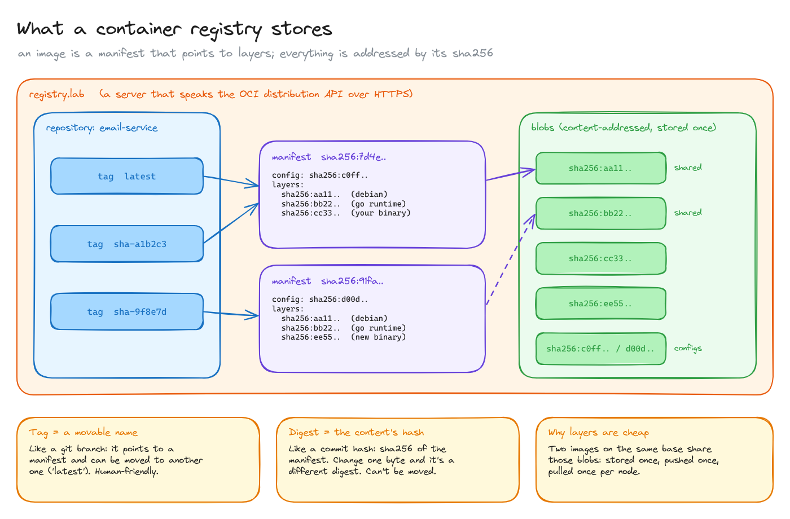
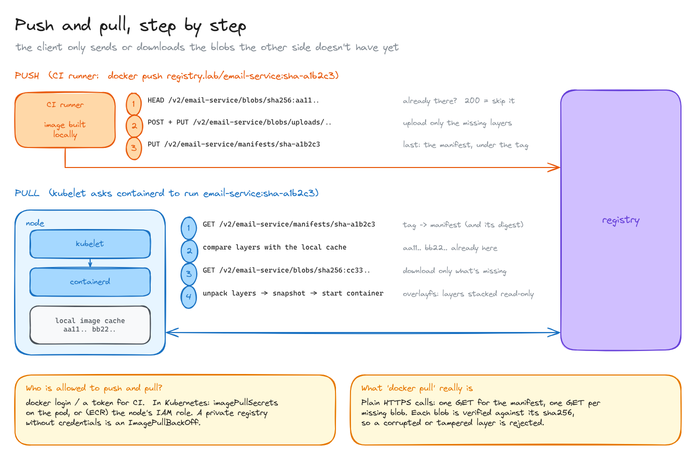
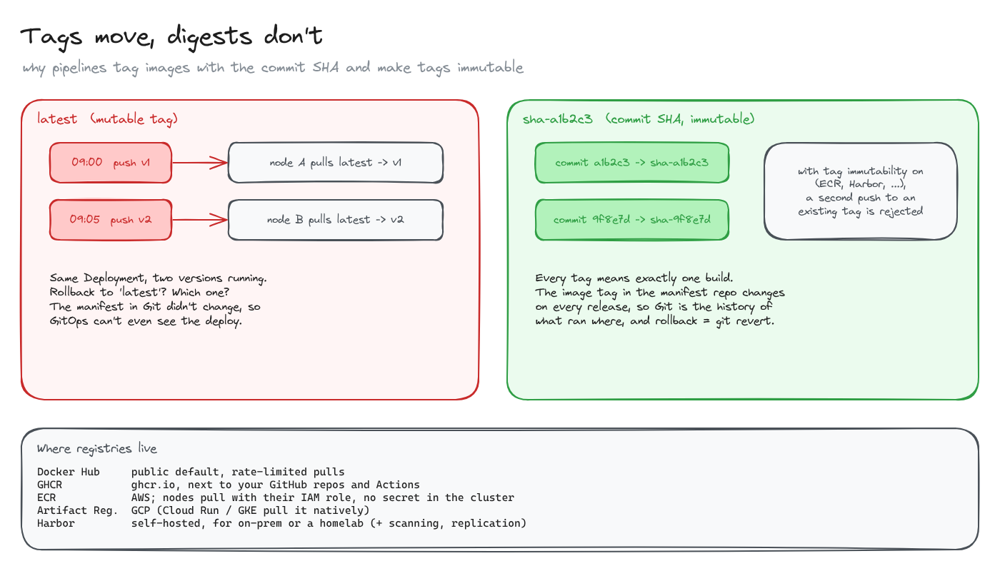

# Container registry

> Where your images live between `docker build` and a running pod: what a registry stores, how push and pull work over plain HTTPS, and why images are tagged with the commit SHA.

**What you'll learn**

- What an image really is: a manifest that points to layers, everything addressed by `sha256`.
- Repository, tag, manifest and blob, and how they relate.
- What `docker push` and `docker pull` send over the wire, and why they're fast.
- Tags vs digests, and why mutable tags like `latest` break deployments.
- Where registries live (Docker Hub, GHCR, ECR, Artifact Registry, Harbor) and how nodes authenticate.

**Before reading**: nothing. This is the first topic of the category.

---

## 1. What a registry stores

A container registry is just **an HTTP server that stores images**, speaking a standard API: the [OCI distribution spec](https://github.com/opencontainers/distribution-spec) (the old "Docker Registry v2" API). An image isn't one file. It's split into pieces:

| Piece | What it is | Analogy |
|---|---|---|
| **Repository** | One per service: `registry.lab/email-service` | A git repo |
| **Tag** | A human name that points to a manifest: `latest`, `sha-a1b2c3` | A git branch |
| **Manifest** | A small JSON document: the config blob plus the list of layer blobs, in order | A commit |
| **Blob** | A file stored under its own hash: each layer (a `tar.gz` of files) and the config | A git object |

Everything except the tag is **content-addressed**: its name is the `sha256` of its bytes. That has two consequences:

- **Integrity for free.** The client recomputes the hash of what it downloads. A corrupted or tampered blob doesn't match and is rejected.
- **Deduplication for free.** Two images built on the same base (`debian`, the Go runtime) point to the same layer blobs. They're stored once, pushed once and pulled once per node. Only the last layer, your binary, changes between builds.

The **digest** of an image is the `sha256` of its manifest. `email-service@sha256:7d4e...` always means exactly the same bytes; `email-service:latest` means "whatever the tag points to right now".

## 2. Push and pull, step by step

`docker push` and `docker pull` aren't magic: they're a handful of HTTPS calls.

**Push** (what the CI runner does after `docker build`):

1. For each layer, `HEAD /v2/<repo>/blobs/<digest>`: does the registry already have it? A `200` means skip it. This is why pushing a new version only uploads your binary's layer.
2. Upload the missing blobs (`POST` to start an upload, `PUT` to finish it).
3. Finally, `PUT /v2/<repo>/manifests/<tag>`: the manifest goes last, so the tag never points to layers that aren't there yet.

**Pull** (what happens when Kubernetes schedules a pod on a node):

1. The kubelet asks the container runtime (containerd) to run `email-service:sha-a1b2c3`.
2. containerd does `GET /v2/<repo>/manifests/<tag>` and gets the manifest, and with it the digest.
3. It compares the layer list with its **local image cache** and downloads only the missing blobs.
4. It unpacks the layers into a snapshot (overlayfs stacks them read-only, with a writable layer on top for the container) and starts the container.

That's why the first pod of a new version on a node takes a few seconds longer, and why `imagePullPolicy: IfNotPresent` with immutable tags means "pull once per node".

**Authentication.** Locally it's `docker login`; in CI, a token. In Kubernetes the node needs credentials for private registries: an `imagePullSecret` on the pod or service account, or, on AWS with ECR, the **node's IAM role** (no secret stored in the cluster). Without credentials the pod gets stuck in `ImagePullBackOff`.

## 3. Tags move, digests don't

A tag is a pointer that can be moved. With `latest`:

- Node A pulls at 09:00 and gets v1. You push v2 at 09:05. Node B pulls and gets v2. **Same Deployment, two versions running.**
- Rollback to "latest"? Which one?
- The manifest in Git still says `latest`, so a GitOps tool doesn't even notice a new release.

The fix pipelines use:

- **Tag every image with the commit SHA**: `sha-a1b2c3`. One tag means exactly one build.
- **Turn on tag immutability** where the registry supports it (ECR, Harbor, and others): a second push to an existing tag is rejected.
- The manifest repo changes its image tag on every release, so **Git becomes the history of what ran where**, and a rollback is a `git revert`. This is the bridge to [GitOps](../02-gitops-from-commit-to-pod/README.md).

Where registries usually live:

| Registry | Notes |
|---|---|
| Docker Hub | The public default. Anonymous pulls are rate-limited |
| GHCR (`ghcr.io`) | Next to your GitHub repos; GitHub Actions can push with its built-in token |
| Amazon ECR | Nodes, ECS and Fargate pull with their IAM role |
| GCP Artifact Registry | Native for Cloud Run and GKE |
| Harbor | Self-hosted, for on-prem or a homelab; adds vulnerability scanning and replication |

All diagrams on one canvas: [`diagrams/container-registry.excalidraw`](diagrams/container-registry.excalidraw).

---

## Key takeaways

- An image = a manifest + layer blobs. Everything but the tag is named by its `sha256`.
- Content addressing gives integrity checks and deduplication for free.
- Push and pull are plain HTTPS: only missing blobs travel, and the manifest goes last.
- Tags are movable names; digests are immutable. Tag with the commit SHA and make tags immutable.
- Nodes need credentials: `imagePullSecrets`, or the node's cloud identity.

## Interview cheat sheet

**Q: What is a container image, physically?**
A: A JSON manifest listing a config blob and an ordered set of layer blobs (tarballs). Each blob is stored and addressed by its `sha256`.

**Q: Why is pushing a new version of a service fast?**
A: The client asks the registry which layers it already has (`HEAD` per blob) and only uploads the missing ones, usually just the layer with the new binary.

**Q: Why not deploy `latest`?**
A: It's mutable: different nodes can pull different versions, rollbacks are ambiguous and the deploy manifest doesn't change, so GitOps can't track it. Tag with the commit SHA (or deploy by digest).

**Q: A pod is stuck in `ImagePullBackOff`. What do you check?**
A: That the image name and tag exist, and that the node can authenticate to the registry (`imagePullSecrets`, node IAM role) and reach it over the network.

## Further reading

- [OCI distribution spec](https://github.com/opencontainers/distribution-spec)
- [OCI image spec: manifest](https://github.com/opencontainers/image-spec/blob/main/manifest.md)
- [Kubernetes: pull an image from a private registry](https://kubernetes.io/docs/tasks/configure-pod-container/pull-image-private-registry/)
