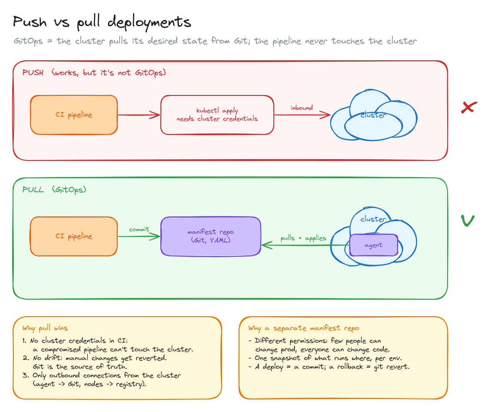
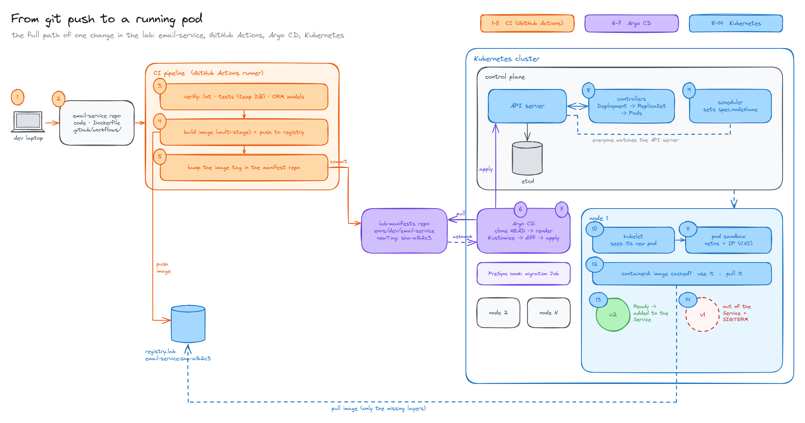
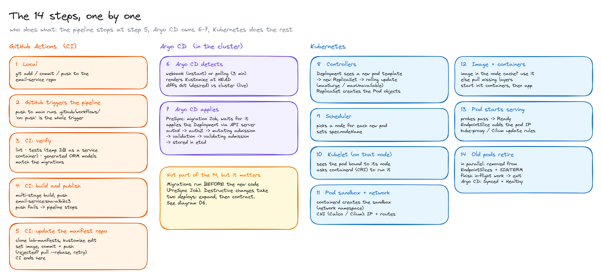
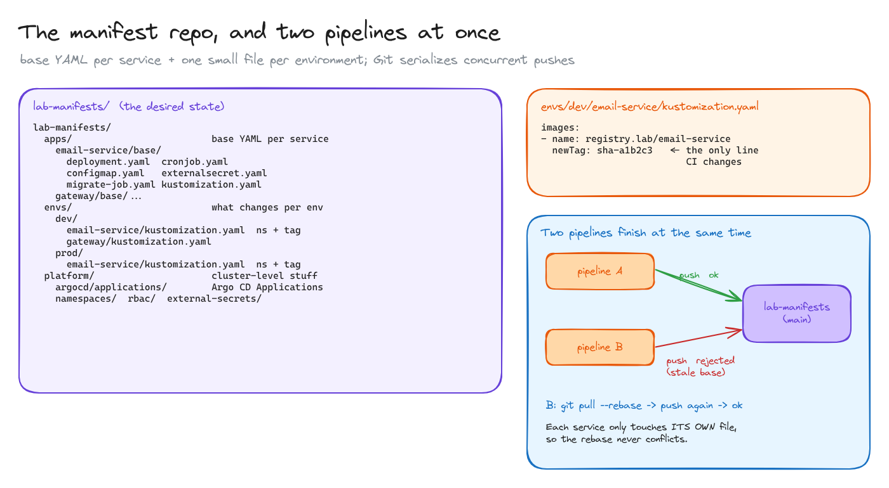
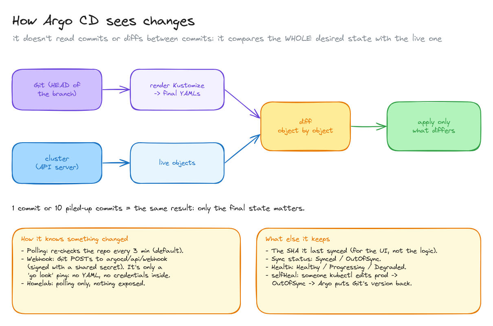
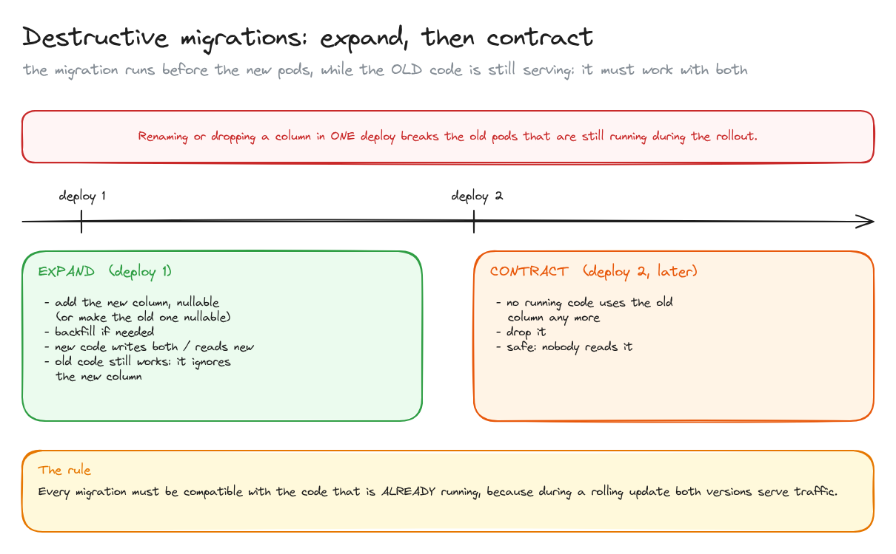
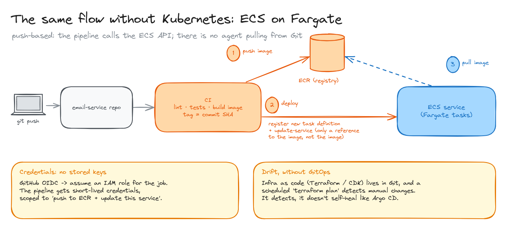

# GitOps: from a commit to a running pod

> The full path of one change, from `git push` to new pods serving traffic: what the CI pipeline does, what Argo CD does, and what every Kubernetes component does in between. The example is my homelab's `email-service`.

**What you'll learn**

- Push vs pull deployments, and why pulling from Git (GitOps) is safer.
- The 14 steps between `git push` and a new pod serving traffic, and who owns each one.
- How a manifest repo is laid out with Kustomize, and why two pipelines pushing at once is fine.
- How Argo CD decides what to change: whole-state diff, polling vs webhook, self-heal.
- Why destructive database migrations need two deploys (expand / contract).
- What the same flow looks like without Kubernetes, on ECS Fargate.

**Before reading**: [Container registry](../01-container-registry/README.md).

---

## 1. Push vs pull

There are two ways to get a new version into a cluster:

- **Push**: the pipeline runs `kubectl apply` (or `helm upgrade`) against the cluster. It works, but the pipeline needs **cluster credentials**, the cluster must accept **inbound** connections from CI, and anyone with `kubectl` can change things that Git doesn't know about.
- **Pull (GitOps)**: the pipeline only **commits** the new desired state to a Git repo. An **agent running inside the cluster** (Argo CD, Flux) pulls that repo and applies it.

Why pull wins:

1. **No cluster credentials in CI.** A compromised pipeline can't touch the cluster; at worst it can make a commit, which is reviewable and revertable.
2. **No drift.** If someone changes something by hand, the agent sees the cluster differs from Git and puts it back. Git is the source of truth.
3. **Only outbound connections** from the cluster: the agent goes to Git, the nodes go to the registry. Nothing needs to be exposed.

The desired state usually lives in a **separate manifest repo** (`lab-manifests`), not in the service repo: it has different permissions (few people can change prod), it's one snapshot of what runs where, and a deploy is a commit, so a rollback is a `git revert`.

## 2. The whole path, on one picture

The colours are the three owners: **orange** is the CI pipeline (steps 1-5), **violet** is Argo CD (6-7), **blue** is Kubernetes itself (8-14). The pipeline never talks to the cluster: its last action is a commit to the manifest repo. Argo CD never builds anything: it only makes the cluster look like Git. And the nodes pull the image straight from the registry.

The next section walks through the numbers.

## 3. The 14 steps

**CI: GitHub Actions (steps 1-5)**

1. **Local.** `git add`, `git commit`, `git push` to the `email-service` repo.
2. **GitHub triggers the pipeline.** A push to `main` runs the workflows in `.github/workflows/`; `on: push` is the whole trigger.
3. **Verify.** Lint, tests (with a temporary database as a service container), and a check that the ORM models generated locally match the migrations.
4. **Build and publish.** Multi-stage Docker build, push to `registry.lab/email-service:sha-a1b2c3`. If the push fails, the pipeline stops and nothing else changes.
5. **Update the manifest repo.** Clone `lab-manifests`, `kustomize edit set image` to the new tag in `envs/dev/email-service/`, commit and push (if the push is rejected: `pull --rebase` and retry). **CI ends here.**

**Argo CD (steps 6-7)**

6. **Argo CD detects** the change: by webhook (instantly) or by polling (every 3 minutes by default). It renders Kustomize at `HEAD` and diffs the desired state (Git) against the live state (cluster).
7. **Argo CD applies.** First the **PreSync hook**: the migration Job, and it waits for it to succeed. Then it applies the updated Deployment through the API server, which runs every request through the same pipeline: **authentication → authorization → mutating admission (defaults, injected fields) → schema validation → validating admission → stored in etcd**.

**Kubernetes (steps 8-14)**

8. **Controllers.** The Deployment controller sees a new pod template, creates a **new ReplicaSet** and starts a rolling update (`maxSurge` / `maxUnavailable` decide how many pods change at a time). The ReplicaSet controller creates the Pod objects.
9. **Scheduler.** Picks a node for each new pod (resources, affinity, taints) and writes `spec.nodeName`.
10. **Kubelet** on that node sees a pod bound to it and asks the container runtime (containerd, through the CRI) to run it.
11. **Pod sandbox and network.** containerd creates the pod sandbox, with its own network namespace, and calls the **CNI plugin** (Calico, Cilium) to give it an IP and routes.
12. **Image and containers.** Is the image in the node's cache? Use it. If not, pull the missing layers from the registry. Then start the init containers, and after them the app containers.
13. **Pod starts serving.** The readiness probe passes → the pod is **Ready** → the EndpointSlice controller adds its IP to the Service → kube-proxy (or Cilium) updates the node rules → traffic arrives.
14. **Old pods retire.** As new pods become Ready, the rollout deletes old ones. A terminating pod is **removed from the EndpointSlices and sent SIGTERM at the same time** (in parallel, which is why apps often add a short `preStop` sleep), finishes its in-flight requests and exits. Argo CD ends at **Synced + Healthy**.

Steps 8-14 overlap in practice: a rolling update repeats 9-14 for each new pod until all replicas are replaced.

## 4. The manifest repo, and two pipelines at once

`lab-manifests` is split with Kustomize:

- `apps/<service>/base/`: the YAML that's the same everywhere (Deployment, CronJob, ConfigMap, ExternalSecret, the migration Job).
- `envs/<env>/<service>/kustomization.yaml`: what changes per environment: the namespace and the **image tag**. The tag line is the only thing CI edits.
- `platform/`: cluster-level things: Argo CD `Application`s, namespaces, RBAC, External Secrets.

**Two pipelines finishing at the same time?** Git serializes pushes: the first one is accepted, the second is rejected because its base is stale. The pipeline does `git pull --rebase` and pushes again. Because every service only edits **its own file**, that rebase can never conflict, so a simple retry loop is enough.

## 5. How Argo CD sees changes

Argo CD doesn't read commits or the diffs between them. On every reconciliation it:

1. Clones the branch at `HEAD`.
2. Renders Kustomize into the final YAML.
3. Asks the API server for the live objects.
4. Compares them **object by object**.
5. Applies only what differs.

So one commit or ten piled-up commits give the same result: only the final state matters. It stores the last synced SHA, but only to show it, not to decide anything.

How it notices a change: **polling** (every 3 minutes by default) or a **webhook**. The webhook is a `POST` from GitHub to `argocd/api/webhook`, signed with a shared secret; it carries no YAML and no credentials, it's only a "go look now" ping. In a homelab with nothing exposed to the internet, polling is enough.

With `selfHeal` on, a manual `kubectl edit` makes the app **OutOfSync** and Argo CD puts Git's version back. Health (`Healthy`, `Progressing`, `Degraded`) is separate from sync status: a synced Deployment whose pods crash-loop is Synced but Degraded.

## 6. Destructive migrations: expand, then contract

The migration Job runs **before** the new pods (PreSync), while the **old code is still serving**, and during the rolling update both versions serve traffic at once. So every migration has to work with the code that's already running.

Renaming or dropping a column in one deploy breaks the old pods. It takes two deploys:

- **Expand (deploy 1):** add the new column as nullable (or make the old one nullable), backfill if needed, and ship code that writes both and reads the new one. The old code ignores the new column.
- **Contract (deploy 2, later):** once no running code uses the old column, drop it.

There's no one-step version of this; tools only automate the two steps.

## 7. The same flow without Kubernetes: ECS on Fargate

On ECS there's no agent pulling from Git. It's **push-based**:

1. The pipeline builds the image and pushes it to ECR, tagged with the commit SHA.
2. It calls the ECS API: registers a new **task definition** pointing to the new image, and updates the **service** to that revision. It sends a reference, not the image.
3. ECS starts new tasks and Fargate pulls the image from ECR, like the kubelet would, then drains the old tasks.

Two things replace what GitOps gave us:

- **Credentials:** GitHub OIDC lets the job assume an IAM role and get short-lived credentials scoped to "push to ECR and update this service". No stored keys.
- **Drift:** the infrastructure lives in Git as Terraform or CDK, and a scheduled `terraform plan` reports manual changes. It detects drift but doesn't fix it on its own like Argo CD's self-heal.

All diagrams on one canvas: [`diagrams/gitops.excalidraw`](diagrams/gitops.excalidraw).

---

## Key takeaways

- GitOps = the cluster pulls its desired state from Git. CI never gets cluster credentials.
- CI ends with a commit to the manifest repo. Argo CD makes the cluster match Git. Kubernetes controllers do the rest.
- Every write to the cluster goes through the API server: authN, authZ, mutating admission, validation, validating admission, etcd.
- Controllers and the scheduler never talk to nodes directly: everyone watches the API server.
- The kubelet sets up the sandbox and network (CNI) first, then pulls the image and starts containers.
- Old pods leave the Service and get SIGTERM in parallel.
- Migrations must be backward compatible: destructive ones take two deploys.

## Interview cheat sheet

**Q: What's the difference between push-based CD and GitOps?**
A: In push-based CD the pipeline applies changes to the cluster with its own credentials. In GitOps the pipeline only commits the desired state to Git, and an agent in the cluster pulls and applies it, continuously correcting drift.

**Q: Walk me through what happens after `kubectl apply` of a Deployment with a new image.**
A: The API server authenticates, authorizes, runs admission and validation, and stores it in etcd. The Deployment controller creates a new ReplicaSet, which creates pods. The scheduler assigns each pod a node. The kubelet there creates the sandbox and network through CRI and CNI, pulls the image if needed and starts the containers. When readiness passes, the pod joins the Service's EndpointSlice, and old pods are removed and terminated.

**Q: Two services deploy at the same moment and both push to the manifest repo. What happens?**
A: Git accepts one push and rejects the other as non-fast-forward. The second pipeline rebases and retries; since each service edits its own file, the rebase is conflict-free.

**Q: How do you rename a column with zero downtime?**
A: Expand/contract: add the new column and ship code that works with both, then remove the old column in a later deploy, once no running code reads it.

**Q: Why might clients see errors while old pods shut down?**
A: Endpoint removal and SIGTERM happen in parallel, so a pod can receive new requests after it starts shutting down. A short `preStop` sleep and graceful shutdown handling fix it.

## Further reading

- [Argo CD documentation](https://argo-cd.readthedocs.io/)
- [Kubernetes: Deployments](https://kubernetes.io/docs/concepts/workloads/controllers/deployment/)
- [Kubernetes: Controlling access to the API (authN, authZ, admission)](https://kubernetes.io/docs/concepts/security/controlling-access/)
- [Kubernetes: Pod lifecycle and termination](https://kubernetes.io/docs/concepts/workloads/pods/pod-lifecycle/#pod-termination)
- [OpenGitOps principles](https://opengitops.dev/)
