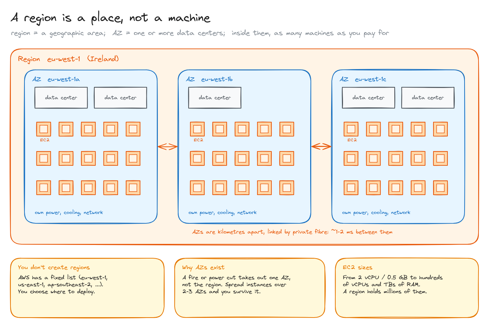
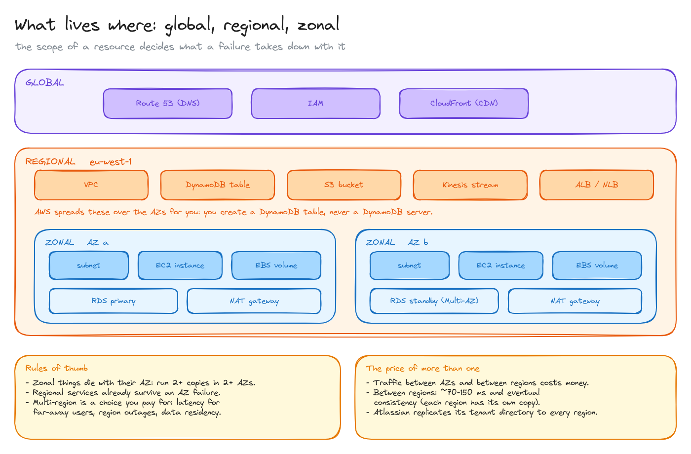

# AWS regions and availability zones

> What a region and an availability zone physically are, which resources live at which level, and what that means when something fails.

**What you'll learn**

- A region is a geographic area, not a machine; an AZ is one or more data centers.
- Why you spread things over 2-3 AZs, and what multi-region costs you.
- Which resources are global, regional or zonal, and what each failure takes down.
- Why "one DynamoDB per region" really means "one table per region".

**Before reading**: nothing, but it helps for [the path of a request in AWS](../04-path-of-a-request-in-aws/README.md).

---

## 1. A region is a place, not a machine

- **Region**: a geographic area where AWS has data centers: `eu-west-1` is Ireland, `us-east-1` is Virginia. **You don't create regions**: AWS has a fixed list and you choose where to deploy.
- **Availability Zone (AZ)**: inside each region there are usually 3 or more AZs (`eu-west-1a`, `-1b`, `-1c`). Each AZ is **one or more data centers** with their own power, cooling and network, kilometres away from the other AZs and linked to them by private fibre (around 1-2 ms between AZs).
- **Inside an AZ**: as many EC2 instances as you pay for. An instance can be tiny (2 vCPU, half a GB of RAM) or huge (hundreds of vCPUs, terabytes of RAM). A region doesn't have "one EC2"; it holds an enormous number of them.

The reason AZs exist: a fire, a flood or a power cut takes out **one AZ, not the whole region**. If your instances are spread over two or three AZs, you survive it.

## 2. Global, regional and zonal resources

Every AWS resource has a scope, and the scope decides what a failure takes down with it:

| Scope | Examples | Fails with |
|---|---|---|
| **Global** | Route 53, IAM, CloudFront | Practically never, by design |
| **Regional** | VPC, DynamoDB table, S3 bucket, Kinesis stream, ALB/NLB | The region; they already survive an AZ failure |
| **Zonal** | Subnet, EC2 instance, EBS volume, RDS instance, NAT gateway | Their AZ |

Regional services are spread over the AZs **for you**. You never create "a DynamoDB server": you create a **table** in a region, and AWS decides how many partitions and machines are underneath, in which AZs. You don't see them and you don't manage them. That's why "a DynamoDB per region" really means "a table per region".

Zonal things are your job: run at least two copies in two AZs. An ALB needs subnets in at least two AZs; an RDS Multi-AZ deployment keeps a synchronous standby in another AZ and fails over to it.

**Multi-region is a choice you pay for**, made for one of three reasons:

1. **Latency** for users far away (Europe to Virginia is ~80-100 ms per round trip).
2. **Surviving a whole-region outage.**
3. **Data residency**: some customers need their data to stay in the EU.

The price: traffic between AZs and between regions costs money, a request between regions adds ~70-150 ms, and data copied across regions is eventually consistent. Atlassian, for example, copies its small tenant directory to every region but keeps each customer's data in one region ([path of a request](../04-path-of-a-request-in-aws/README.md)).

All diagrams on one canvas: [`diagrams/aws-regions-and-azs.excalidraw`](diagrams/aws-regions-and-azs.excalidraw).

---

## Key takeaways

- Region = a geographic area from AWS's fixed list. AZ = one or more isolated data centers in it.
- A region isn't a machine: it's data centers full of instances of any size.
- Global, regional and zonal resources fail at different scopes. Spread zonal resources over 2+ AZs.
- Regional managed services (DynamoDB, S3) already hide the AZs and machines from you.
- Multi-region buys latency, region-failure survival and data residency, at the price of cost, latency between regions and eventual consistency.

## Interview cheat sheet

**Q: What's the difference between a region and an availability zone?**
A: A region is a geographic area; an AZ is an isolated group of data centers inside it, with its own power and network, a few milliseconds from the other AZs. You spread across AZs for high availability and across regions for latency, disaster recovery or data residency.

**Q: Your service runs on EC2 in one AZ. What's the risk and the fix?**
A: An AZ failure takes it down. Run instances in at least two AZs behind a load balancer, with an Auto Scaling group spanning them.

**Q: Is DynamoDB highly available within a region?**
A: Yes: a table is a regional service, replicated across AZs by AWS. Across regions you need Global Tables or your own replication.

## Further reading

- [AWS: Regions and Availability Zones](https://aws.amazon.com/about-aws/global-infrastructure/regions_az/)
- [AWS Fault Isolation Boundaries (whitepaper)](https://docs.aws.amazon.com/whitepapers/latest/aws-fault-isolation-boundaries/abstract-and-introduction.html)
