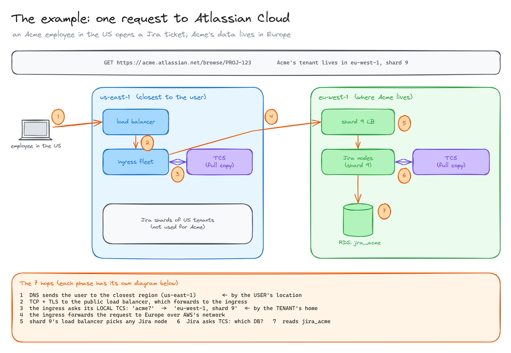
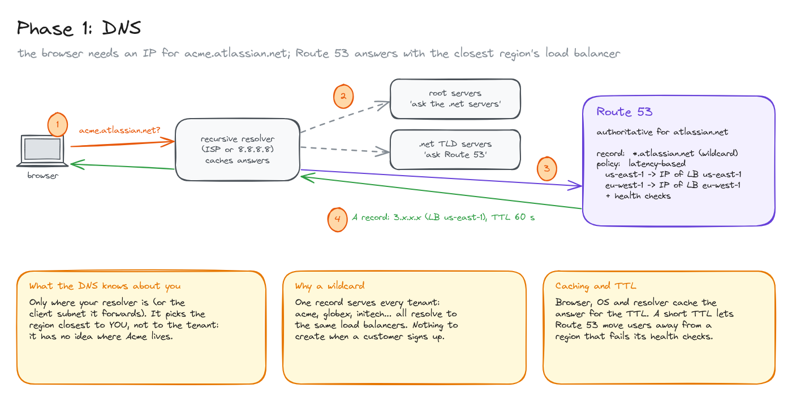
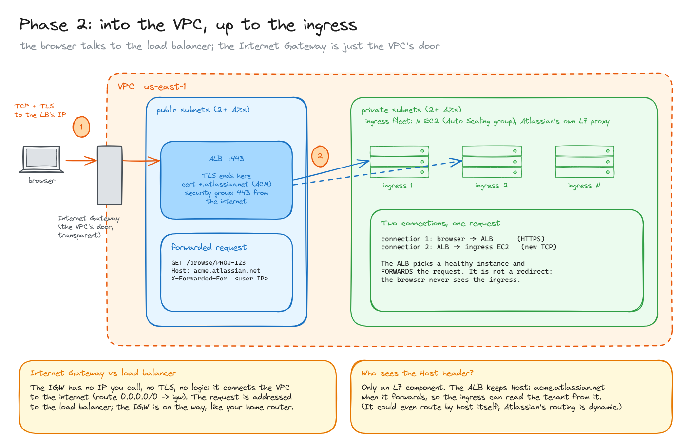
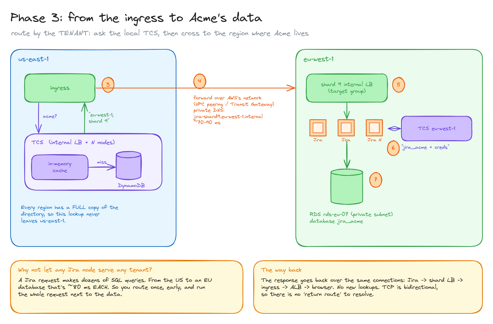
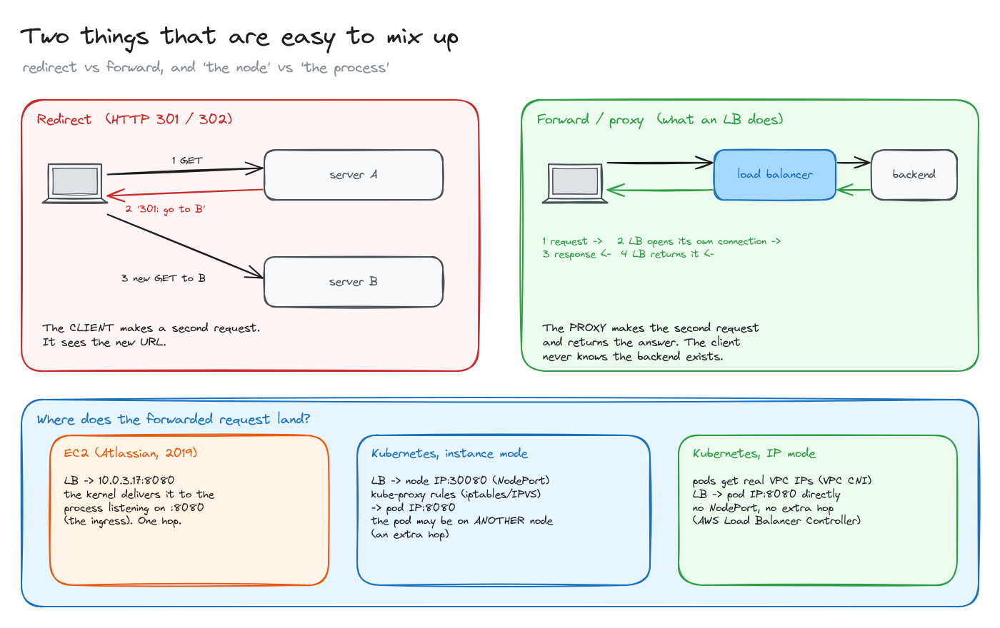

# The path of a request in AWS

> Everything that happens between typing a URL and the database answering, using Atlassian Cloud as the example: DNS, the Internet Gateway, the load balancer, the ingress, a lookup to find the tenant, a hop to another region, and back.

**What you'll learn**

- How DNS (Route 53) sends a user to the closest region, and what it can't know.
- What the Internet Gateway is and isn't, and why the browser talks to the load balancer.
- Why there are two TCP connections for one request, and what "forward" means.
- How the ingress finds where a tenant lives, and why it routes once, early, next to the data.
- Redirect vs forward, and where a forwarded request lands on EC2 vs Kubernetes.

**Before reading**: [AWS regions and AZs](../03-aws-regions-and-azs/README.md). The tenant directory (TCS) is explained in [system design: tenant routing](../../system-design/02-tenant-routing/README.md).

> **What's from the article and what isn't.** Atlassian's post ([link](https://www.atlassian.com/blog/how-we-build/aws-scaling-multi-region-low-latency-service)) describes the ingress, the tenant directory (TCS), the shards and the per-tenant databases. It doesn't describe their DNS, VPCs or network between regions. Those parts here are **how this is typically built on AWS**, not a description of Atlassian's exact setup.

---

## 1. The example

Atlassian Cloud runs Jira for hundreds of thousands of companies (tenants). Each company has a subdomain, like `acme.atlassian.net`. Companies are grouped into **shards** spread over several regions, and each company's Jira data lives in **its own database** in its shard's region.

The scenario: an **Acme employee travelling in the US** opens `https://acme.atlassian.net/browse/PROJ-123`, but **Acme's data lives in `eu-west-1`, shard 9**.

Two different questions get answered along the way:

1. **Which region is closest to the user?** Answered by DNS, using the user's location.
2. **Where does this tenant live?** Answered by the ingress, by asking the tenant directory (TCS).

Mixing them up is the most common mistake: DNS has no idea where Acme's data is.

## 2. Phase 1: DNS

1. The browser (and the OS) has no cached answer, so it asks its **recursive resolver** (the ISP's, or `8.8.8.8`) for `acme.atlassian.net`.
2. The resolver, if it has nothing cached, walks the hierarchy: the **root servers** point to the **`.net` servers**, which point to the name servers that own `atlassian.net`: **Route 53**.
3. Route 53 has a **wildcard record** `*.atlassian.net`, so every tenant resolves the same way and nothing is created when a customer signs up. The record uses **latency-based routing**: one answer per region, and Route 53 picks the one with the lowest latency for the resolver (or for the client subnet the resolver forwards).
4. It returns the IP of the **public load balancer in `us-east-1`**, with a TTL. The resolver, the OS and the browser cache it for that long.

What DNS knows about you is only where your resolver is. It picks the region **closest to the user, not to the tenant**. Health checks let Route 53 stop answering with a region that's down, and a short TTL makes clients move away quickly.

## 3. Phase 2: into the VPC, up to the ingress

1. The browser opens **TCP + TLS to the load balancer's IP on port 443**. Packets enter the VPC through the **Internet Gateway**, which is the VPC's connection to the internet (a route `0.0.0.0/0 → igw`). It has no IP you call, no TLS, no logic: it's on the way, like your home router.
2. The **ALB** lives in public subnets in two or more AZs. It **terminates TLS** with a certificate for `*.atlassian.net` (from ACM), its security group allows 443 from the internet, and it **forwards** the HTTP request to a healthy instance of the **ingress fleet** in private subnets.

There are **two TCP connections**: browser → ALB, and ALB → ingress. The ALB keeps the `Host: acme.atlassian.net` header and adds `X-Forwarded-For` with the user's IP. The browser never learns that the ingress exists.

The **ingress** is Atlassian's own L7 reverse proxy running on N EC2 instances (an Auto Scaling group). It's code, not an AWS product. See [ingress and egress](../06-ingress-and-egress/README.md).

## 4. Phase 3: from the ingress to Acme's data

3. The ingress reads the tenant from `Host` and asks **TCS in its own region**: "where does `acme` live?". TCS answers from its in-memory cache (or its DynamoDB table on a miss): `eu-west-1, shard 9`. Every region holds a **full copy** of this small directory, so this lookup never leaves `us-east-1`.
4. The ingress **forwards** the request to Europe over AWS's network (typically VPC peering or a Transit Gateway), to a private name like `jira-shard9.eu-west-1.internal` resolved by a Route 53 private zone. This hop costs ~70-90 ms.
5. Shard 9's **internal load balancer** picks any Jira node of that shard. The nodes are stateless, so any of them will do.
6. The Jira node asks the **TCS of `eu-west-1`**: "which database for `acme`?" → `jira_acme` on `rds-eu-07`, with its credentials.
7. Jira runs its queries against `jira_acme` (RDS in a private subnet, whose security group only accepts the Jira nodes) and builds the response.

The response travels back over the **same connections**: Jira → shard LB → ingress → ALB → browser. TCP is bidirectional, so there's no return route to look up.

**Why not let any Jira node serve any tenant?** A Jira page makes dozens of SQL queries. From a US node to a European database, that's ~80 ms **per query**. Routing once, early, and running the whole request next to the data pays the ocean crossing once instead of dozens of times.

## 5. Two things that are easy to mix up

**Redirect vs forward.**

- A **redirect** (HTTP 301/302) tells the **client** to go somewhere else. The client makes a second request and sees the new URL.
- A **forward** (what a load balancer or reverse proxy does) is the **proxy** making the second request itself and returning the answer. The client never knows the backend exists.

Load balancers and ingresses forward; they don't redirect.

**Where does the forwarded request land?**

- **On EC2** (Atlassian in 2019): the LB sends it to `instance-IP:8080`, and the kernel delivers it to the process listening on that port, which is the ingress. Machine and process are one hop.
- **On Kubernetes, instance mode**: the LB sends it to a node's `NodePort`; kube-proxy's iptables/IPVS rules forward it to a pod, which may be on **another node** (an extra hop).
- **On Kubernetes, IP mode** (AWS Load Balancer Controller + VPC CNI): pods have real VPC IPs and the LB sends traffic **straight to the pod**.

All diagrams on one canvas: [`diagrams/path-of-a-request.excalidraw`](diagrams/path-of-a-request.excalidraw).

---

## Key takeaways

- DNS answers "which region is closest to the user"; the ingress + tenant directory answers "where does this tenant live". Two different questions.
- A wildcard record + latency-based routing serves every tenant from one DNS record.
- The Internet Gateway is the VPC's door, not a hop you address. The browser's connection ends at the load balancer.
- One request, two TCP connections; the LB forwards, it doesn't redirect.
- Route once, early, and run the request next to its data: one cross-region hop instead of one per query.
- A small directory replicated to every region keeps the routing lookup local.

## Interview cheat sheet

**Q: What happens when you type a URL into the browser? (Go as deep as you can.)**
A: DNS resolution (cache, recursive resolver, root, TLD, authoritative; possibly latency or geo routing), TCP and TLS handshakes with the load balancer, TLS termination there, the LB forwarding the HTTP request to a backend over a new connection, the backend's own lookups and database queries, and the response back over the same connections.

**Q: How does a global SaaS send users to the right region?**
A: DNS (latency or geo routing, or anycast) gets the user to the nearest entry point. Then the entry point looks up the tenant's home in a directory and forwards the request there, because the data lives in one region.

**Q: Why can't DNS route directly to the tenant's region?**
A: It could with one record per tenant, but DNS is cached everywhere for the TTL, so moving a tenant would be slow; it can't route by URL path (`/wiki` to another product); and you'd lose a single entry point for TLS, auth and protection.

**Q: What's the difference between an Internet Gateway and a NAT gateway?**
A: An Internet Gateway connects a VPC to the internet for resources with public IPs, both ways. A NAT gateway lets resources in private subnets make outbound connections without being reachable from outside.

## Further reading

- [Atlassian: Our not-so-magic journey scaling low latency, multi-region services on AWS](https://www.atlassian.com/blog/how-we-build/aws-scaling-multi-region-low-latency-service)
- [Route 53: latency-based routing](https://docs.aws.amazon.com/Route53/latest/DeveloperGuide/routing-policy-latency.html)
- [Application Load Balancer: how it works](https://docs.aws.amazon.com/elasticloadbalancing/latest/application/introduction.html)
- [VPC: Internet gateways](https://docs.aws.amazon.com/vpc/latest/userguide/VPC_Internet_Gateway.html)
