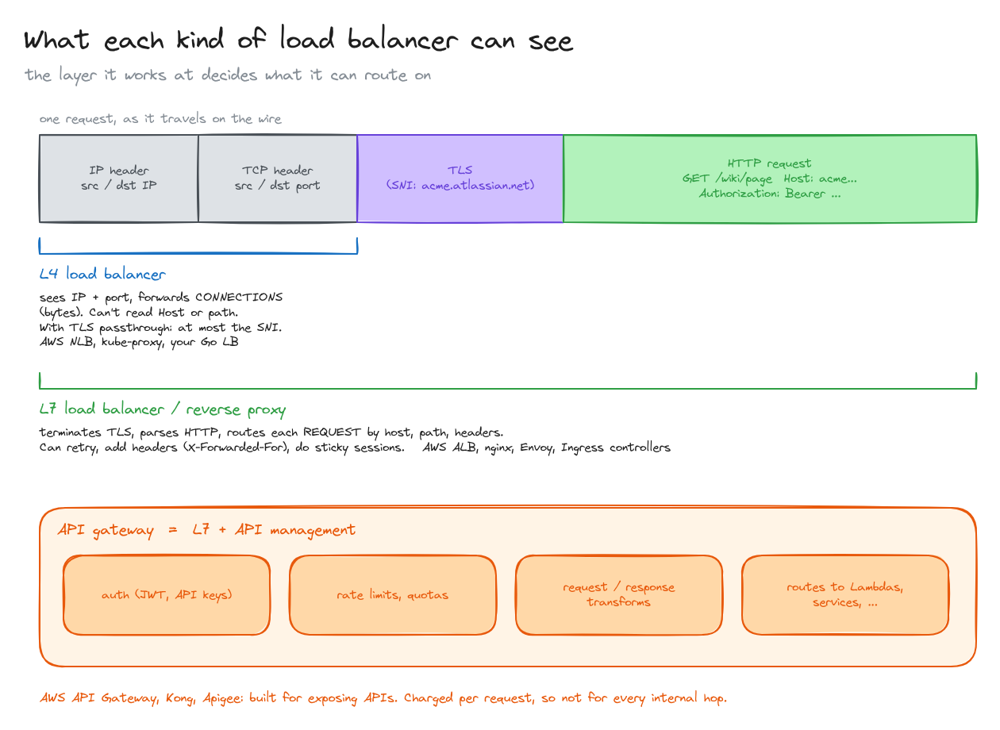
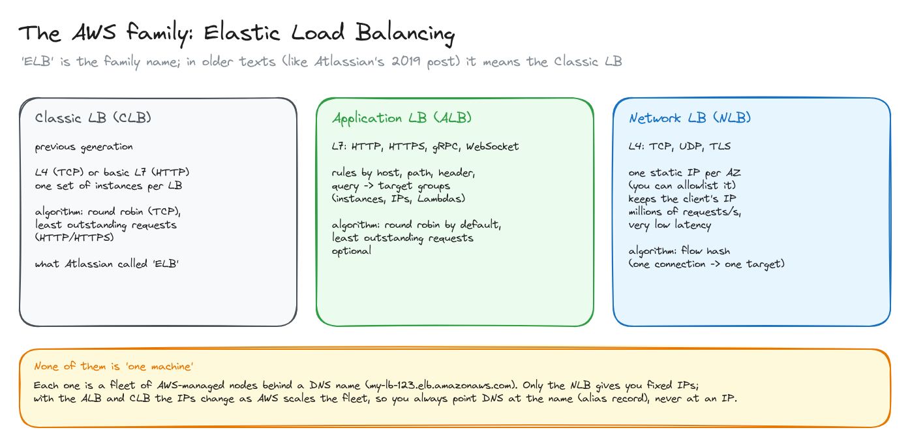
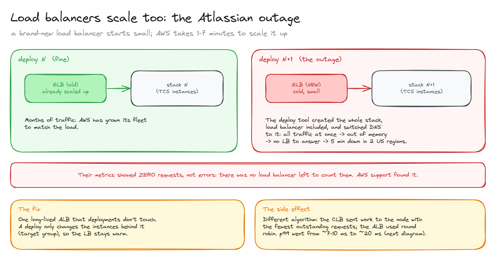
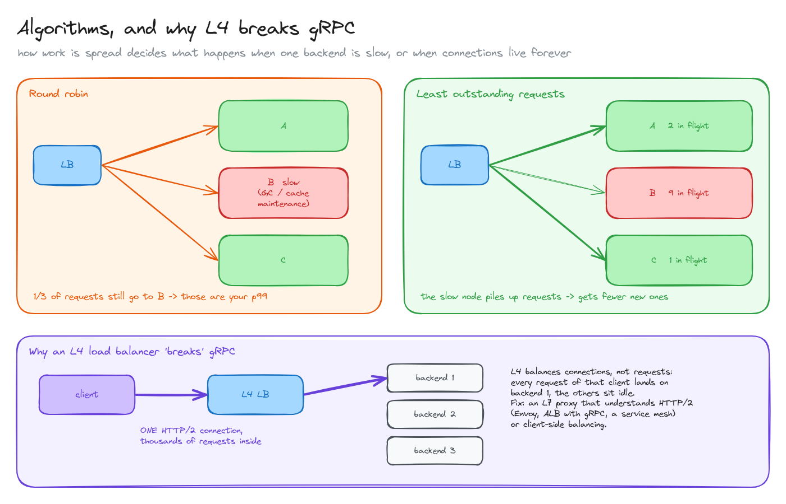

# Load balancers

> What an L4 load balancer, an L7 load balancer and an API gateway can each see, the AWS family (Classic, ALB, NLB), why a load balancer is a fleet that has to scale too, and how the balancing algorithm shows up in your p99.

**What you'll learn**

- L4 vs L7 vs API gateway: what each one can read and route on.
- Classic LB, ALB and NLB, and why "ELB" means different things in different texts.
- Why a brand-new load balancer can fall over, using Atlassian's 5-minute outage.
- Round robin vs least outstanding requests when one backend is slow.
- Why an L4 load balancer "breaks" gRPC.

**Before reading**: [the path of a request in AWS](../04-path-of-a-request-in-aws/README.md) helps, but isn't required.

---

## 1. What each kind can see

A request on the wire is layers: IP header, TCP header, TLS, and inside it the HTTP request. A load balancer can only route on what it can read:

- **L4** (TCP/UDP) sees IPs and ports. It forwards **connections**: it picks a backend when a connection opens and then shuffles bytes. It can't read `Host` or the path; with TLS passthrough it can at most peek at the SNI in the TLS handshake. Examples: AWS NLB, kube-proxy for Services, a hand-written L4 balancer.
- **L7** (HTTP) **terminates TLS**, parses HTTP and routes **each request** by host, path or header. It can retry, add headers like `X-Forwarded-For`, do sticky sessions. Examples: AWS ALB, nginx, Envoy, every Ingress controller.
- An **API gateway** is an L7 proxy plus API management: authentication (JWT, API keys), rate limits and quotas, request/response transformations, routing to Lambdas or services. Examples: AWS API Gateway, Kong, Apigee. It's built for exposing APIs to clients, and on AWS it's billed per request, so it isn't what you put on every internal hop.

## 2. The AWS family

**Elastic Load Balancing** is the family name. Older texts, like Atlassian's 2019 post, say "ELB" meaning the **Classic Load Balancer**.

| | Classic (CLB) | Application (ALB) | Network (NLB) |
|---|---|---|---|
| Layer | L4 or basic L7 | L7 (HTTP, HTTPS, gRPC, WebSocket) | L4 (TCP, UDP, TLS) |
| Routing | One set of instances | Rules by host, path, header, query → target groups (instances, IPs, Lambdas) | Port → target group |
| Algorithm | Round robin (TCP); least outstanding requests (HTTP) | Round robin by default; least outstanding requests or weighted random optional | Flow hash: one connection → one target |
| Fixed IPs | No | No | Yes, one per AZ |
| Status | Previous generation | The default for HTTP | Extreme throughput, static IPs, non-HTTP |

None of them is one machine. Each is a **fleet of AWS-managed nodes behind a DNS name** (`my-lb-123.elb.amazonaws.com`). With the ALB and CLB the IPs change as AWS scales the fleet, so DNS always points at the name (a Route 53 alias record), never at an IP. Only the NLB gives you static IPs that a partner can allowlist.

## 3. Load balancers scale too: the Atlassian outage

From the article: TCS was down for about five minutes in two US regions, so every Atlassian cloud product was down there. Their metrics showed no errors, just **zero requests**. AWS support found that the load balancers had **run out of memory**: there was no load balancer left to receive (or count) anything.

The cause was their deployment process. Each deploy created a **whole new stack, load balancer included**, and switched DNS to it. A new ELB starts small, and AWS takes **1 to 7 minutes** to scale it. Receiving all of production's traffic at once, cold, it died. The ELB was within its SLA; TCS just needed more than that.

**The fix**: one long-lived ALB that deploys don't recreate. A deploy only changes the instances in its target group, so the load balancer stays warm. (Another option on AWS is asking for pre-warming before a known spike.)

## 4. Algorithms, and why L4 breaks gRPC

The switch to the ALB had a side effect: p99 latency went from ~7-10 ms to ~20 ms. The reason was the **algorithm**:

- **Least outstanding requests** (what the CLB used for HTTP): send each request to the backend with the fewest requests in flight. A slow node piles up requests and automatically gets fewer new ones.
- **Round robin** (the ALB's default): send requests in turn, regardless of load. A node that's temporarily slow (a GC pause, cache maintenance) still gets 1/N of the traffic, and those requests become your p99.

That led them to [the next problem: their cache](../../system-design/04-caching-at-scale/README.md).

**Why an L4 load balancer "breaks" gRPC.** gRPC runs over HTTP/2, which multiplexes thousands of requests over **one long-lived connection**. An L4 balancer balances **connections**, so every request from that client lands on the same backend while the others sit idle. The fix is something that understands HTTP/2 and balances per request: an L7 proxy (Envoy, an ALB with gRPC support, a service mesh), or client-side load balancing.

All diagrams on one canvas: [`diagrams/load-balancers.excalidraw`](diagrams/load-balancers.excalidraw).

---

## Key takeaways

- L4 balances connections and sees IP:port; L7 balances requests and sees HTTP; an API gateway is L7 plus auth, quotas and transformations.
- "ELB" is a family: Classic, ALB, NLB. Only the NLB has fixed IPs.
- A load balancer is a managed fleet that scales over minutes. Don't create a new one per deploy.
- Round robin keeps feeding slow nodes; least outstanding requests routes around them.
- Long-lived HTTP/2 connections (gRPC) need L7 or client-side balancing.

## Interview cheat sheet

**Q: L4 or L7 load balancer, when?**
A: L7 when you need to route by host/path/header, terminate TLS, or balance per request (HTTP/2, gRPC). L4 for raw throughput, non-HTTP protocols, static IPs or TLS passthrough.

**Q: Why might latency go up after switching to round robin?**
A: Round robin ignores backend load, so a temporarily slow instance keeps receiving its share and those requests form the tail. Least-outstanding-requests sends fewer requests to busy instances.

**Q: Your gRPC service has 3 replicas but only one is busy. Why?**
A: The client keeps one HTTP/2 connection, and an L4 balancer pinned it to one replica. Use an L7 proxy that balances per request, or client-side balancing.

**Q: What's the difference between a load balancer and an API gateway?**
A: Both can be L7 proxies. The gateway adds API concerns: authentication, API keys, rate limits, quotas, transformations, often per-request billing; it sits at the edge for API clients.

## Further reading

- [Atlassian: Our not-so-magic journey scaling low latency, multi-region services on AWS](https://www.atlassian.com/blog/how-we-build/aws-scaling-multi-region-low-latency-service)
- [Elastic Load Balancing: product comparison](https://aws.amazon.com/elasticloadbalancing/features/)
- [ALB routing algorithms](https://docs.aws.amazon.com/elasticloadbalancing/latest/application/load-balancer-target-groups.html#modify-routing-algorithm)
- [gRPC load balancing (grpc.io)](https://grpc.io/blog/grpc-load-balancing/)
