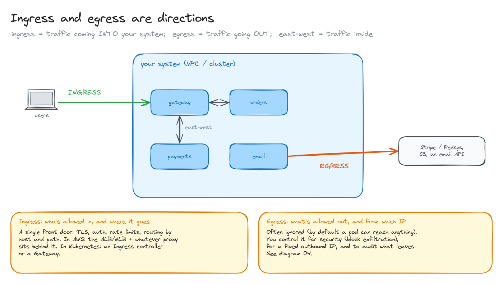
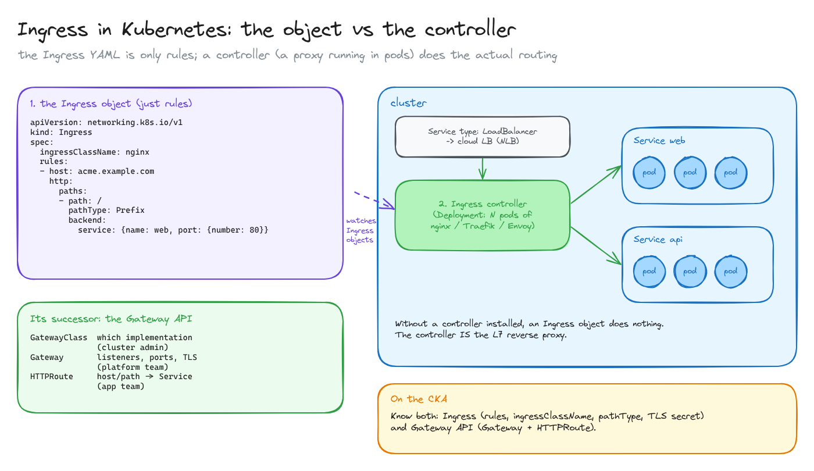
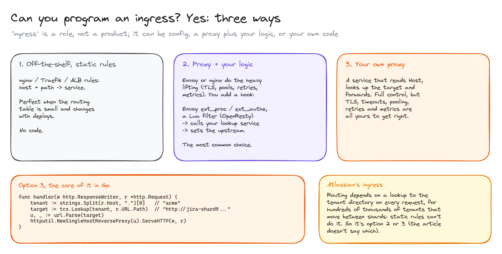
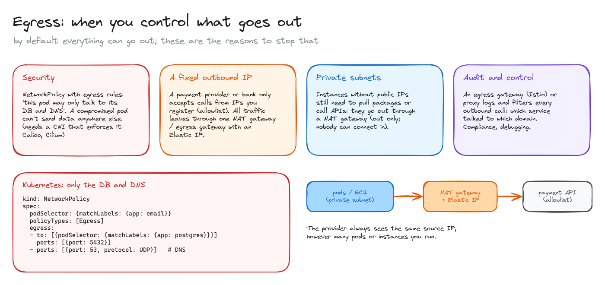

# Ingress and egress

> Ingress and egress are directions of traffic, not products. What "the ingress" means in AWS and in Kubernetes, whether you can program one, and when you need to control what leaves your system.

**What you'll learn**

- Ingress, egress and east-west traffic.
- In Kubernetes: the Ingress object vs the Ingress controller, and the Gateway API.
- Three ways to build an ingress: static rules, a proxy plus your logic, or your own proxy.
- Why controlling egress matters: security, fixed outbound IPs, private subnets, audit.

**Before reading**: [load balancers](../05-load-balancers/README.md).

---

## 1. Directions, not products

- **Ingress**: traffic coming **into** your system (users → your VPC or cluster).
- **Egress**: traffic going **out** (your services → Stripe, Redsys, S3, an email API).
- **East-west**: traffic between your own services, inside.

"The ingress" is whatever handles the way in: a single front door that terminates TLS, authenticates, rate-limits and routes by host and path. In AWS that's the ALB or NLB plus whatever proxy sits behind it; in Kubernetes it's an Ingress controller or a Gateway.

Egress is often ignored: by default a pod or an instance can reach anything. Section 4 covers when that's a problem.

## 2. Ingress in Kubernetes: the object vs the controller

Two different things share the name:

1. **The `Ingress` object**: a YAML with rules (`host`, `path`, `pathType`, backend Service, TLS secret). It does nothing on its own.
2. **The Ingress controller**: a Deployment of proxy pods (ingress-nginx, Traefik, Envoy-based, or the AWS Load Balancer Controller, which provisions an ALB instead). It **watches** Ingress objects and configures itself from them. It's exposed with a `Service` of type `LoadBalancer`, which gets a cloud load balancer in front.

Without a controller installed, Ingress objects are ignored. `ingressClassName` says which controller should handle each one.

Its successor is the **Gateway API**, which splits the same thing by role: `GatewayClass` (which implementation, chosen by the cluster admin), `Gateway` (listeners, ports, TLS, owned by the platform team) and `HTTPRoute` (host/path → Service, owned by app teams). Both appear in the CKA.

## 3. Can you program an ingress?

Yes. "Ingress" is a role, and there are three ways to fill it:

1. **Off-the-shelf with static rules**: nginx, Traefik or ALB rules mapping host + path to a service. Perfect when the routing table is small and changes with deploys. No code.
2. **A proxy plus your logic**: Envoy or nginx do the hard parts (TLS, connection pools, retries, metrics), and you add a hook: Envoy's `ext_proc` or `ext_authz` filters, or a Lua filter in OpenResty, that calls your own lookup service and sets the upstream. This is the most common choice when routing is dynamic.
3. **Your own proxy**: a service that reads `Host`, looks up the target and forwards (Go's `httputil.ReverseProxy` is the core of it). Full control, but TLS, timeouts, pooling, retries and observability are all yours to get right.

Atlassian's ingress needs a lookup to the tenant directory on every request, for hundreds of thousands of tenants that move between shards. Static rules can't express that, so it's option 2 or 3; [the article](https://www.atlassian.com/blog/how-we-build/aws-scaling-multi-region-low-latency-service) doesn't say which.

## 4. Egress: when you control what goes out

Do you need to control egress? Not always. You do when one of these applies:

- **Security.** A `NetworkPolicy` with egress rules ("this pod may only talk to its database and DNS") means a compromised pod can't send data anywhere else. It needs a CNI that enforces policies (Calico, Cilium). Remember to allow DNS, or nothing resolves.
- **A fixed outbound IP.** Payment providers and banks often only accept calls from IPs you register. All traffic leaves through one **NAT gateway** (or egress gateway) with an Elastic IP, so the provider always sees the same source IP however many pods you run.
- **Private subnets.** Instances without public IPs still need to reach package registries and external APIs. They go out through a **NAT gateway**, which allows outbound connections only: nobody can connect in.
- **Audit and control.** An egress gateway (Istio) or an outbound proxy logs and filters every external call: which service talked to which domain. Useful for compliance and debugging.

All diagrams on one canvas: [`diagrams/ingress-and-egress.excalidraw`](diagrams/ingress-and-egress.excalidraw).

---

## Key takeaways

- Ingress = in, egress = out, east-west = inside. They're directions; the components that handle them vary.
- In Kubernetes, the Ingress object is rules; the controller is the actual L7 proxy. No controller, no routing.
- The Gateway API splits ingress config by role and is replacing Ingress.
- An ingress can be static config, a proxy plus a lookup hook, or your own proxy.
- Control egress for security, fixed outbound IPs, private-subnet access and audit.

## Interview cheat sheet

**Q: You created an Ingress but traffic doesn't arrive. What do you check?**
A: That an Ingress controller is installed and its class matches `ingressClassName`, that the controller's Service has an external address, that the host/path rules match the request, and that the backend Service has ready endpoints.

**Q: Ingress or Gateway API?**
A: Gateway API for new setups: it's more expressive (header matching, traffic splitting) and separates infrastructure from app routing by role. Ingress is still everywhere and simpler.

**Q: A partner requires a fixed source IP. Your app runs on autoscaled pods. How?**
A: Route its outbound traffic through a NAT gateway or egress gateway that has a static (Elastic) IP, and give the partner that IP.

**Q: How do you stop a compromised pod from exfiltrating data?**
A: A default-deny egress NetworkPolicy plus explicit allows (its DB, DNS), enforced by the CNI; optionally an egress gateway for external domains.

## Further reading

- [Kubernetes: Ingress](https://kubernetes.io/docs/concepts/services-networking/ingress/)
- [Kubernetes: Gateway API](https://gateway-api.sigs.k8s.io/)
- [Kubernetes: Network Policies](https://kubernetes.io/docs/concepts/services-networking/network-policies/)
- [AWS: NAT gateways](https://docs.aws.amazon.com/vpc/latest/userguide/vpc-nat-gateway.html)
