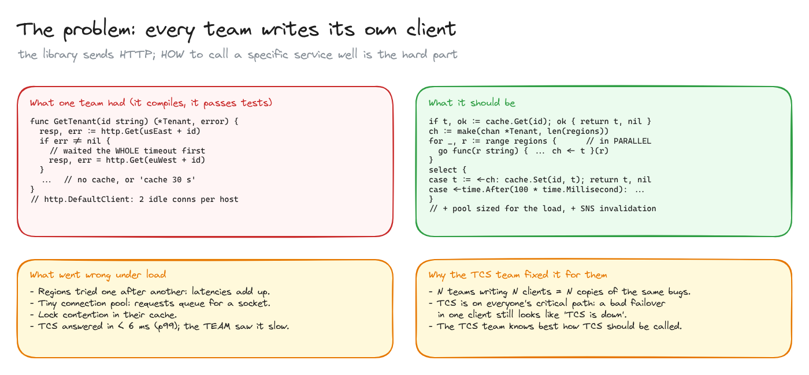
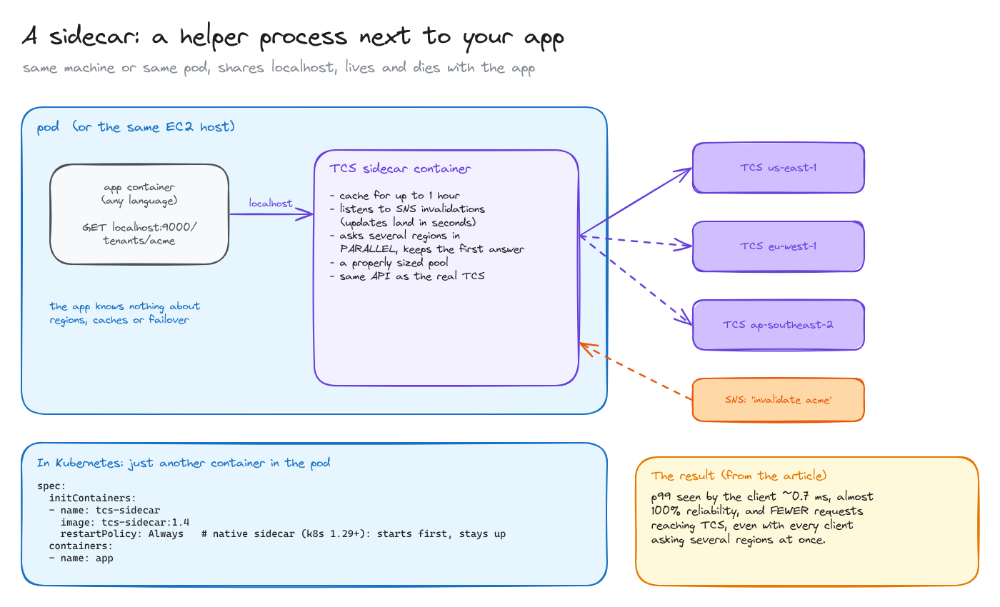
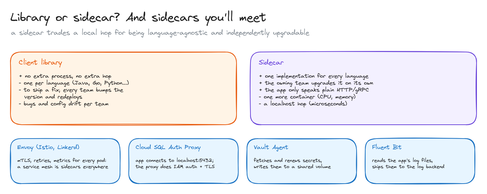

# Sidecars

> A sidecar is a helper process that runs next to your app and does a job for it. Why Atlassian built one for their tenant directory, and when a sidecar beats a client library.

**What you'll learn**

- What "the client" of a service means, and why writing one well is harder than it looks.
- What a sidecar is, physically, on EC2 and in a Kubernetes pod.
- Library vs sidecar: the trade-offs.
- Sidecars you'll meet in practice: Envoy, Cloud SQL Auth Proxy, Vault Agent, Fluent Bit.

**Before reading**: [ingress and egress](../06-ingress-and-egress/README.md). The service in the example is the tenant directory from [system design: tenant routing](../../system-design/02-tenant-routing/README.md).

---

## 1. The problem: every team writes its own client

"The client" of a service isn't an HTTP library. `net/http` only sends requests. The client is **the code each calling service writes around it**: which region to call, what to do on failure, whether to cache, how long to wait.

Atlassian's tenant directory (TCS) answered in under 6 ms at p99, but one internal team kept saying it was slow. Their client:

- Tried **regions one after another**: call region A, wait for the whole timeout, then try B. Latencies add up.
- Used a **connection pool that was too small** (Go's default client keeps only 2 idle connections per host), so requests queued waiting for a socket.
- Had **lock contention** in its local cache.
- Cached results for 30 seconds unconditionally, so data was stale for up to 30 s and TCS was still called every 30 s.

It compiled and passed tests; it only broke under real load.

Technically that's the calling team's fault. The TCS team fixed it anyway, for three reasons:

1. **N teams writing N clients = N copies of the same bugs.**
2. TCS is on everyone's critical path: a bad failover in one client still looks like "TCS is down".
3. The TCS team knows best how TCS should be called. This is the platform mindset: make the right way the default way.

## 2. The sidecar

A **sidecar** is a helper process or container that runs **next to the app**: on the same EC2 host, or in the same Kubernetes pod. It shares `localhost` with the app and lives and dies with it.

Atlassian's TCS sidecar:

- **Same API as the real TCS**: the app just calls `localhost` instead.
- **Long-lived cache** (up to an hour), kept fresh by listening to the same **SNS invalidations** as the TCS servers, so changes still land within seconds. That beat the old "cache 30 s unconditionally".
- **Parallel multi-region requests**: ask several regions at once and keep the first answer.
- A properly sized connection pool.

The result, from the article: p99 seen by the clients around **0.7 ms**, almost 100% reliability, and **fewer** requests reaching TCS, even though every client now asked several regions in parallel, thanks to the smarter cache.

In Kubernetes a sidecar is just another container in the pod. Since Kubernetes 1.29 (on by default; GA in 1.33) there are **native sidecars**: an `initContainer` with `restartPolicy: Always`, which starts before the app containers and keeps running alongside them.

## 3. Library or sidecar?

| | Client library | Sidecar |
|---|---|---|
| Languages | One implementation per language | One for every language |
| Shipping a fix | Every team bumps the version and redeploys | The owning team rolls it out |
| Cost | Nothing extra | One more container (CPU, memory) and a localhost hop (microseconds) |
| App's view | A function call | Plain HTTP or gRPC to `localhost` |

For a service used by dozens of teams in different languages, the sidecar wins. For a single-language shop, a good library is often simpler.

Sidecars you'll run into:

- **Envoy** in a service mesh (Istio, Linkerd uses its own proxy): mTLS, retries and metrics for every pod. A service mesh is sidecars everywhere.
- **Cloud SQL Auth Proxy** (GCP): the app connects to `localhost:5432`; the proxy handles IAM authentication and TLS to Cloud SQL.
- **Vault Agent**: fetches and renews secrets and writes them to a shared volume.
- **Fluent Bit**: reads the app's log files and ships them to the logging backend.

All diagrams on one canvas: [`diagrams/sidecars.excalidraw`](diagrams/sidecars.excalidraw).

---

## Key takeaways

- The "client" is the calling logic around HTTP: regions, retries, timeouts, pools, caching. It's easy to get wrong.
- A sidecar runs next to the app, shares localhost, and does that logic once, for every language.
- If your service is critical, ship its client yourself (library or sidecar).
- Sidecars trade a container and a local hop for independence from language and release cycles.

## Interview cheat sheet

**Q: What's a sidecar?**
A: A separate process or container deployed alongside an application instance, sharing its network (and possibly volumes), that handles a cross-cutting concern: proxying, auth, secrets, logs, a service client.

**Q: Sidecar or library for a service client?**
A: A library has no extra hop or process but needs one implementation per language and every team to upgrade. A sidecar is language-agnostic and centrally upgradable, at the cost of a container per pod.

**Q: Why might a service look slow to one team when its own metrics are fine?**
A: The time is lost in the client: sequential retries across regions, an exhausted connection pool, lock contention. Measure latency from the caller's side, not only the server's.

## Further reading

- [Atlassian: Our not-so-magic journey scaling low latency, multi-region services on AWS](https://www.atlassian.com/blog/how-we-build/aws-scaling-multi-region-low-latency-service)
- [Kubernetes: Sidecar containers](https://kubernetes.io/docs/concepts/workloads/pods/sidecar-containers/)
- [Microsoft: Sidecar pattern](https://learn.microsoft.com/en-us/azure/architecture/patterns/sidecar)
