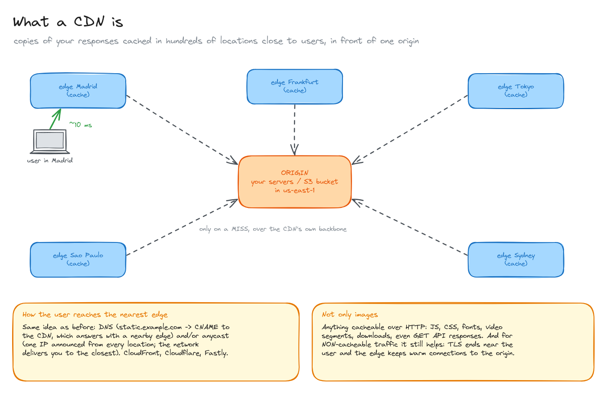
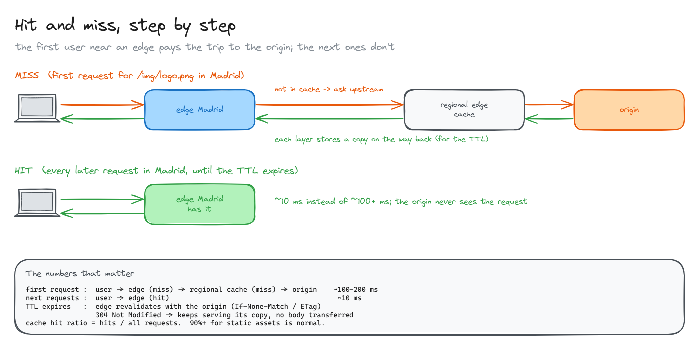
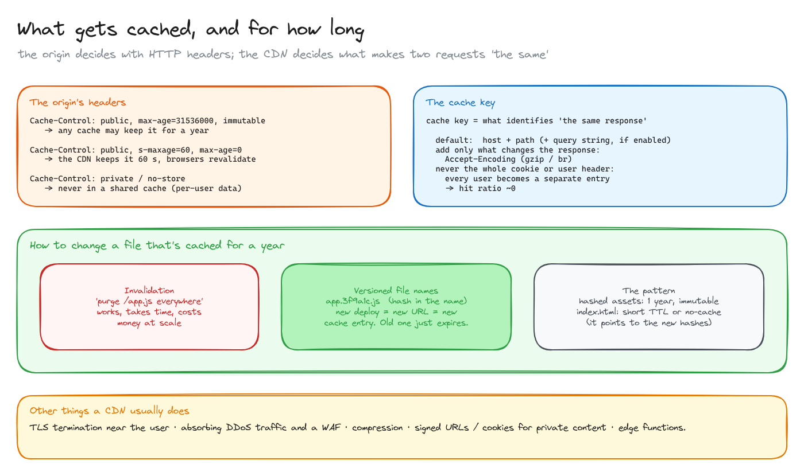

# CDN

> A content delivery network keeps copies of your responses in hundreds of locations close to users, so most requests never reach your servers. How hits and misses work, what gets cached and for how long, and how to change a file that's cached for a year.

**What you'll learn**

- What a CDN is: edge locations, an origin, and how a user reaches the nearest edge.
- A cache hit vs a cache miss, layer by layer, with rough numbers.
- `Cache-Control`, TTLs and revalidation.
- The cache key, and why putting cookies in it kills your hit ratio.
- Invalidation vs versioned file names.

**Before reading**: [the path of a request in AWS](../04-path-of-a-request-in-aws/README.md), for DNS.

---

## 1. What a CDN is

Your **origin** (your servers, or an S3 bucket) lives in one region, say `us-east-1`. A user in Madrid is ~100 ms away from it per round trip. A CDN (CloudFront, Cloudflare, Fastly, Akamai) runs **edge locations** (points of presence) in hundreds of cities. Each edge keeps a **cache** of responses. A user is sent to the nearest edge (~10 ms away), and the edge only goes to the origin on a **miss**, over the CDN's own network.

How the user reaches the nearest edge is the same trick as in [DNS routing](../04-path-of-a-request-in-aws/README.md): `static.example.com` is a CNAME to the CDN, whose DNS answers with a nearby edge, and/or **anycast**: the same IP is announced from every location, and internet routing delivers you to the closest.

**A CDN isn't only for images.** It caches anything that's cacheable over HTTP: JS, CSS, fonts, video segments, downloads, even `GET` API responses. And it helps **non-cacheable** traffic too: TLS terminates near the user (the handshake round trips are short), and the edge keeps warm, reused connections to the origin over a well-managed backbone.

## 2. Hit and miss, step by step

**First request** for `/img/logo.png` in Madrid (a **miss**):

1. The user asks the Madrid edge. It doesn't have the object.
2. The edge asks a **regional edge cache** (a bigger, shared cache layer). If that misses too, it goes to the **origin**. (CloudFront can add one more layer, **Origin Shield**, so that all regions funnel through a single cache in front of the origin.)
3. The response travels back and **each layer stores a copy** for its TTL.

**Every later request** in Madrid (a **hit**): the edge answers directly in ~10 ms, and the origin never sees it.

When the TTL expires, the edge doesn't necessarily download the object again: it **revalidates** with a conditional request (`If-None-Match` with the `ETag`). If nothing changed, the origin answers `304 Not Modified`, without a body, and the edge keeps serving its copy.

The number to watch is the **cache hit ratio** = hits / all requests. For static assets, 90%+ is normal.

## 3. What gets cached, and for how long

**The origin decides** with response headers:

| Header | Meaning |
|---|---|
| `Cache-Control: public, max-age=31536000, immutable` | Any cache may keep it for a year and doesn't need to revalidate |
| `Cache-Control: public, s-maxage=60, max-age=0` | Shared caches (the CDN) keep it 60 s; browsers revalidate every time |
| `Cache-Control: private` or `no-store` | Never in a shared cache: per-user data |

**The CDN decides what makes two requests "the same"**: the **cache key**. By default it's the host plus the path (plus the query string, if you enable it). Add only what really changes the response, such as `Accept-Encoding` for gzip vs brotli. Never put the whole `Cookie` or a per-user header in the key: every user becomes a separate entry and the hit ratio drops to about zero.

**How to change a file that's cached for a year:**

- **Invalidation**: tell the CDN to purge `/app.js` everywhere. It works, but takes a while to propagate and costs money at scale.
- **Versioned file names**: put a hash of the content in the name, `app.3f9a1c.js`. A new deploy means a new URL, so a new cache entry; the old one just expires. Nothing to purge.

The usual pattern: hashed assets get a year and `immutable`; `index.html` gets a short TTL or `no-cache`, because it's the file that points to the new hashes.

Other things CDNs usually do: absorb DDoS traffic and run a WAF, compress responses, serve private content with signed URLs or cookies, and run small functions at the edge.

All diagrams on one canvas: [`diagrams/cdn.excalidraw`](diagrams/cdn.excalidraw).

---

## Key takeaways

- A CDN = many edge caches near users in front of one origin. Users reach the nearest edge via DNS and/or anycast.
- Miss: edge → regional cache → origin, and every layer keeps a copy. Hit: the edge answers alone.
- After the TTL, revalidation with ETags avoids re-downloading unchanged objects.
- The origin sets the TTL with `Cache-Control`; the cache key decides what counts as the same object.
- Version asset names instead of invalidating; keep HTML short-lived.
- It's not only for images, and it speeds up uncacheable traffic too.

## Interview cheat sheet

**Q: How does a CDN reduce latency?**
A: It serves cached responses from an edge near the user instead of the faraway origin, and even for uncached requests it terminates TLS close to the user and reuses optimized connections to the origin.

**Q: You deployed a new `app.js` but users still get the old one. Why, and how do you prevent it?**
A: The CDN and browsers cached it for its TTL. Use content-hashed file names so each version has a new URL, and keep the HTML that references them short-lived.

**Q: The CDN hit ratio is very low. What do you check?**
A: The cache key (cookies, query strings or headers that vary per user), `Cache-Control` headers from the origin (`private`, `no-store`, tiny TTLs), and whether the content is actually shareable.

**Q: Should you cache API responses at the CDN?**
A: Public, identical-for-everyone `GET`s, yes, with a short `s-maxage`. Per-user or authenticated responses, no (`private`).

## Further reading

- [MDN: HTTP caching](https://developer.mozilla.org/en-US/docs/Web/HTTP/Caching)
- [Amazon CloudFront: how CloudFront delivers content](https://docs.aws.amazon.com/AmazonCloudFront/latest/DeveloperGuide/HowCloudFrontWorks.html)
- [Cloudflare: what is a CDN?](https://www.cloudflare.com/learning/cdn/what-is-a-cdn/)
