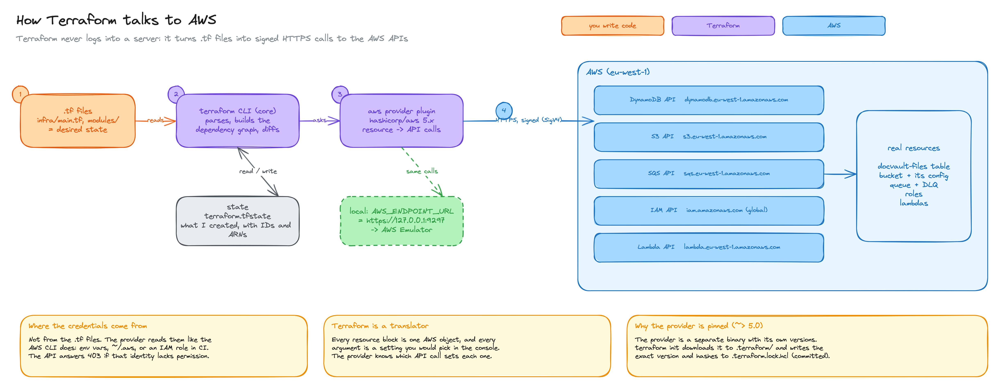
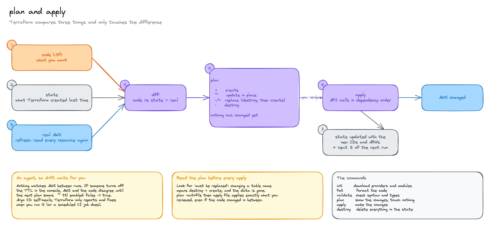
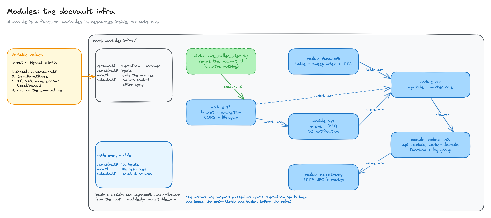
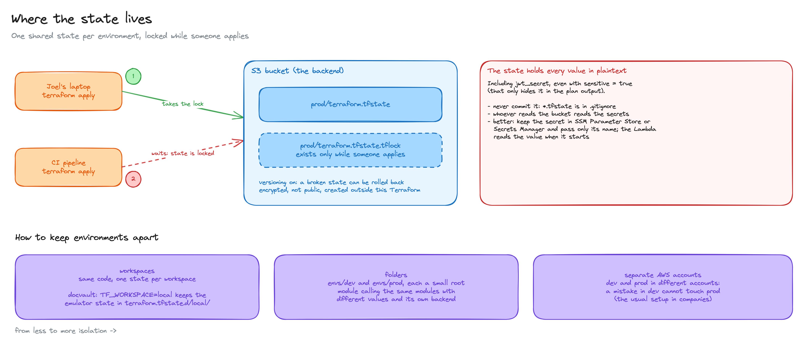
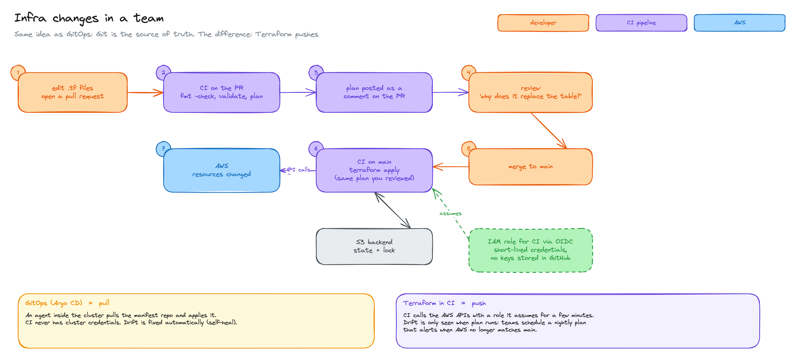

# Terraform: infrastructure as code on AWS

> How Terraform turns `.tf` files into AWS resources: who talks to whom, what the state is, how `plan` and `apply` decide what to change, and how a team runs it. The example is the infra of my `docvault` project (API Gateway, Lambda, S3, SQS, DynamoDB).

**What you'll learn**

- What Terraform actually does: code → provider → signed calls to the AWS APIs.
- Why every AWS setting you pick has a line in a `.tf` file: Terraform is a translation of those choices.
- How `plan` compares code, state and real AWS, and why you read the plan before every `apply`.
- How a project is split into a root module and modules, and how outputs connect them.
- Where the state lives, why it is locked, why it is a secret, and how environments are kept apart.
- How infra changes flow in a team, and how that differs from GitOps.

**Before reading**: [GitOps: from a commit to a running pod](../02-gitops-from-commit-to-pod/README.md).

---

## 1. How Terraform talks to AWS

Terraform never logs into a server. Everything is an HTTPS call to an AWS API, the same calls the console or the AWS CLI make:

1. **You write `.tf` files**: the desired state. "There is a DynamoDB table called `docvault-files` with these keys."
2. **The Terraform CLI (core)** parses them, builds a **dependency graph** (the table before the role that points to it) and works out what has to change.
3. **The provider** (`hashicorp/aws`) is a plugin that knows every AWS resource type and which API call creates, reads, updates or deletes each one. Terraform itself knows nothing about AWS; there are providers for GCP, Cloudflare, GitHub, Kubernetes…
4. **AWS APIs** receive the calls, signed with your credentials (SigV4), and create the real resources.

The **state** file is where Terraform writes down what it created and the IDs/ARNs AWS gave back, so the next run knows what already exists.

Credentials are never in the code: the provider reads them the same way the AWS CLI does (env vars, `~/.aws`, an IAM role in CI). Locally, `AWS_ENDPOINT_URL=https://127.0.0.1:9297` sends the exact same calls to the AWS Emulator instead of AWS.

## 2. Terraform is a translation of your AWS decisions

As a backend engineer, the hard part is choosing the service and its settings. Terraform is just where you write those choices down:

| Decision | Why | Terraform |
| --- | --- | --- |
| DynamoDB, pay per request | Low, spiky traffic: no capacity to plan | `billing_mode = "PAY_PER_REQUEST"` |
| Keys `PK` / `SK` | One partition per user, files sorted by ULID | `hash_key`, `range_key` and one `attribute` per key |
| Sparse index for the sweeper | Only files that need cleaning are indexed | `global_secondary_index` on `gsiPK` / `gsiSK` |
| Expire old records for free | DynamoDB deletes them, no job needed | `ttl { attribute_name = "expiresAt" }` |
| Private bucket, presigned URLs only | Files are never public | `aws_s3_bucket_public_access_block` |
| Browser uploads straight to S3 | S3 is another origin | `aws_s3_bucket_cors_configuration` |
| Queue between S3 and the worker | Retries and backpressure | `aws_sqs_queue` + `redrive_policy` to a DLQ |
| Retry only the failed messages | Not the whole batch | `function_response_types = ["ReportBatchItemFailures"]` |
| Least privilege | Each Lambda only touches its own resources | one `aws_iam_role` per Lambda, actions scoped to ARNs |

The **ARN** (Amazon Resource Name) is the unique ID of any resource: `arn:aws:dynamodb:eu-west-1:123456789012:table/docvault-files`. IAM policies use it to say *on what* an action is allowed.

## 3. plan and apply

On every run Terraform compares three things:

1. **Code**: what you want.
2. **State**: what it created last time.
3. **Real AWS**: it re-reads every resource (*refresh*).

The difference becomes the **plan**: `+` create, `~` update in place, `-/+` replace, `-` destroy. Nothing has changed yet. **`apply`** makes the calls in dependency order and writes the new IDs to the state.

Two habits:

- **Read the plan.** `must be replaced` on a table means destroy + create: the data is gone. Renaming a DynamoDB table does exactly that.
- **`plan -out=file`, then `apply file`** applies exactly what you reviewed.

There is **no agent**. If someone changes something by hand in the console (*drift*), nothing notices until the next `plan`, which shows the difference, and `apply` puts it back to what the code says. Argo CD self-heals; Terraform only fixes drift when you run it.

| Command | What it does |
| --- | --- |
| `terraform init` | Downloads providers and modules, sets up the backend |
| `terraform fmt` | Formats the code |
| `terraform validate` | Checks syntax and types |
| `terraform plan` | Shows the changes, touches nothing |
| `terraform apply` | Makes the changes |
| `terraform destroy` | Deletes everything in the state |
| `terraform import` | Adopts a resource that already exists into the state |

## 4. Modules: the docvault infra

A module is a folder of `.tf` files that works like a function:

- `variables.tf`: inputs (`type`, `default`, `validation`, `sensitive`).
- `main.tf`: the resources.
- `outputs.tf`: what it returns.

The **root module** (`infra/`) is the one you run. It has `versions.tf` (Terraform and provider versions, the provider block), `variables.tf`, `main.tf` (calls the modules) and `outputs.tf`.

Modules are wired by passing **outputs as inputs**: `module.dynamodb.table_arn` goes into `module.iam`. That is also how Terraform learns the order: the table and the bucket exist before the roles that point to them. The same `lambda` module is used twice, for the API and for the worker.

Other building blocks:

- **`resource "type" "name"`**: something Terraform creates. Referenced as `aws_dynamodb_table.files.arn`.
- **`data "type" "name"`**: something Terraform only reads. `data "aws_caller_identity"` gives the account id, used to make the bucket name unique.
- **`locals`**: named values inside a module, like a constant.
- **`for_each` / `count`**: many resources from one block. `for_each` over a set keeps stable names (`routes["GET /files"]`); `count` numbers them, so removing one in the middle shifts the rest.
- **`lifecycle { prevent_destroy = true }`**: the plan fails instead of deleting a production table.
- **`depends_on`**: an explicit order when no reference shows it (the queue policy before the S3 notification).

Variable values, from lowest to highest priority: `default` → `terraform.tfvars` → `TF_VAR_name` env var → `-var` on the command line.

## 5. Where the state lives

The state is a JSON file. In a team it lives in an **S3 bucket** (the *backend*) so everybody uses the same one:

- **Locking**: while someone applies, a `.tflock` file next to the state blocks a second apply. Without a lock, two applies start from different states and can duplicate or lose resources. (Since Terraform 1.10 S3 locks by itself with `use_lockfile = true`; older setups used a DynamoDB table.)
- **Versioning on**: a broken state can be rolled back.
- **The state bucket is created outside this Terraform**: Terraform needs it before it can create anything, and if it managed it, `destroy` would delete its own state.

**The state is a secret.** It holds every value in plaintext, `jwt_secret` included. `sensitive = true` only hides it in the plan output. Never commit it, restrict who can read the bucket, and keep real secrets in SSM Parameter Store or Secrets Manager: Terraform passes only the parameter name and the Lambda reads the value when it starts.

Keeping environments apart, from less to more isolation:

- **Workspaces**: same code, one state per workspace. docvault uses `TF_WORKSPACE=local` for the emulator.
- **Folders**: `envs/dev`, `envs/prod`, each a small root module calling the same modules with its own values and backend.
- **Separate AWS accounts**: a mistake in dev cannot touch prod. The usual setup in companies.

## 6. Infra changes in a team

1. A developer edits `.tf` files and opens a pull request.
2. CI runs `fmt -check`, `validate` and `plan`.
3. The plan is posted as a comment on the PR.
4. Someone reviews it ("why does it replace the table?").
5. Merge to `main`.
6. CI runs `apply`, assuming an **IAM role through OIDC**: short-lived credentials, no keys stored in GitHub.
7. AWS changes; the state in the S3 backend is updated.

Same idea as GitOps: Git is the source of truth and every change is reviewed. The difference is **push vs pull**: Argo CD is an agent inside the cluster that pulls and self-heals; Terraform in CI pushes API calls and only sees drift when a plan runs, so teams schedule a nightly plan that alerts when AWS no longer matches `main`.

Where the code lives: next to the service when it only describes that service (a new route or env var changes both in one commit), in a separate repo when it is shared (VPC, DNS, clusters) or owned by a platform team.

All diagrams on one canvas: [`diagrams/terraform.excalidraw`](diagrams/terraform.excalidraw).

---

## Key takeaways

- Terraform turns `.tf` files into signed calls to the AWS APIs through a provider plugin. It never logs into a server.
- Every resource block is an AWS object and every argument a setting you would pick in the console.
- `plan` = code vs state vs real AWS. Read it before every `apply`; `must be replaced` can mean data loss.
- No agent: drift is only found when a plan runs.
- Modules are functions; outputs passed as inputs connect them and set the order.
- State: shared in S3, locked, versioned, and treated as a secret. Never committed.
- Environments: workspaces, folders, or separate accounts (the safest).
- In a team: PR → plan in CI → review → merge → apply with short-lived credentials.

## Interview cheat sheet

**Q: What is the Terraform state and why does it matter?**
A: A file mapping each resource in the code to the real object in AWS, with its IDs. Terraform diffs against it to know what to create, change or delete. In a team it lives in a remote backend like S3, locked during applies, versioned, and protected because it stores values in plaintext.

**Q: What happens if two people run `terraform apply` at the same time?**
A: With a backend that locks, the second one waits or fails until the first releases the lock. Without locking both start from the same old state and can create duplicates or overwrite each other's changes.

**Q: What is drift and how do you detect it?**
A: A difference between the real infrastructure and the code, usually from a manual change. `terraform plan` shows it; `apply` reverts it. Teams run a scheduled plan in CI to catch it.

**Q: How do you handle secrets with Terraform?**
A: Not as plain variables, because they end up in the state. Store them in SSM Parameter Store or Secrets Manager, pass only the name or ARN, and let the application read the value at runtime with an IAM permission.

**Q: How do you separate dev and prod?**
A: Separate states at minimum (workspaces or folders with their own backend), and ideally separate AWS accounts so a mistake in dev can't reach prod.

**Q: `count` or `for_each`?**
A: `for_each` when items have a natural key: each resource keeps its address. With `count`, removing an item in the middle renumbers the rest and Terraform recreates them.

**Q: How do you bring an existing resource under Terraform?**
A: Write the resource block and `terraform import` it (or an `import` block), then run `plan` until it shows no changes.

**Q: How does CI authenticate to AWS without stored keys?**
A: OIDC: the CI provider issues a token, AWS trusts it through an identity provider, and the job assumes an IAM role with short-lived credentials scoped to what it needs.

## Further reading

- [Terraform: core workflow](https://developer.hashicorp.com/terraform/intro/core-workflow)
- [Terraform: state](https://developer.hashicorp.com/terraform/language/state)
- [Terraform: S3 backend](https://developer.hashicorp.com/terraform/language/backend/s3)
- [Terraform: modules](https://developer.hashicorp.com/terraform/language/modules)
- [AWS provider documentation](https://registry.terraform.io/providers/hashicorp/aws/latest/docs)
- [AWS: IAM roles for GitHub Actions (OIDC)](https://docs.github.com/en/actions/security-for-github-actions/security-hardening-your-deployments/configuring-openid-connect-in-amazon-web-services)
