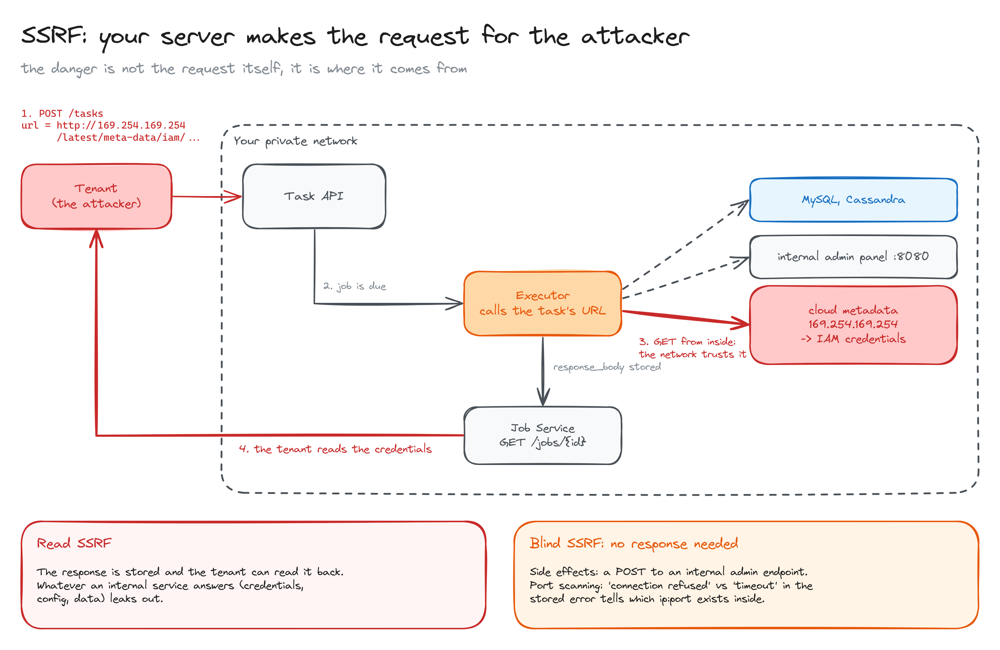
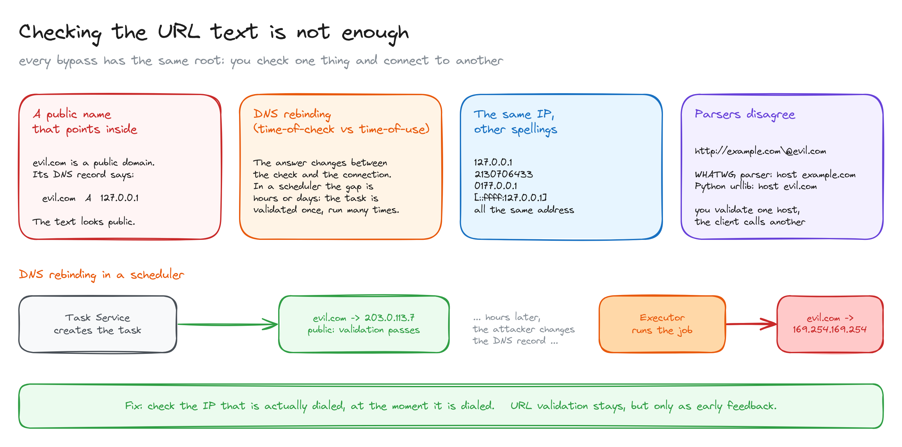
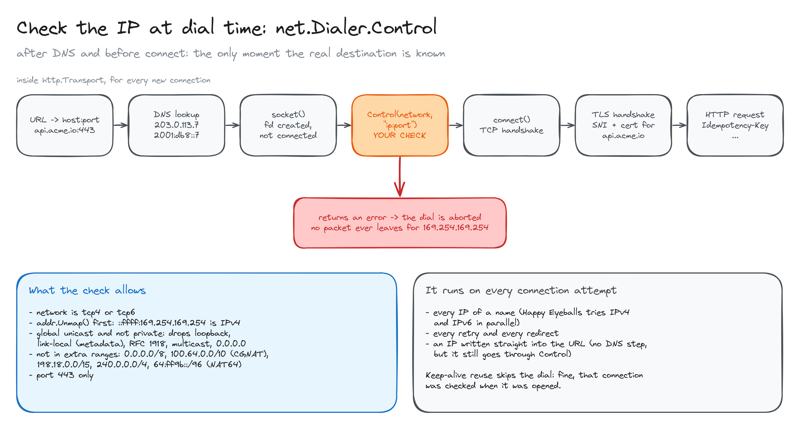
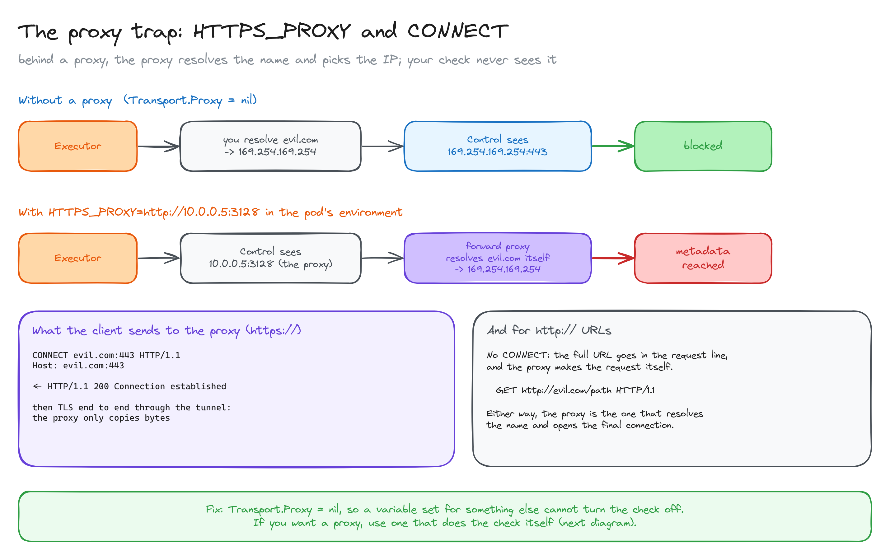
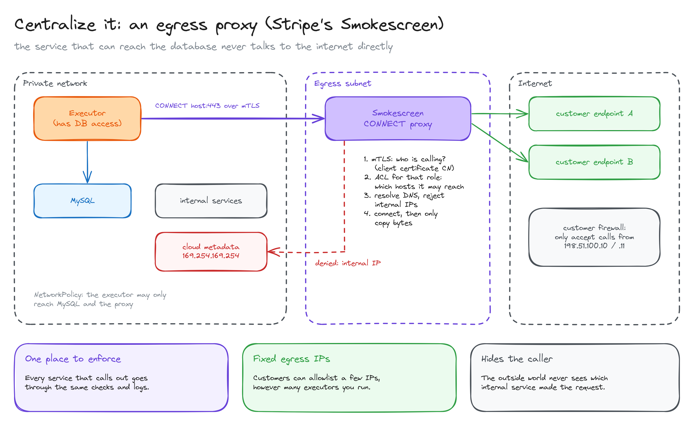

# SSRF: when your server calls URLs chosen by someone else

> Any service that calls URLs provided by users (webhooks, schedulers, link previews, importers) can be turned into a tool to reach your private network. Why checking the URL is not enough, how to check the real IP at dial time in Go, the proxy trap with `CONNECT`, and how Stripe centralizes it all in an egress proxy.

**What you'll learn**

- What SSRF is, and why the danger is where the request comes from, not the request itself.
- Read SSRF vs blind SSRF.
- Why validating the URL text fails: internal DNS records, DNS rebinding, alternative IP spellings, parser differences.
- How `net.Dialer.Control` checks the real destination after DNS and before `connect()`.
- What a forward proxy is, what `CONNECT` sends, and why an `HTTPS_PROXY` variable can silently disable your check.
- Defense in depth: network policies, cloud metadata hardening, and an egress proxy like Stripe's Smokescreen.

**Before reading**: [ingress and egress](../../platform-infra/06-ingress-and-egress/README.md) (what egress control is) and [load balancers](../../platform-infra/05-load-balancers/README.md) (L4 vs L7).

The running example is the executor of a distributed job scheduler: a service that, at the scheduled time, makes an HTTP call to a URL each tenant configured.

---

## 1. The problem: your server makes the request for the attacker



**SSRF (Server-Side Request Forgery)** means getting **your server** to make a request the attacker can't make directly.

The request itself is harmless. The problem is **where it comes from**. The executor runs inside your network, next to things nobody outside should reach:

- databases and the ports of other services, on `localhost` or `10.x.x.x`;
- internal admin panels;
- the cloud **metadata service** at `169.254.169.254` (AWS, GCP, Azure), which hands out the machine's credentials to anyone who asks from inside.

Those internal services usually trust any request that comes from inside the network. The attacker borrows your network position.

The attack in a scheduler:

1. A tenant creates a task with `url = http://169.254.169.254/latest/meta-data/iam/...`.
2. When the job is due, the executor makes the call **from inside**.
3. The metadata service answers with credentials.
4. The executor stores the response, and the tenant reads it through the jobs API.

A webhook system is the textbook case: its whole job is calling URLs the customer chooses. That's why every webhook provider has this solved, and why Stripe built a dedicated tool for it (section 6).

There are two variants, and both matter:

- **Read SSRF:** the response comes back to the attacker (stored, or returned). Whatever an internal service answers leaks out.
- **Blind SSRF:** no response needed. The attacker can trigger **side effects** (a `POST` to an internal admin endpoint) or **map your network**: if the stored error says "connection refused" for one `ip:port` and "timeout" for another, they know what exists inside. Not storing the response body is not a fix.

## 2. Checking the URL text is not enough



The natural first defense is to validate the URL when the task is created: reject `localhost`, `*.internal` and private IPs. It's useful as early feedback for the user, but it's not security. Four ways around it:

- **A public name that points inside.** `evil.com` is a public domain, and its DNS record can say `evil.com A 127.0.0.1`. The text looks public.
- **DNS rebinding.** The DNS answer changes between the check and the connection: a public IP when you validate, an internal one when you connect. It's a **TOCTOU** bug (time of check vs time of use). In a scheduler it's worse than usual: the task is validated once and runs hours or days later, many times.
- **The same IP, other spellings.** `127.0.0.1`, `2130706433`, `0177.0.0.1` and `[::ffff:127.0.0.1]` are all the same address.
- **Parsers that disagree.** `http://example.com\@evil.com` is read as host `example.com` by WHATWG parsers and as `evil.com` by Python's `urllib`. You validate one host and the client calls another.

All four have the same root: **you check one thing and connect to another**. The fix is to check the IP that is actually dialed, at the moment it is dialed.

## 3. Check the IP at dial time: `net.Dialer.Control`



First, the pieces:

- A **socket** is an operating system object (a file descriptor) that represents one end of a network connection.
- Go's **`net.Dialer`** is the code that *produces* connections: it resolves the name, creates the socket, connects it and returns a `net.Conn` wrapping it.

A TCP connection needs an IP, so a URL with a name always has to be resolved first: by DNS, `/etc/hosts` or a cache. The exceptions are a URL that already contains an IP (no resolution) and a proxy (the proxy resolves, see section 4).

What `http.Transport` does for every **new** connection:

```text
1. URL -> host:port               https://api.acme.io/x -> api.acme.io:443
2. Resolve the name               api.acme.io -> [203.0.113.7, 2001:db8::7]
3. For each IP (IPv4 and IPv6 in parallel, "Happy Eyeballs"):
   a. socket()    the fd exists, not connected yet
   b. Control()   <- your check, with the real "203.0.113.7:443"
   c. connect()   TCP handshake (SYN, SYN-ACK, ACK)
4. TLS handshake (SNI and certificate for api.acme.io)
5. Send the HTTP request
```

`Dialer.Control` is a hook that runs **after resolution and before `connect()`**, on a socket that exists but hasn't sent a single packet. It receives the exact address it's about to connect to. If it returns an error, the dial is aborted.

That closes every bypass from section 2 at once: it doesn't matter how the URL was written or what the DNS said earlier, you check the IP at the moment it's used. And because it runs on **every** connection attempt, it also covers every IP of a name, retries, redirects (if you followed them) and URLs that contain a raw IP. The hostname is kept for the `Host` header, SNI and certificate validation, so TLS keeps working.

Keep-alive reuse skips the dial (no `Control`), which is fine: that connection was checked when it was opened and still points to the same IP.

```go
var errBlocked = errors.New("destination not allowed")

// Ranges that IsGlobalUnicast / IsPrivate do not catch.
var extraBlocked = []netip.Prefix{
	netip.MustParsePrefix("0.0.0.0/8"),     // "this network"
	netip.MustParsePrefix("100.64.0.0/10"), // CGNAT, used as internal space by some clouds and VPNs
	netip.MustParsePrefix("192.0.0.0/24"),  // IETF protocol assignments
	netip.MustParsePrefix("198.18.0.0/15"), // benchmarking
	netip.MustParsePrefix("240.0.0.0/4"),   // reserved
	netip.MustParsePrefix("64:ff9b::/96"),  // NAT64: an IPv6 that becomes an IPv4
	netip.MustParsePrefix("2002::/16"),     // 6to4: embeds an IPv4
}

func allowed(addr netip.Addr) bool {
	addr = addr.Unmap() // ::ffff:169.254.169.254 -> 169.254.169.254
	if !addr.IsGlobalUnicast() || addr.IsPrivate() {
		return false // loopback, link-local (metadata), multicast, unspecified, RFC 1918, fc00::/7
	}
	for _, p := range extraBlocked {
		if p.Contains(addr) {
			return false
		}
	}
	return true
}

// control runs after DNS resolution and before connect(), with the real destination.
func control(network, address string, _ syscall.RawConn) error {
	if network != "tcp4" && network != "tcp6" {
		return errBlocked
	}
	ap, err := netip.ParseAddrPort(address)
	if err != nil || ap.Port() != 443 || !allowed(ap.Addr()) {
		return errBlocked
	}
	return nil
}
```

Details that are easy to get wrong:

- **`Unmap()` first.** With `netip.Addr`, `::ffff:169.254.169.254` is treated as IPv6, so `IsLinkLocalUnicast()` and `IsPrivate()` return `false` for it. Unmap it to its IPv4 form before checking. (The older `net.IP` type treats both forms as equivalent.)
- **`IsGlobalUnicast()` alone is not enough.** It returns `true` for private ranges too, hence the extra `IsPrivate()`.
- **Allow what is valid, don't list what is forbidden.** Starting from "global unicast and not private" and removing a few extra ranges is safer than a growing deny list. OWASP calls deny lists "bypass-prone".
- **Ports.** Allowing only 443 doesn't protect your network (the IP check does that). It stops others from using you as a scanner against third parties, for example sending spam to port 25 of a mail server.

## 4. The proxy trap: `HTTPS_PROXY` and `CONNECT`



A **forward proxy** is an intermediate server through which a machine sends its outbound traffic instead of connecting directly. They are common in companies and some clusters.

Many programs configure it through environment variables: `HTTP_PROXY`, `HTTPS_PROXY` and `NO_PROXY` (also in lower case). Go's `http.DefaultTransport` reads them by default (`Proxy: http.ProxyFromEnvironment`), and uses one or the other depending on the URL's scheme. If someone sets `HTTPS_PROXY=http://10.0.0.5:3128` in the pod for any other reason, every request of your client goes through it without a code change.

What the client sends to the proxy depends on the scheme.

**`https://` URLs: the `CONNECT` method.** HTTP has a method just for this, and the destination goes in the first line. No body:

```text
CONNECT evil.com:443 HTTP/1.1
Host: evil.com:443

```

The proxy receives only `host:port`: not the path, not your headers, not your body. It resolves the name, opens a TCP connection to the destination and answers:

```text
HTTP/1.1 200 Connection established
```

From then on the proxy becomes a **tunnel**: it copies bytes in both directions without understanding them. The TLS handshake and the real request travel inside, encrypted end to end between your client and the destination, and the certificate is validated against `evil.com`. It starts at L7 (an HTTP method) and ends as a blind byte pipe.

**`http://` URLs: no `CONNECT`.** The client sends the normal request to the proxy, with the **full URL** in the first line instead of just the path, and the proxy makes the request itself (pure L7):

```text
GET http://evil.com/path HTTP/1.1
Host: evil.com
```

Either way, **the proxy resolves the name and opens the final connection.** Your `Control` only ever sees `10.0.0.5:3128`. If `evil.com` resolves to `169.254.169.254` and the proxy sits inside your network, it connects without complaint.

The fix is to set **`Proxy: nil`** in the executor's transport, so it ignores the environment and always dials the destination directly:

```go
dialer := &net.Dialer{Timeout: 10 * time.Second, Control: control}
client := &http.Client{
	Transport: &http.Transport{
		Proxy:               nil, // never read HTTP_PROXY / HTTPS_PROXY from the environment
		DialContext:         dialer.DialContext,
		TLSHandshakeTimeout: 10 * time.Second,
		ForceAttemptHTTP2:   true, // a custom Transport disables HTTP/2 unless asked
		MaxIdleConnsPerHost: 10,
		IdleConnTimeout:     90 * time.Second,
	},
	// Do not follow redirects: the 3xx is the job's result.
	CheckRedirect: func(*http.Request, []*http.Request) error { return http.ErrUseLastResponse },
}
```

There are two coherent setups: **you dial and you check** (`Proxy: nil` + `Control`), or **a proxy that checks** does it for you (section 6). The one that must never happen is the one in between: a proxy that doesn't validate, switched on by a variable someone set for something else.

## 5. The rest of the client

| Setting | Why |
|---|---|
| Don't follow redirects | A public endpoint can answer `302` to an internal URL. `Control` would still block the IP, but this way the job calls exactly the configured URL, and the 3xx is stored as the result. OWASP recommends disabling redirects. |
| `https` only | Headers and body may carry secrets, and other schemes (`file://`, `gopher://`) are their own attack vectors. Go's client already refuses them, but validate the scheme anyway. |
| Timeout per job (`context.WithTimeout`) and for connect/TLS | An endpoint that never answers must not hold a worker forever. |
| Response body limited (`io.LimitReader`) | An endpoint that returns 5 GB would take the executor down if read whole. |
| Generic error for blocked destinations | The stored error is visible to the tenant. "destination not allowed", never the dial detail ("connection refused" vs "timeout" is a free port scanner). |
| `Idempotency-Key: <job id>` | Not SSRF, but same place: if a job runs twice (retry, expired lease), the endpoint can detect the duplicate. |

## 6. Defense in depth: centralize it in an egress proxy



`Control` is the application-level defense. OWASP recommends also restricting at the **network level**, so a bug in the application isn't enough:

- **The executor can't reach internal things even if it tries.** In Kubernetes, an egress `NetworkPolicy` that only allows MySQL and the outside, and blocks `169.254.169.254` and private ranges.
- **Hardened metadata.** In AWS, require **IMDSv2**: it needs a session token obtained with a `PUT`, which a plain `GET` SSRF can't do. In GKE, Workload Identity. And the executor's pod shouldn't have cloud permissions it doesn't need.

The next step is what Stripe does: **the service that can reach the database never talks to the internet directly.** All outbound traffic goes through **Smokescreen**, an HTTP `CONNECT` proxy that lives in its own isolated subnet:

1. The client connects over **mTLS**, and Smokescreen identifies the calling service from its certificate.
2. It checks the requested destination against that service's **ACL** (which hosts it may reach).
3. It **resolves the name and rejects internal IPs**: the same check as section 3, done once, for every service.
4. It connects and copies bytes.

Stripe's README gives the reason directly: it stops their own webhook infrastructure from being used to scan Stripe's internal network.

What you get by centralizing:

- **One place to enforce and audit** every outbound call, for every service and language.
- **Fixed egress IPs.** Customers can allowlist a few IPs in their firewall ("only accept calls from these IPs"), however many executors you run. Payment partners often require it.
- **The caller is hidden.** The outside never learns which internal service made the request.

This is the section 4 trade-off resolved the other way: instead of disabling the proxy, you make the proxy the one that checks, and force everything through it with the network policy.

All diagrams on one canvas: [`diagrams/ssrf.excalidraw`](diagrams/ssrf.excalidraw).

---

## Key takeaways

- SSRF uses your server's network position. Any feature that calls user-provided URLs is exposed.
- Not returning the response doesn't fix it: blind SSRF still triggers side effects and maps your network through errors and timings.
- Validating the URL text is feedback, not security. DNS can point inside, change later, or the IP can be spelled another way.
- Check the IP that is actually dialed, at dial time: in Go, `net.Dialer.Control`. Unmap IPv4-mapped addresses first.
- A forward proxy resolves the destination itself, so `HTTPS_PROXY` in the environment silently bypasses your check. Set `Proxy: nil`, or use a proxy that does the check.
- Defense in depth: network policies, IMDSv2, and at scale an egress proxy (Smokescreen) that centralizes checks, audit and fixed egress IPs.

## Interview cheat sheet

**Q: What is SSRF and why are webhook systems exposed to it?**
A: Making a server issue requests to destinations the attacker chooses, so the attacker uses the server's network position: internal services, databases, cloud metadata. Webhook and scheduler systems call user-provided URLs by design.

**Q: Why isn't validating the URL when it's saved enough?**
A: The name can resolve to an internal IP, the DNS answer can change between validation and use (DNS rebinding, a TOCTOU bug), the same IP has many spellings, and URL parsers disagree about the host. You must check the resolved IP at connection time.

**Q: How do you implement that check in Go?**
A: A custom `http.Transport` whose `net.Dialer` has a `Control` function. It runs after DNS resolution and before `connect()`, receives the real `ip:port`, and aborts the dial if the IP isn't public unicast (after unmapping IPv4-mapped IPv6) or the port isn't allowed. Also: no proxy from the environment, no redirects.

**Q: What does an HTTP `CONNECT` request do?**
A: It asks a forward proxy to open a TCP tunnel to `host:port`. The proxy resolves the name, connects, answers `200 Connection established`, and then copies bytes; TLS runs end to end through the tunnel. It's how HTTPS goes through a proxy.

**Q: Why can a proxy break SSRF protection?**
A: Behind a proxy, the proxy resolves the destination and opens the final connection, so a client-side dial check only sees the proxy's IP. Either disable environment proxies or route everything through a proxy that enforces the check itself.

**Q: How would you protect this at scale?**
A: Isolate the services that call out: network policies so they can't reach internal ranges or metadata, IMDSv2, and all egress through a central proxy (like Smokescreen) with per-service ACLs and IP checks, which also gives fixed egress IPs for customer allowlists.

## Further reading

- [Andrew Ayer: Preventing Server Side Request Forgery in Golang](https://www.agwa.name/blog/post/preventing_server_side_request_forgery_in_golang)
- [OWASP: Server Side Request Forgery Prevention Cheat Sheet](https://cheatsheetseries.owasp.org/cheatsheets/Server_Side_Request_Forgery_Prevention_Cheat_Sheet.html)
- [Stripe: Smokescreen, an SSRF-preventing egress proxy](https://github.com/stripe/smokescreen)
- [Go: `net.Dialer`](https://pkg.go.dev/net#Dialer)
- [RFC 9110: the `CONNECT` method](https://www.rfc-editor.org/rfc/rfc9110#name-connect)
- [AWS: Instance Metadata Service v2](https://docs.aws.amazon.com/AWSEC2/latest/UserGuide/configuring-instance-metadata-service.html)
