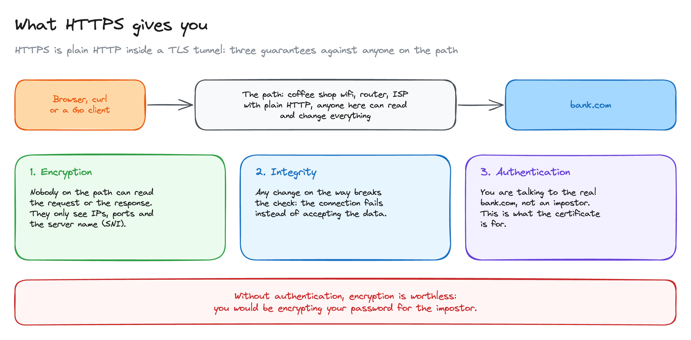
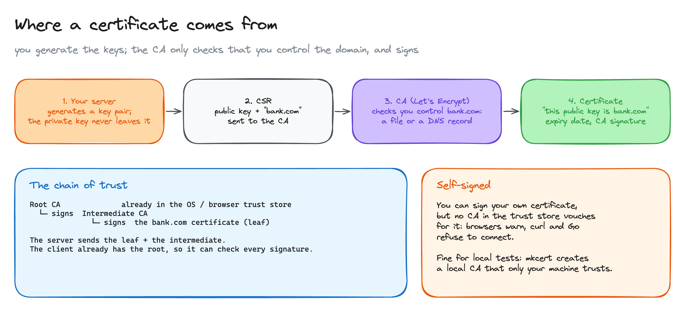
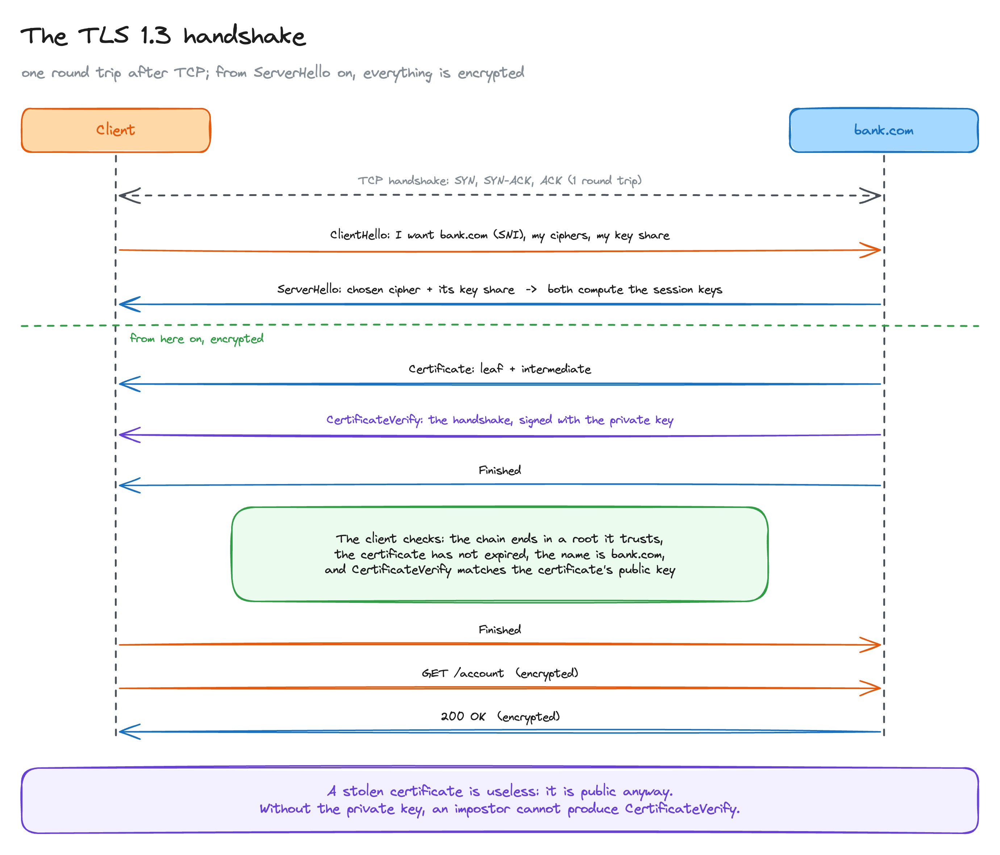
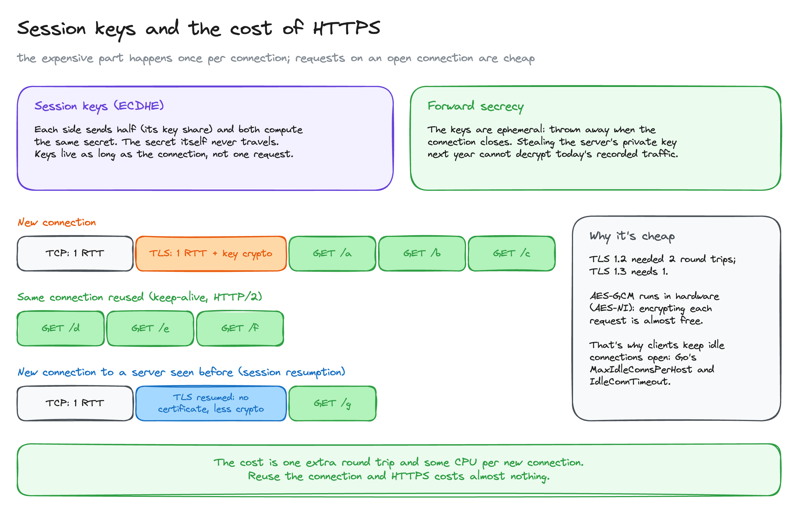
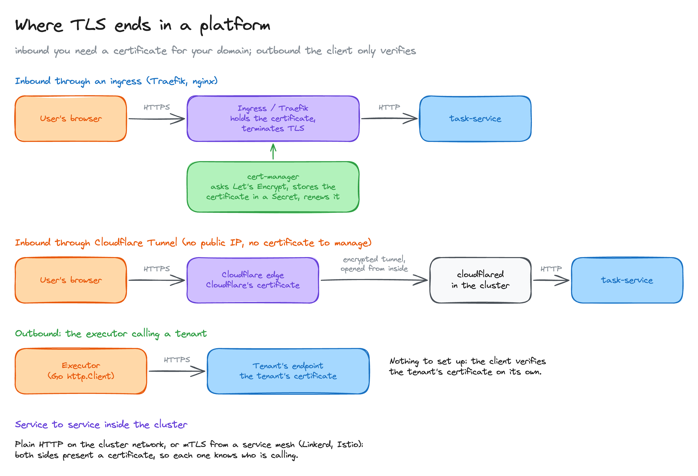

# HTTPS: what TLS protects and how it works

> HTTPS is plain HTTP inside a TLS tunnel. What that tunnel guarantees, where a certificate comes from, what happens in the handshake, what the session keys are, what it costs, and who does the work: the browser, curl, Go, or your platform.

**What you'll learn**

- The three things HTTPS gives you: encryption, integrity and authentication, and why the third is the one that matters.
- Where a certificate comes from: your key pair, the CSR, how a CA checks you own the domain, and the chain of trust.
- The TLS 1.3 handshake step by step, and why a stolen certificate is useless without the private key.
- Session keys (ECDHE), forward secrecy, and what HTTPS really costs.
- Why the browser, curl and Go do exactly the same checks.
- Where TLS ends in a platform: ingress with cert-manager, Cloudflare Tunnel, outbound calls, and mTLS.

**Before reading**: [load balancers](../../platform-infra/05-load-balancers/README.md) (L4 vs L7, terminating TLS) and [ingress and egress](../../platform-infra/06-ingress-and-egress/README.md).

The running examples are a browser opening `bank.com`, and the executor of the distributed job scheduler from [SSRF](../01-ssrf/README.md) calling each tenant's endpoint.

---

## 1. What HTTPS gives you



Between your client and `bank.com` there are machines you don't control: the coffee shop wifi, routers, your ISP. With plain HTTP, any of them can read and change everything.

**HTTPS** is the same HTTP inside a **TLS** tunnel (Transport Layer Security). The requests don't change; they travel encrypted. TLS gives three guarantees:

1. **Encryption.** Nobody on the path can read the request or the response. They still see the IPs, the ports and the server name, which travels in clear text in the first message (SNI, see section 3).
2. **Integrity.** Every encrypted record carries a check. If anyone changes a byte on the way, the check fails and the connection is closed instead of accepting the data.
3. **Authentication.** You are talking to the real `bank.com`, not an impostor. This is what the certificate is for.

The third one is the one the other two depend on. Encryption with an impostor is worthless: you would be encrypting your password for them. Most of TLS is about proving who is on the other side.

## 2. Where a certificate comes from



The server has two pieces:

- A **private key**. Secret, it never leaves the server.
- A **certificate**. Public. It says "this public key belongs to `bank.com`, until this date", and it's signed by a **certificate authority (CA)** such as Let's Encrypt or DigiCert.

You don't write the certificate yourself. The steps are:

1. **You generate the key pair** on your server.
2. **You send the CA a CSR** (Certificate Signing Request): your public key and the domain. The private key is not in it, so the CA never sees it.
3. **The CA checks that you control the domain.** Let's Encrypt does it with the ACME protocol: publish a file it gives you at `http://bank.com/.well-known/acme-challenge/...` (HTTP-01), or a TXT record in the domain's DNS (DNS-01). Only whoever controls the domain can do either.
4. **The CA signs the certificate** and hands it back. Let's Encrypt certificates last 90 days, so renewal has to be automatic.

**The chain of trust.** Browsers and operating systems ship a list of root CAs they trust: the **trust store**. Roots don't sign websites directly. They sign **intermediate CAs**, which sign the server's certificate (the **leaf**). The server sends the leaf plus the intermediate; the client already has the root, so it can check every signature up the chain.

**Self-signed certificates.** You can sign your own certificate, but no CA in anyone's trust store vouches for it: browsers show a warning, and curl and Go refuse to connect. It's fine for local tests: `mkcert` creates a local CA and adds it to your machine's trust store only.

## 3. The TLS 1.3 handshake



After the TCP connection is open, client and server run the handshake. In TLS 1.3 it takes **one round trip**:

```text
1. Client -> ClientHello     "I want bank.com" (SNI), the ciphers it supports,
                             and its key share (half of the key exchange)
2. Server -> ServerHello     the chosen cipher and its own key share
                             -> both sides now compute the same session keys;
                                everything from here on is encrypted
3. Server -> Certificate     the leaf + the intermediate
4. Server -> CertificateVerify
                             a signature over the whole handshake so far,
                             made with the private key
5. Server -> Finished
6. Client checks             the chain ends in a root it trusts, the certificate
                             hasn't expired, the name matches bank.com, and the
                             CertificateVerify signature matches the certificate's key
7. Client -> Finished, and the first request (GET /account), already encrypted
```

Step 4 is the important one. The private key **doesn't sign the domain**: the CA already did that inside the certificate. It signs **this handshake**, which contains random values from this connection. That proves, live, that the server holds the private key for the certificate it just sent.

That's why **a stolen certificate is useless**. The certificate is public anyway: anyone can download it. An impostor can send it, but can't produce the step 4 signature without the private key, and the client hangs up.

**SNI** (Server Name Indication) is the name in step 1. One IP can host many sites, so the server needs to know which certificate to send before anything is encrypted. That's why the name is visible on the path. ECH (Encrypted Client Hello) hides it, but it's not deployed everywhere yet.

## 4. Session keys, forward secrecy and the cost



**The session keys aren't created by the client alone.** Both sides derive them with **ECDHE** (Elliptic Curve Diffie-Hellman, Ephemeral): each one sends its half (the key share in steps 1 and 2) and keeps a secret part, and with the math of the exchange both arrive at the same secret. **The secret itself never travels**, so watching the handshake doesn't reveal it.

**The keys last as long as the connection, not one request.** Many requests travel over one connection: keep-alive in HTTP/1.1, multiplexing in HTTP/2.

**Forward secrecy.** The key shares are ephemeral: thrown away when the connection closes. The certificate's private key only signs, it doesn't encrypt anything. So if someone records today's traffic and steals the server's private key next year, they still can't decrypt it.

**What it costs.** Only opening a connection is expensive:

| | Cost |
|---|---|
| TLS 1.3 handshake | **1 extra round trip** after TCP (TLS 1.2 needed 2), plus some CPU for the signature and the key exchange |
| Every request after that | Almost nothing: symmetric encryption (AES-GCM) runs in hardware (AES-NI) |
| New connection to a server seen before | **Session resumption**: the client reuses a key from the last session and skips the certificate and the signature. 0-RTT can even send the first request in the first message, but it can be replayed, so it's only safe for idempotent requests |

This is why clients keep idle connections open. In Go, `http.Transport`'s `MaxIdleConnsPerHost` and `IdleConnTimeout` exist to reuse connections, and with them the handshake.

## 5. The browser, curl and Go do the same thing

It's the same protocol and the same checks. What changes is where each one gets its trust store from and how it tells you something is wrong:

| Client | Trust store | Invalid certificate | Skipping the check |
|---|---|---|---|
| Browser | Chrome and Firefox ship their own root store; Safari uses the OS's | "Your connection is not private" page | Clicking through the warning |
| curl | The CA bundle it was built with, usually the OS's | `SSL certificate problem: ...` | `curl -k` (`--insecure`) |
| Go `http.Client` | The OS's roots (`/etc/ssl/certs` on Linux) | `x509: certificate signed by unknown authority`, and others | `InsecureSkipVerify: true` |

Skipping the check keeps the encryption but drops the authentication, which is the guarantee section 1 says the others depend on. It's for local tests only.

Two things that are handy in practice:

- `curl -v https://bank.com` prints the handshake: TLS version, cipher, and the certificate's subject, issuer and expiry date. `openssl s_client -connect bank.com:443 -servername bank.com` shows the whole chain.
- **Minimal containers have no trust store.** An image built `FROM scratch` has no `/etc/ssl/certs`, so every HTTPS call from Go fails with `unknown authority`. Use a base image that includes CA certificates (distroless, Alpine with `ca-certificates`) or copy them into the image.

## 6. Where TLS ends in a platform



Who needs a certificate depends on the direction of the call.

**Outbound: nothing to set up.** When the scheduler's executor calls a tenant's endpoint, the tenant's server has the certificate. Go's client does the handshake and verifies it on its own, as in section 5.

**Inbound: you need a certificate for your domain.** The usual setup leaves the services alone and terminates TLS at the entrance, at the ingress (an L7 proxy, see [load balancers](../../platform-infra/05-load-balancers/README.md)):

```text
browser --HTTPS--> ingress / Traefik (holds the certificate) --HTTP--> task-service
```

- **cert-manager + Let's Encrypt.** cert-manager runs in the cluster, requests the certificate with ACME, stores it as a Kubernetes `Secret` the ingress reads, and renews it before it expires. It needs a real domain pointing at the cluster, so the CA can check you control it.
- **Cloudflare Tunnel.** `cloudflared` runs inside the cluster and opens an encrypted tunnel *out* to Cloudflare. Users connect to Cloudflare's edge, which holds the public certificate. No public IP, no open port, and no certificate to manage.

**Service to service, inside the cluster.** Often plain HTTP on the cluster network. When that isn't enough, a service mesh (Linkerd, Istio) adds **mTLS**: both sides present a certificate, so the server also knows which service is calling. That's mutual authentication, what Stripe's Smokescreen uses to identify callers (see [SSRF](../01-ssrf/README.md)).

All diagrams on one canvas: [`diagrams/https.excalidraw`](diagrams/https.excalidraw).

---

## Key takeaways

- HTTPS is HTTP inside TLS. It gives encryption, integrity and authentication, and the first two are worthless without the third.
- The certificate is public and says "this public key is `bank.com`", signed by a CA in the client's trust store. The private key never leaves the server.
- A CA signs only after checking you control the domain (ACME: a file or a DNS record). You don't make the certificate; self-signed ones aren't trusted.
- In the handshake the private key signs the handshake itself, proving possession live. A stolen certificate alone is useless.
- Both sides derive the session keys with ECDHE; the secret never travels. Keys last one connection and are thrown away: forward secrecy.
- The cost is one round trip and some CPU per new connection. Reuse connections and it's nearly free.
- Browser, curl and Go run the same checks. `-k` and `InsecureSkipVerify` drop authentication.
- Outbound, the client only verifies. Inbound, terminate TLS at the ingress with cert-manager, or let Cloudflare hold the certificate.

## Interview cheat sheet

**Q: What does HTTPS protect against?**
A: Anyone on the network path. TLS encrypts the traffic, detects any modification, and authenticates the server through its certificate, so you know you are talking to the real domain.

**Q: What's in a certificate, and why can you trust it?**
A: A public key, the domain names it's valid for, an expiry date and a CA's signature. The client trusts it because the chain of signatures ends in a root CA from its trust store, and the CA only signs after checking you control the domain.

**Q: If someone copies a server's certificate, can they impersonate it?**
A: No. The certificate is public. In the handshake the server signs the handshake with its private key (CertificateVerify), and without that key the signature can't be made.

**Q: Walk me through a TLS 1.3 handshake.**
A: ClientHello with SNI, ciphers and a key share; ServerHello with the server's key share, after which both derive the session keys and the rest is encrypted; then Certificate, CertificateVerify and Finished from the server. The client validates chain, expiry, name and signature, sends Finished, and its first request. One round trip after TCP.

**Q: What is forward secrecy?**
A: The session keys come from an ephemeral Diffie-Hellman exchange and are discarded after the connection. The long-term private key only signs, so stealing it later doesn't decrypt recorded traffic.

**Q: Is HTTPS slow?**
A: Only to open a connection: one extra round trip in TLS 1.3 and some CPU. After that, symmetric encryption runs in hardware. Connection reuse and session resumption make the handshake rare.

**Q: How do you serve HTTPS from Kubernetes?**
A: Terminate TLS at the ingress, with cert-manager getting and renewing certificates from Let's Encrypt into a Secret. Or put Cloudflare in front with a tunnel. For service-to-service, a mesh adds mTLS.

## Further reading

- [The Illustrated TLS 1.3 Connection](https://tls13.xargs.org/): every byte of a real handshake, explained
- [Cloudflare: What happens in a TLS handshake?](https://www.cloudflare.com/learning/ssl/what-happens-in-a-tls-handshake/)
- [Let's Encrypt: How it works](https://letsencrypt.org/how-it-works/)
- [RFC 8446: TLS 1.3](https://www.rfc-editor.org/rfc/rfc8446)
- [cert-manager documentation](https://cert-manager.io/docs/)
- [Go: `crypto/tls`](https://pkg.go.dev/crypto/tls)
