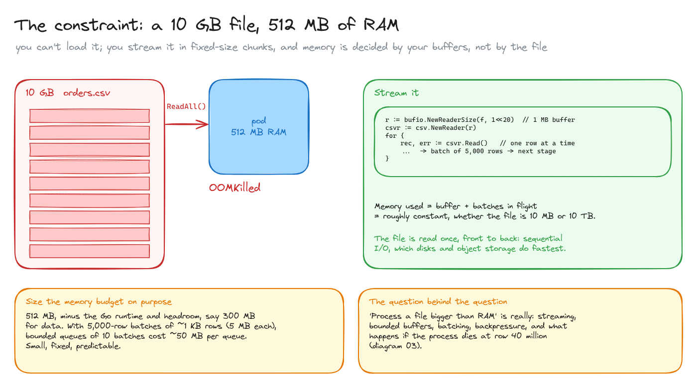
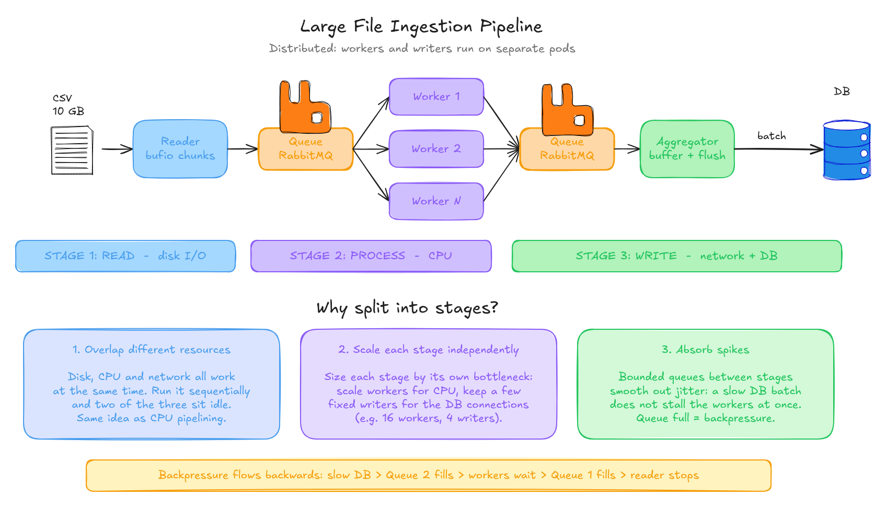
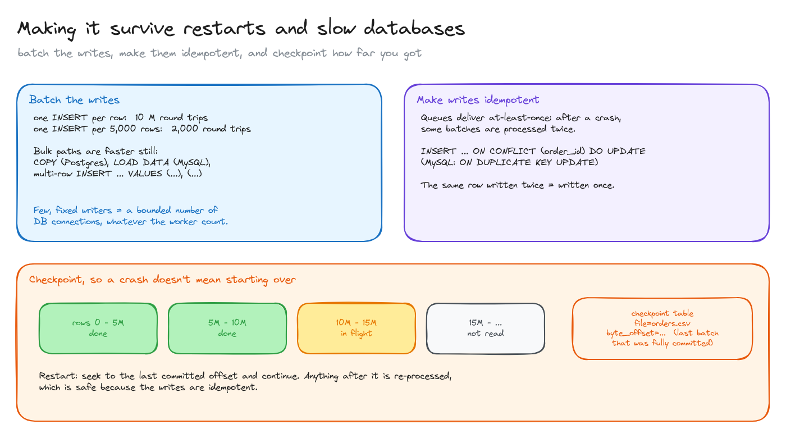

# Large file ingestion: 10 GB with 512 MB of RAM

> How to load a file much bigger than memory into a database: stream it, split the work into stages joined by bounded queues, let backpressure protect the database, and make the job survive a crash halfway.

**What you'll learn**

- Why you stream instead of loading, and how to size a memory budget.
- Splitting the job into read / process / write stages, each scaled by its own bottleneck.
- Bounded queues and backpressure.
- Batching writes, idempotent upserts, and checkpoints so a restart doesn't start from zero.

**Before reading**: nothing. [CDC and Kafka](../../database-internals/04-cdc-and-kafka/README.md) helps with at-least-once delivery.

---

## 1. The constraint

The problem: a 10 GB CSV, and a pod with 512 MB of RAM. `ReadAll()` gets the pod `OOMKilled`.

The answer is **streaming**: read the file front to back through a fixed-size buffer (`bufio.NewReaderSize(f, 1<<20)` plus `csv.Reader`), one row at a time, and group rows into batches for the next stage. Memory then depends on **your buffers and how many batches are in flight**, not on the file. It's the same whether the file is 10 MB or 10 TB. Reading sequentially is also what disks and object storage do fastest.

Size the memory budget on purpose. Out of 512 MB, leave room for the Go runtime and headroom; say 300 MB for data. With batches of 5,000 rows of ~1 KB (5 MB per batch), a bounded queue of 10 batches costs ~50 MB. Small, fixed and predictable.

The interview question "process a file bigger than RAM" is really about streaming, bounded buffers, batching, backpressure and failure.

## 2. The pipeline and backpressure

The job has three stages, and each one is limited by a different resource:

1. **Read**: disk or network I/O. One reader is usually enough.
2. **Process**: CPU (parse, validate, transform). Scale the number of workers.
3. **Write**: network and database. Keep a **few, fixed writers** so the number of database connections stays bounded, whatever the worker count.

Splitting into stages gives three things:

- **Overlap**: disk, CPU and network work at the same time instead of taking turns, like CPU pipelining.
- **Independent scaling**: size each stage by its own bottleneck (for example 16 workers and 4 writers).
- **Absorbing spikes**: the queues between stages smooth out jitter, so one slow database batch doesn't stall every worker at once.

The queues must be **bounded**. Then **backpressure flows backwards**: a slow database → queue 2 fills → workers block → queue 1 fills → the reader stops reading. Nothing grows without limit, and memory stays inside the budget.

In a single process, the queues can be buffered Go channels. Across pods (as in the drawing), they're a broker like RabbitMQ, where a bounded queue plus a limited prefetch per consumer gives the same backpressure.

## 3. Surviving restarts and slow databases

- **Batch the writes.** One `INSERT` per row means 10 million round trips; one per 5,000 rows means 2,000. Bulk paths are faster still: `COPY` in Postgres, `LOAD DATA` in MySQL, or multi-row `INSERT ... VALUES (...), (...)`.
- **Make the writes idempotent.** Queues deliver at least once: after a crash, some batches are processed twice. An upsert keyed by a natural key (`INSERT ... ON CONFLICT (order_id) DO UPDATE` in Postgres, `ON DUPLICATE KEY UPDATE` in MySQL) makes "written twice" the same as "written once".
- **Checkpoint.** Record the byte offset of the last batch that was fully committed. After a crash, seek to it and continue. Anything after the checkpoint is processed again, which is safe because the writes are idempotent.

All diagrams on one canvas: open the three files in [`diagrams/`](diagrams/).

---

## Key takeaways

- Stream with fixed buffers: memory is set by your buffers, not by the file size.
- Split read / process / write and scale each stage by its own bottleneck.
- Bounded queues turn a slow database into backpressure instead of an out-of-memory crash.
- Few writers, big batches, bulk-load paths.
- At-least-once + idempotent upserts + checkpoints = restartable without duplicates.

## Interview cheat sheet

**Q: How do you process a 10 GB file with 512 MB of RAM?**
A: Stream it with a buffered reader, row by row, into batches; pass batches through bounded queues to CPU workers and a few DB writers doing bulk inserts. Memory is bounded by buffer size × queue capacity.

**Q: What happens when the database gets slow?**
A: The writers slow down, their queue fills, workers block, the first queue fills and the reader stops. That's backpressure: the system slows to the database's speed instead of buffering until it dies.

**Q: The job crashes at row 40 million. Then what?**
A: Restart from the last checkpoint (byte offset of the last committed batch). Some rows after it are reprocessed, which is harmless because writes are idempotent upserts.

**Q: Why not one goroutine per row?**
A: Unbounded concurrency means unbounded memory and connections. A fixed pool of workers and writers keeps both bounded and lets you tune each stage.

## Further reading

- [Go: bufio](https://pkg.go.dev/bufio) and [encoding/csv](https://pkg.go.dev/encoding/csv)
- [Postgres: COPY](https://www.postgresql.org/docs/current/sql-copy.html)
- *Designing Data-Intensive Applications* (Kleppmann), chapter 10: batch processing.
