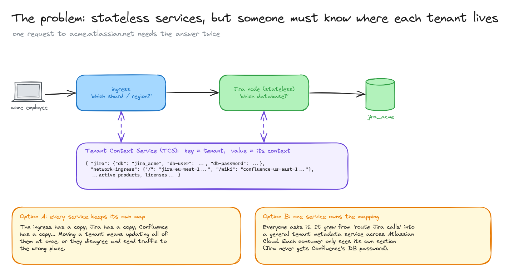
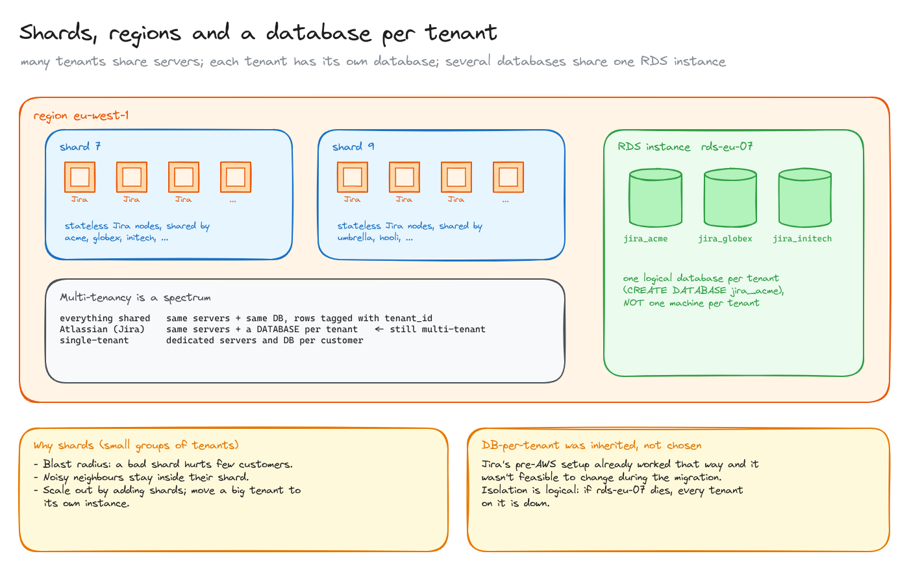
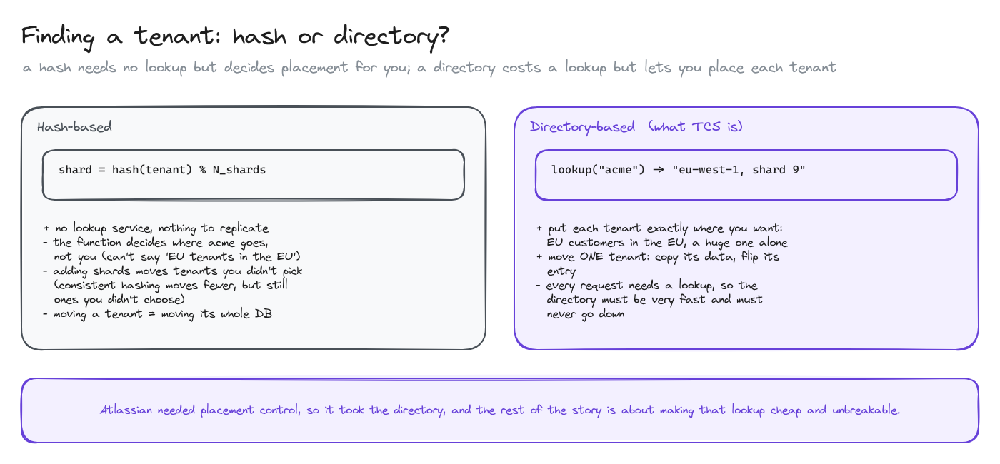
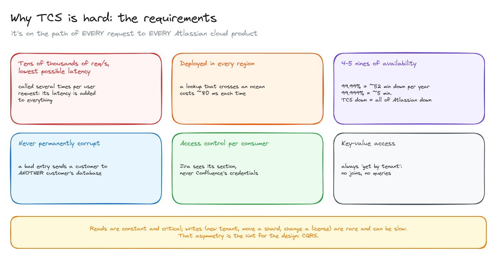

# Tenant routing: knowing where each customer lives

> A case study from Atlassian Cloud: when services are stateless and customers are spread over shards, regions and per-tenant databases, something has to answer "where does this tenant live?" on every request. Why they built a central directory (TCS) and why it's hard.

**What you'll learn**

- Why stateless services still need someone to care about state.
- Shards, regions and database-per-tenant, and why that's still multi-tenant.
- Hash-based vs directory-based placement.
- The requirements of a directory that sits on every request.

**Before reading**: nothing. Continues in [CQRS and multi-region replication](../03-cqrs-multi-region/README.md) and [caching at scale](../04-caching-at-scale/README.md). The network side is in [the path of a request in AWS](../../platform-infra/04-path-of-a-request-in-aws/README.md).

Source: [Atlassian: Our not-so-magic journey scaling low latency, multi-region services on AWS](https://www.atlassian.com/blog/how-we-build/aws-scaling-multi-region-low-latency-service) (2019).

---

## 1. The problem

Atlassian Cloud (Jira, Confluence...) is one SaaS product used by hundreds of thousands of companies, the **tenants**, each on its own subdomain (`acme.atlassian.net`). When moving it to AWS they made their services **stateless**: any instance can serve any request. But stateless services move the state problem somewhere else.

A request to `acme.atlassian.net` needs the same answer twice:

1. The **ingress** has to know which **region and shard** serve Acme, to forward the request there.
2. The **Jira node** that receives it is stateless, so it has to know **which database** holds Acme's data, and with which credentials.

Two options:

- **A.** Every service keeps its own tenant → location map. Moving a tenant means updating every copy at once, or they disagree and send traffic to the wrong place.
- **B.** **One service owns the mapping** and everyone asks it. That's the **Tenant Context Service (TCS)**: key = tenant, value = a document with a section per consumer (the ingress's routes, Jira's DB credentials, active products, licences). It grew from "route Jira calls" into a general tenant metadata service across Atlassian Cloud.

## 2. Shards, regions and a database per tenant

- **Shards** are small groups of tenants served by the same set of stateless Jira nodes. They limit the **blast radius** (a bad shard hurts few customers), contain **noisy neighbours**, and let them **scale out** by adding shards.
- Shards are **spread over regions** around the world.
- Each Jira tenant has **its own database**: a logical database (`CREATE DATABASE jira_acme`), not its own machine. Several tenant databases share one RDS instance. This was **inherited** from Jira's pre-AWS setup, and changing it during the migration wasn't feasible.

That is still **multi-tenant**: the servers are shared, only the data is separated. Multi-tenancy is a spectrum: everything shared with a `tenant_id` column, shared servers with a database per tenant (Atlassian), or fully dedicated single-tenant stacks.

The isolation is logical, not physical: if the RDS instance dies, every tenant on it is down.

## 3. Hash or directory?

Two classic ways to find a tenant's shard:

- **Hash-based**: `shard = hash(tenant) % N`. No lookup service, but the function decides placement, not you: you can't say "EU customers in the EU" or "this huge customer alone". Adding shards moves tenants you didn't choose (consistent hashing moves fewer, but still not your choice), and moving a tenant here means moving its whole database.
- **Directory-based**: look the tenant up in a table. Every request pays a lookup, but you place each tenant exactly where you want and can move **one** tenant by copying its data and flipping its entry.

Atlassian needed placement control (regions, data residency, big tenants), so it took the directory. The rest of the story is about making that lookup cheap and unbreakable.

## 4. Why TCS is hard

TCS sits on the path of every request to every Atlassian cloud product. From the article, it had to:

- Serve **tens of thousands of requests per second** at the lowest possible latency: it's called **several times per user request**, so its latency is added to everything.
- Be deployed in **every region**: crossing an ocean costs ~80 ms per lookup.
- Have **4-5 nines of availability**: 99.99% is ~52 minutes of downtime a year, 99.999% is ~5. If TCS is down, no request to any customer succeeds.
- **Never be permanently corrupt**: a bad entry could send a customer to another customer's database.
- **Control access per consumer**: Jira sees its section, never Confluence's credentials.
- Serve **key-value lookups**: always "get by tenant", no joins.

The key observation: **reads are constant and critical, writes are rare and can be slow** (a new tenant, a shard move, a licence change). That asymmetry is the hint for the design: [CQRS](../03-cqrs-multi-region/README.md).

All diagrams on one canvas: [`diagrams/tenant-routing.excalidraw`](diagrams/tenant-routing.excalidraw).

---

## Key takeaways

- Stateless services don't remove state; they move it to a service that must be very fast and very available.
- Two different questions: which region is closest to the user (DNS) and where the tenant lives (the directory).
- DB-per-tenant on shared servers is still multi-tenant; the isolation is logical.
- A directory costs a lookup per request but gives full control over placement and moves.
- When reads dominate and writes are rare, separate them.

## Interview cheat sheet

**Q: How would you route requests in a multi-tenant SaaS with tenants in several regions?**
A: Entry point near the user (DNS latency routing or anycast), then a tenant directory lookup (tenant → region/shard/DB) at the edge, then forward the whole request to the tenant's home. Replicate the small directory to every region and cache it aggressively.

**Q: Hash-based or directory-based sharding?**
A: Hashing needs no lookup but you can't choose placement and rebalancing moves arbitrary tenants. A directory costs a lookup but allows data residency, isolating big tenants and moving one tenant at a time.

**Q: What does "database per tenant" cost you?**
A: Many databases to migrate and operate, connection management per tenant, and limits on how many fit per instance. In exchange: strong isolation of data, per-tenant backups and moves.

## Further reading

- [Atlassian: Our not-so-magic journey scaling low latency, multi-region services on AWS](https://www.atlassian.com/blog/how-we-build/aws-scaling-multi-region-low-latency-service)
- [AWS: SaaS tenant isolation strategies (whitepaper)](https://docs.aws.amazon.com/whitepapers/latest/saas-tenant-isolation-strategies/saas-tenant-isolation-strategies.html)
- *Designing Data-Intensive Applications* (Kleppmann), chapter 6: partitioning.
