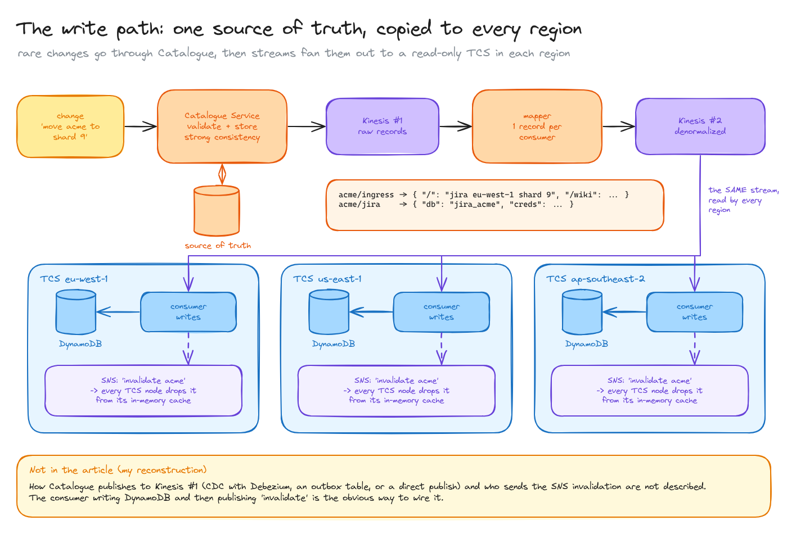
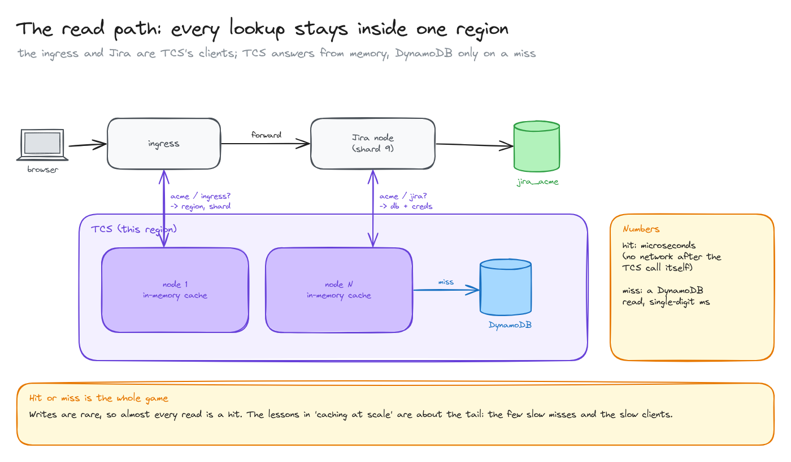
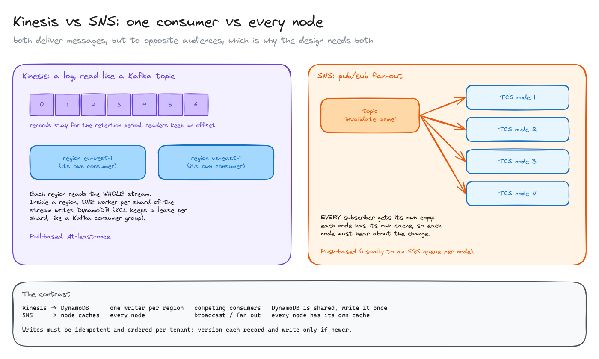
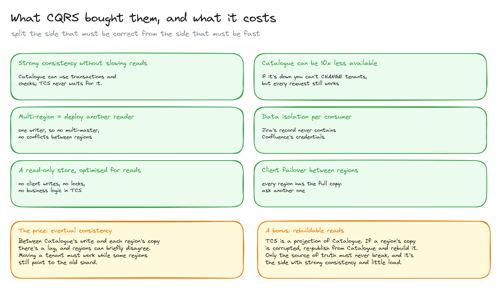

# CQRS and multi-region replication

> How Atlassian split the tenant directory into a strongly consistent write side and a fast, read-only copy in every region, connected by streams. The write path, the read path, why it uses both Kinesis and SNS, and what the split buys and costs.

**What you'll learn**

- CQRS applied at the service level: Catalogue (writes) vs TCS (reads).
- The write path: source of truth → stream → per-consumer records → every region.
- The read path: everything stays inside one region.
- Kinesis vs SNS: competing consumers vs fan-out.
- The benefits, and the price: eventual consistency.

**Before reading**: [tenant routing](../02-tenant-routing/README.md). [CDC and Kafka](../../database-internals/04-cdc-and-kafka/README.md) explains logs, offsets and consumer groups.

---

## 1. The write path

**CQRS** (Command Query Responsibility Segregation) means separating the model you write to from the model you read from. Here it's done across services:

- **Catalogue Service** is the write side and the **source of truth**. Every change goes through it: a new tenant, moving Acme to shard 9, a licence change. It validates the change and stores it with strong consistency. It's slow-ish and that's fine, because writes are rare.
- It publishes the change to **Kinesis #1** (raw records).
- A **mapper** turns each record into **one record per consumer**, already in the shape that consumer needs (`acme/ingress` → routes, `acme/jira` → DB and credentials). This is denormalisation at write time: pay the cost once, on the rare write, so reads are a single key lookup.
- Those go to **Kinesis #2**, which **every region reads**. Each region's TCS writes them into **its own DynamoDB table**.
- Each TCS node keeps an in-memory cache, so the change must also **invalidate** that cache: an SNS message makes every node drop `acme`, and the next read fetches the new value.

Not described in the article: how Catalogue publishes to Kinesis #1 (CDC with Debezium, an outbox table, or a direct publish would all work) and who sends the SNS invalidation. The regional consumer writing DynamoDB and then publishing "invalidate" is the obvious way to wire it, but it's my reconstruction. CQRS also doesn't mean event sourcing: Catalogue stores current state; the stream is just how changes travel.

## 2. The read path

The ingress and the Jira nodes are TCS's **clients**. They ask the TCS of **their own region**; TCS answers from memory (microseconds), and only on a miss reads its DynamoDB table (single-digit milliseconds). Because writes are rare, almost every read is a hit. The lessons in [caching at scale](../04-caching-at-scale/README.md) are about the tail: the few slow misses and the slow clients.

## 3. Kinesis vs SNS

Both deliver messages, but to opposite audiences:

| | Kinesis → DynamoDB | SNS → node caches |
|---|---|---|
| Who must receive it | **One** writer per region | **Every** TCS node |
| Pattern | Competing consumers (like a Kafka consumer group) | Broadcast / fan-out |
| Why | The regional DynamoDB table is shared: write it once | Each node has its own cache |
| Model | A log: records stay for the retention period; readers pull and keep an offset | Pub/sub: pushed to each subscriber (usually an SQS queue per node) |

Inside a region, the Kinesis Client Library keeps a **lease** per stream shard in a DynamoDB table, so each shard is processed by exactly one worker at a time, the same idea as partition ownership in a Kafka consumer group. Delivery is **at least once**, and records can arrive out of order across shards, so writes should be **idempotent and versioned**: write a record only if its version is newer than the stored one, and keep a tenant's changes on one stream shard (tenant as the partition key) to preserve their order.

## 4. What CQRS bought them, and what it costs

From the article:

- **Strong consistency in Catalogue without slowing reads**: TCS never waits for it.
- **Catalogue can be an order of magnitude less available**: if it's down, you can't *change* tenants, but every request still works.
- **Multi-region = deploy another reader** of the same stream. There's one writer, so no multi-master and no conflicts between regions.
- **Data isolation per consumer** and less bandwidth: Jira's record never contains Confluence's credentials.
- **A read-only store** that can be optimised purely for reads.
- **Client failover**: every region has a full copy, so a client can ask another region.

**The price: eventual consistency.** Between Catalogue's write and each region's copy there's a lag, and regions can briefly disagree. Moving a tenant has to work while some regions still point to the old shard.

**A bonus: the read side can be rebuilt.** TCS is a projection of Catalogue, so a corrupted regional copy can be rebuilt by re-publishing from Catalogue. Only the source of truth must never break, and it's the side with strong consistency and little load. (That's my reading of how the "never permanently corruptible" requirement is met; the article doesn't spell it out.)

All diagrams on one canvas: [`diagrams/cqrs-multi-region.excalidraw`](diagrams/cqrs-multi-region.excalidraw).

---

## Key takeaways

- CQRS: one side optimised for correctness (rare writes), the other for speed (constant reads).
- Denormalise at write time so reads are a single key lookup.
- One writer + a replicated log = multi-region read replicas without multi-master conflicts.
- Kinesis (one consumer per region) and SNS (every node) solve opposite delivery problems.
- At-least-once delivery → idempotent, versioned writes.
- The cost is eventual consistency; the bonus is a rebuildable read side.

## Interview cheat sheet

**Q: What is CQRS and when is it worth it?**
A: Separate write and read models (often separate services and stores). Worth it when reads and writes have very different load, latency or consistency needs, like a directory read on every request but changed rarely.

**Q: How do you replicate a dataset to many regions without multi-master?**
A: One authoritative writer publishes changes to a log; each region consumes the log and applies them to its local store. Regions are read-only replicas, eventually consistent.

**Q: Why both a stream and a pub/sub topic?**
A: The stream feeds one writer per region that updates a shared store; the pub/sub notifies every node so each can invalidate its own in-memory cache.

**Q: Messages can be duplicated or reordered. How do you stay correct?**
A: Partition by key so a key's changes stay ordered, and make writes idempotent and conditional on a version number.

## Further reading

- [Atlassian: Our not-so-magic journey scaling low latency, multi-region services on AWS](https://www.atlassian.com/blog/how-we-build/aws-scaling-multi-region-low-latency-service)
- [Martin Fowler: CQRS](https://martinfowler.com/bliki/CQRS.html)
- [Amazon Kinesis Data Streams: key concepts](https://docs.aws.amazon.com/streams/latest/dev/key-concepts.html)
