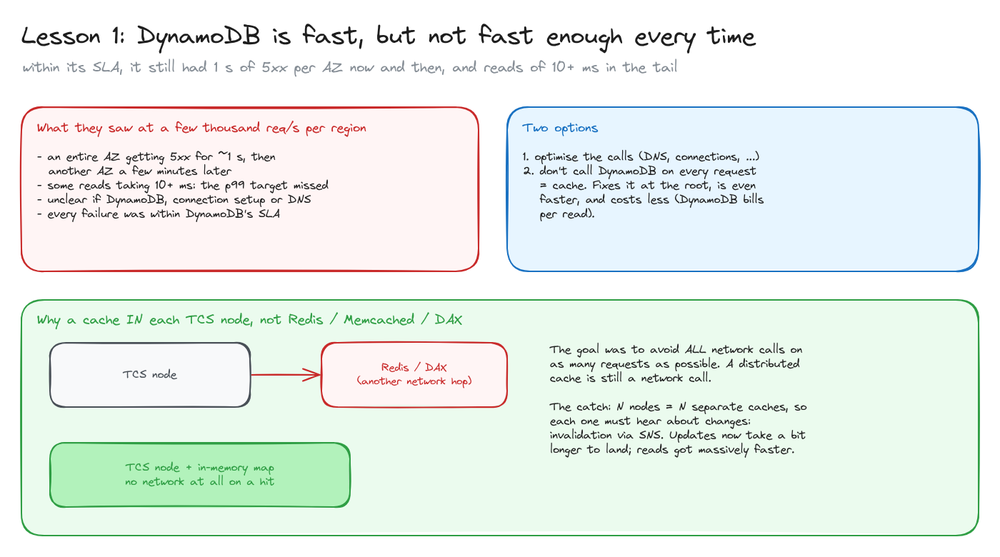
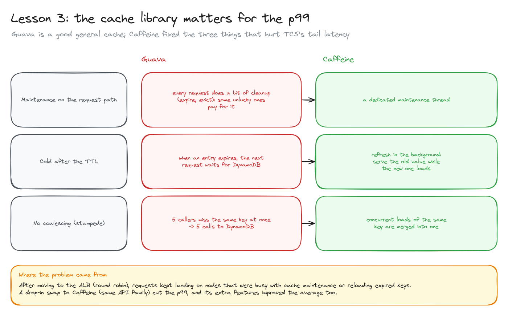
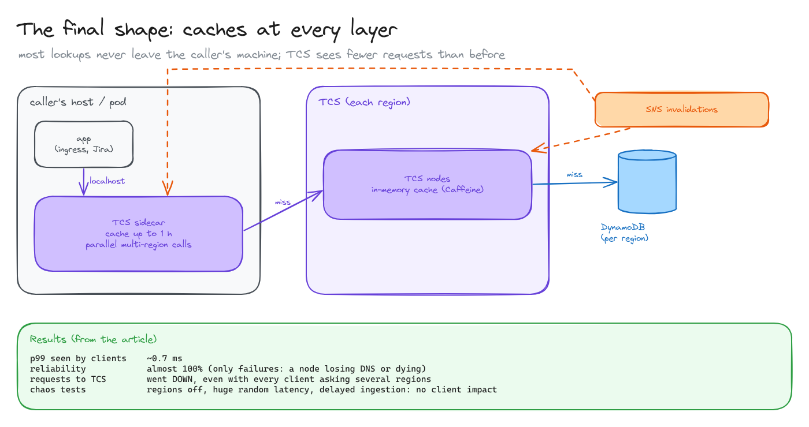
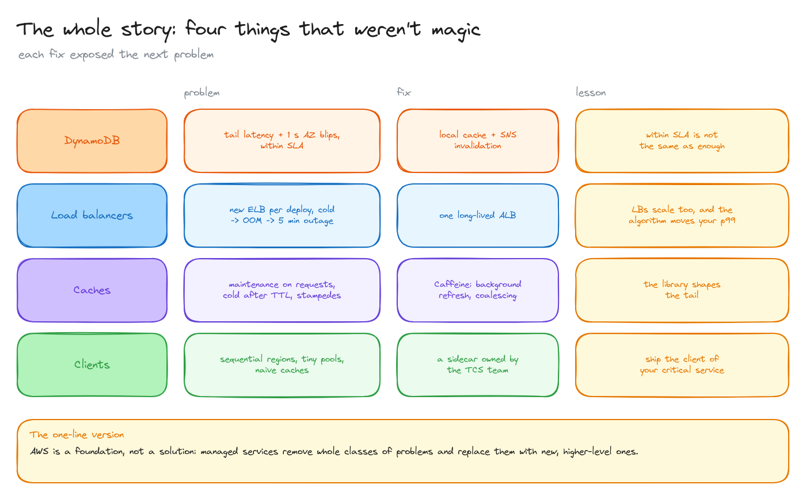

# Caching at scale

> The rest of the Atlassian story: a fast database that wasn't fast enough every time, a cache library that shaped the p99, and clients that made a healthy service look slow. How they ended up with caches at every layer and ~0.7 ms at p99.

**What you'll learn**

- Why "within the SLA" isn't the same as "good enough" on a critical path.
- In-process cache vs distributed cache (Redis, Memcached, DAX), and invalidation with SNS.
- Three cache behaviours that hurt the tail: maintenance on requests, cold after TTL, stampedes.
- Client-side caching through a sidecar.
- The whole story of the article in one table.

**Before reading**: [CQRS and multi-region replication](../03-cqrs-multi-region/README.md). Lesson 2 (load balancers) lives in [platform-infra: load balancers](../../platform-infra/05-load-balancers/README.md) and lesson 4's sidecar in [platform-infra: sidecars](../../platform-infra/07-sidecars/README.md).

---

## 1. Lesson 1: DynamoDB is fast, but not fast enough every time

At a few thousand requests per second per region they saw:

- An entire AZ getting **5xx for about a second**, then another AZ a few minutes later.
- Some reads taking **10+ ms**, so the p99 target was missed.
- No visibility into whether it was DynamoDB itself, connection setup, or DNS.

All of it was **within DynamoDB's SLA**. It wasn't a bad choice; TCS just needed better than the SLA.

Two options: optimise the calls, or **stop calling DynamoDB on every request**, i.e. cache. Caching fixes it at the root, is faster still, and is cheaper (DynamoDB bills per read).

Why a cache **inside each TCS node** instead of Redis, Memcached or DAX: the goal was to avoid **all network calls** on as many requests as possible, and a distributed cache is still a network call. The catch: N nodes means N independent caches, so each must hear about changes. They added **invalidation via SNS** (see [the write path](../03-cqrs-multi-region/README.md)). Updates take slightly longer to land than with a shared cache, but read latency dropped dramatically, and that was enough to move all customer traffic to the new platform.

## 2. Lesson 3: the cache library matters for the p99

After the switch to the ALB (round robin, [lesson 2](../../platform-infra/05-load-balancers/README.md)), the p99 rose to ~20 ms. The code path was just "read the cache, on a miss read DynamoDB", so they looked at the cache: **Guava**. It's a good general-purpose cache, but three of its behaviours hurt TCS:

| | Guava | Caffeine |
|---|---|---|
| Maintenance | Amortised over requests: some unlucky requests do the cleanup | A dedicated maintenance executor |
| After the TTL | The entry is gone; the next request waits for DynamoDB | Refresh in the background while serving the old value |
| Concurrent misses on one key | Each caller loads it: 5 callers → 5 DynamoDB calls (stampede) | Concurrent loads are merged into one |

**Caffeine** is a separate library (by Ben Manes), built for Java 8 on the ideas of Guava's cache, with a very similar API. A drop-in swap cut the p99, and using its extra features (background refresh) improved the average too.

## 3. The final shape: caches at every layer

The last problem was on the **client side**: one team saw TCS as slow while its p99 was under 6 ms, because their client called regions sequentially, ran out of connections and fought over locks ([sidecars](../../platform-infra/07-sidecars/README.md)). The fix was a **TCS sidecar** next to each client with a cache of up to an hour, kept fresh by the same SNS invalidations, and parallel calls to several regions.

The resulting layers: **sidecar cache → TCS node cache → DynamoDB**, with SNS invalidating the first two. Results from the article:

- p99 seen by clients: **~0.7 ms**.
- Almost **100% reliability**: the only failures were a client node losing DNS or dying.
- **Fewer requests reached TCS**, even though every client now asked several regions in parallel.
- Chaos tests (turning regions off, injecting huge latency, delaying ingestion) had no noticeable client impact.

## 4. The whole story

| Not magic | Problem | Fix | Lesson |
|---|---|---|---|
| DynamoDB | Tail latency and 1 s AZ blips, within SLA | Local cache + SNS invalidation | Within the SLA isn't the same as enough |
| Load balancers | A new, cold ELB per deploy → out of memory → 5 min outage | One long-lived ALB | LBs scale too, and the algorithm moves your p99 |
| Caches | Maintenance on requests, cold after TTL, stampedes | Caffeine | The library shapes the tail |
| Clients | Sequential regions, tiny pools, naive caches | A sidecar owned by the TCS team | Ship the client of your critical service |

The article's own conclusions: centralise tenant → location mapping in one place; CQRS is "seriously good"; AWS is a foundation, not a solution (it replaces problems with different, higher-level ones); and consider writing your own clients.

All diagrams on one canvas: [`diagrams/caching-at-scale.excalidraw`](diagrams/caching-at-scale.excalidraw).

---

## Key takeaways

- On a critical path, measure the tail, not the average; "within SLA" can still be too slow.
- The fastest network call is the one you don't make: in-process caches beat distributed ones for latency.
- In-process caches need an invalidation channel to every node (fan-out).
- Background refresh and request coalescing remove most cache-induced tail latency.
- Cache on the client side too, and own the client if your service is critical.

## Interview cheat sheet

**Q: Local cache or Redis?**
A: Local (in-process) for the lowest latency and no network hop, at the cost of N copies and an invalidation mechanism. Redis for a shared, consistent cache across instances, at the cost of a network round trip.

**Q: What's a cache stampede and how do you prevent it?**
A: Many concurrent misses for the same key all hit the backing store at once. Coalesce concurrent loads (single-flight), refresh entries in the background before they expire, and add jitter to TTLs.

**Q: How do you keep N in-memory caches in sync?**
A: Publish invalidations on a fan-out channel (SNS, Redis pub/sub, Kafka) that every node subscribes to, and keep a TTL as a safety net.

**Q: Your service's p99 is fine but a client says it's slow. Where do you look?**
A: At the client: connection pool size, sequential retries or failover, lock contention, DNS, its own caching. Measure from the client's side.

## Further reading

- [Atlassian: Our not-so-magic journey scaling low latency, multi-region services on AWS](https://www.atlassian.com/blog/how-we-build/aws-scaling-multi-region-low-latency-service)
- [Caffeine](https://github.com/ben-manes/caffeine)
- [Go: golang.org/x/sync/singleflight](https://pkg.go.dev/golang.org/x/sync/singleflight), the Go equivalent of request coalescing.
