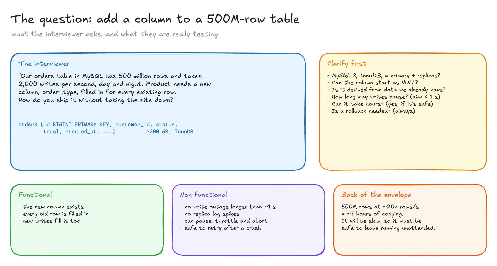
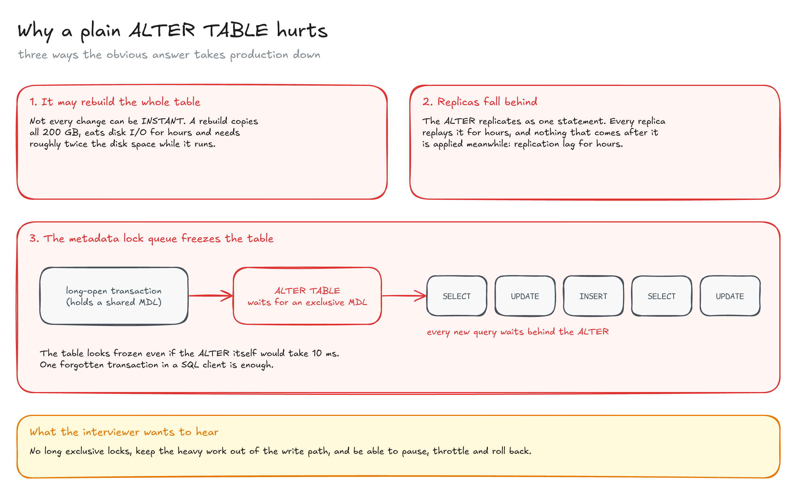
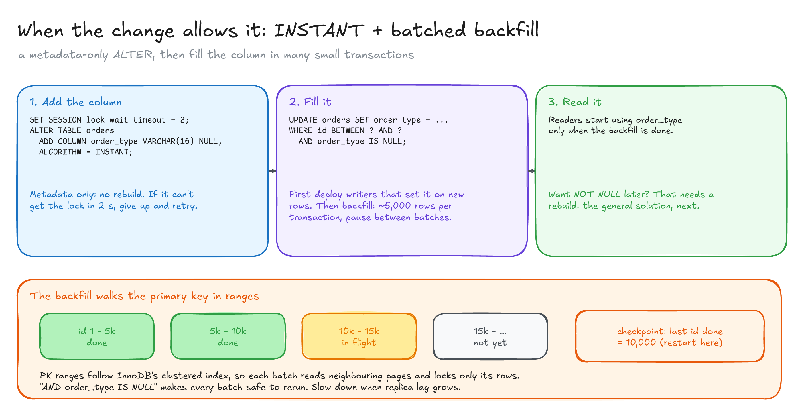
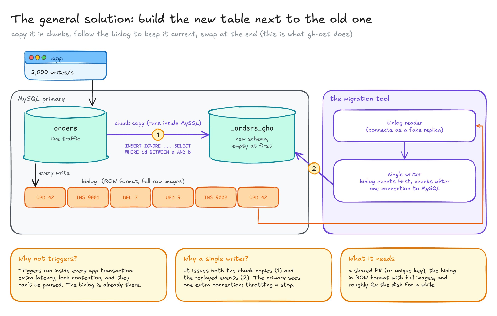
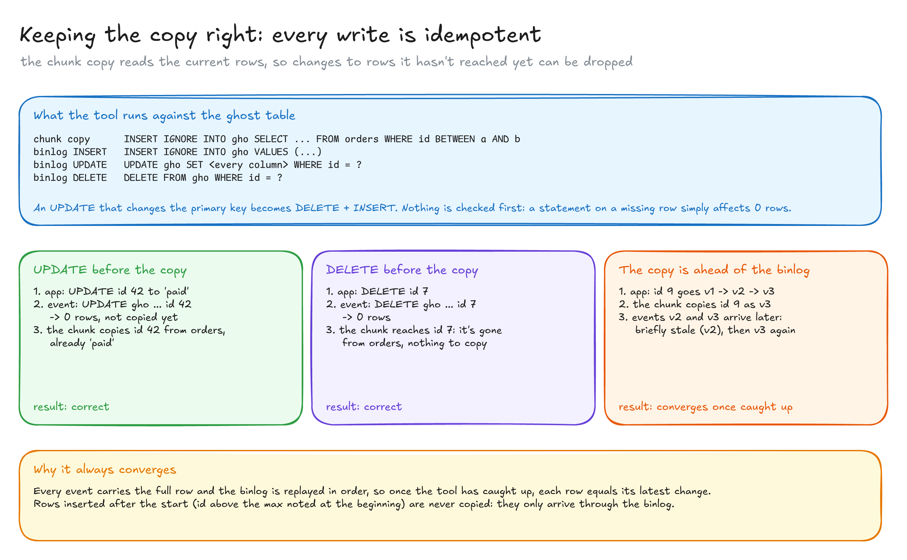
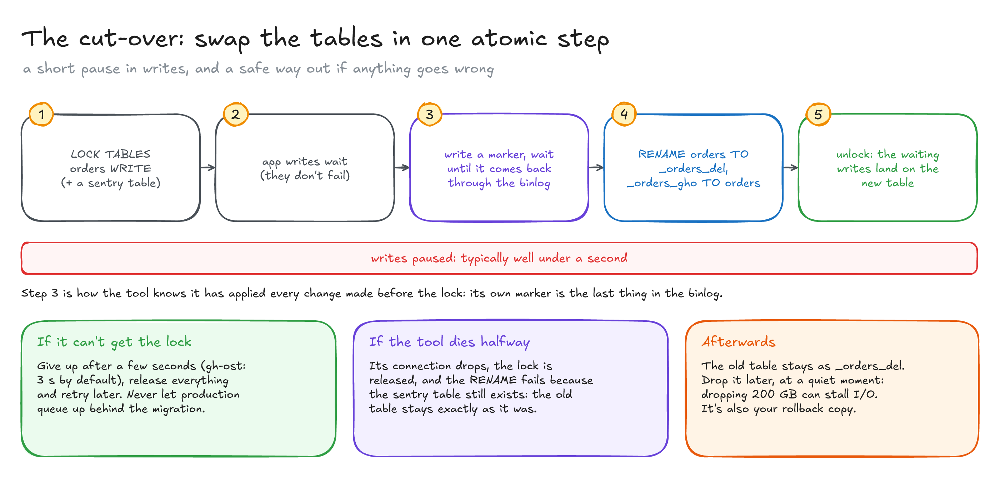
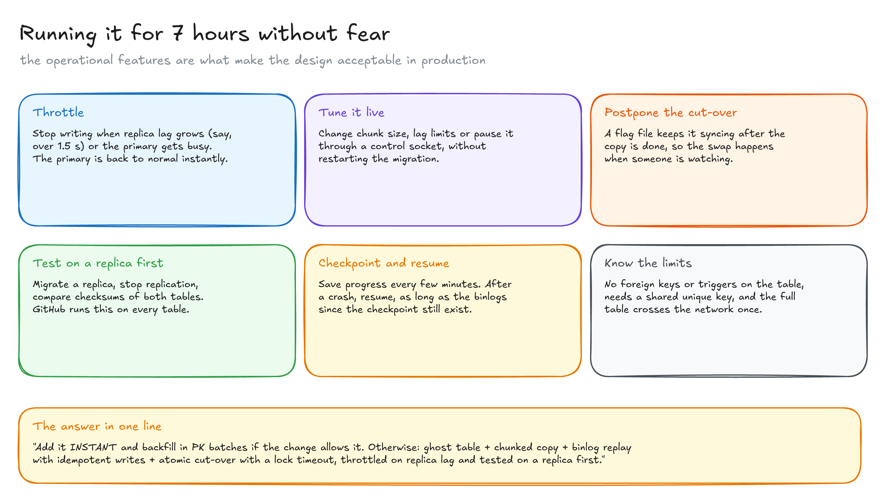

# Zero-downtime schema change: a new column on a 500M-row table

> How to add and fill a column on a huge, busy MySQL table without stopping writes: use a metadata-only `ALTER` when the change allows it, and otherwise build the new table next to the old one, keep it in sync from the binlog, and swap them in one atomic step.

**What you'll learn**

- Why a plain `ALTER TABLE` can take production down, even when it's "instant".
- The cheap path: `ALGORITHM=INSTANT` plus a batched backfill by primary key.
- The general path: a ghost table, a chunked copy and binlog replay, as gh-ost does it.
- Why changes to rows that haven't been copied yet can simply be dropped.
- An atomic cut-over with a lock timeout, and the operational features that make it safe.

**Before reading**: [Online schema migrations](../../database-internals/05-online-schema-migrations/README.md) (metadata locks, `INSTANT`, row locks) and [MySQL vs Postgres](../../database-internals/02-mysql-vs-postgres/README.md) (the binlog, clustered index). [Large file ingestion](../01-large-file-ingestion/README.md) uses the same batching, idempotency and checkpoint ideas.

---

## 1. The question



> "Our `orders` table in MySQL has 500 million rows and takes 2,000 writes per second, day and night. Product needs a new column, `order_type`, filled in for every existing row. How do you ship it without taking the site down?"

Clarify before designing: MySQL 8 with InnoDB and replicas, whether the column can start as `NULL`, whether its value can be derived from existing data, and how long writes may pause (aim for under a second).

The requirements:

- **Functional**: the column exists, every old row is filled in, and new writes fill it too.
- **Non-functional**: no write outage longer than about a second, no replica lag spikes, the ability to pause, throttle and abort, and safe retries after a crash.

A quick estimate sets expectations: 500M rows at ~20k rows/s is about **7 hours** of copying. It will be slow, so it has to be safe to leave running.

## 2. Why a plain ALTER TABLE hurts



1. **It may rebuild the whole table.** Not every change can be `INSTANT`. A rebuild copies all 200 GB, saturates disk I/O for hours and needs about twice the disk while it runs.
2. **Replicas fall behind.** The `ALTER` replicates as a single statement, and each replica replays it for hours. Nothing after it is applied meanwhile: hours of replication lag.
3. **The metadata lock queue.** The `ALTER` needs an exclusive metadata lock. If a long transaction holds the shared one, the `ALTER` waits, and every new query on the table queues behind it. The table looks frozen even if the `ALTER` itself would take milliseconds.

What the interviewer wants to hear: no long exclusive locks, the heavy work kept out of the write path, and the ability to pause, throttle and roll back.

## 3. The cheap path: INSTANT + batched backfill



If the column can start as `NULL` (or with a default), MySQL 8 can add it by changing metadata only:

```sql
SET SESSION lock_wait_timeout = 2;     -- give up fast instead of freezing the table
ALTER TABLE orders
  ADD COLUMN order_type VARCHAR(16) NULL,
  ALGORITHM = INSTANT;                 -- error instead of a silent rebuild
```

Then, in this order:

1. **Deploy the writers** that set `order_type` on every new row, so no new row is missed.
2. **Backfill old rows** in small transactions, walking the primary key:

   ```sql
   UPDATE orders SET order_type = ...
   WHERE id BETWEEN ? AND ?
     AND order_type IS NULL;           -- safe to rerun
   ```

   About 5,000 rows per transaction, a pause between batches, slower when replica lag grows. Record the last id done as a checkpoint.
3. **Deploy the readers** once the backfill has finished.

This covers many real cases. It stops working as soon as the change needs a rebuild: making the column `NOT NULL`, changing a type, most index changes. That needs the general solution.

## 4. The general solution: a ghost table



Build the new table next to the old one and switch to it at the end:

1. Create `_orders_gho` with the new schema. Altering an empty table is instant.
2. **Copy in chunks** by primary key range. Each chunk is one statement that runs inside MySQL, so the rows never travel to the tool: `INSERT IGNORE INTO _orders_gho SELECT ... FROM orders WHERE id BETWEEN a AND b`. The range ends at the max id noted when the copy starts.
3. **Follow the binlog.** The tool connects to MySQL as a fake replica, keeps only the events for `orders`, and replays them on the ghost table.
4. When the copy is done and the binlog has been caught up, **swap the tables** (section 6).

The tool uses **one writer** for both the chunk copies and the replayed events, and gives the events priority. The primary sees a single extra connection, there's no contention on the ghost table, and throttling simply means "stop writing".

Why not triggers, like older tools? Triggers run inside every app transaction: extra latency, lock contention on two tables, and they can't be paused. The binlog already holds every change.

It needs a primary key (or unique key) shared by both tables, the binlog in `ROW` format with full row images, and roughly twice the disk for a while.

## 5. Keeping the copy right



The tricky question: what if the binlog says to update or delete a row the copy hasn't reached yet? Look at what the tool runs:

| Source | Statement on the ghost table |
|---|---|
| Chunk copy | `INSERT IGNORE INTO gho SELECT ... WHERE id BETWEEN a AND b` |
| Binlog `INSERT` | `INSERT IGNORE INTO gho VALUES (...)` |
| Binlog `UPDATE` | `UPDATE gho SET <every column> WHERE id = ?` |
| Binlog `DELETE` | `DELETE FROM gho WHERE id = ?` |

An `UPDATE` that changes the primary key becomes a `DELETE` plus an `INSERT`. Nothing is checked first: a statement on a missing row just affects 0 rows. And that's correct, because **the chunk copy reads the current state of the original table**:

- **Update before the copy**: it affects 0 rows; later the chunk copies the row, already updated.
- **Delete before the copy**: it affects 0 rows; later the chunk doesn't find the row, so it never copies it.
- **The copy is ahead of the binlog**: the chunk copied v3, then the events for v2 and v3 arrive. The row is briefly stale, then correct again.

Every write is **idempotent**, every event carries the full row, and the binlog is replayed in order. Once the tool has caught up, each row equals its latest change. Rows inserted after the start are never copied; they only arrive through the binlog.

## 6. The cut-over



1. Lock the **original** table for writes (plus a sentry table, `_orders_del`). App writes wait; they don't fail.
2. Write a marker into the tool's own table and wait until it comes back through the binlog. Everything written before the lock has now been applied.
3. Issue an atomic `RENAME TABLE orders TO _orders_del, _orders_gho TO orders`. It blocks on the lock.
4. Drop the sentry and unlock: the `RENAME` runs first, and the waiting writes land on the new table.

Writes pause for well under a second. Two safety nets:

- **Lock timeout**: if the lock can't be taken in a few seconds (gh-ost: 3 by default), give up, release, retry later. Production never queues behind the migration.
- **The sentry table**: if the tool dies halfway, its lock is released and the `RENAME` fails because `_orders_del` still exists. The old table is left exactly as it was.

The old table stays as `_orders_del`: your rollback copy. Drop it later at a quiet moment; dropping 200 GB can stall I/O.

## 7. Running it safely



Seven hours on the busiest table only works with operational controls:

- **Throttle** on replica lag or load on the primary. The tool stops writing, and the primary is back to normal instantly.
- **Tune it live** (chunk size, lag limits, pause) without restarting.
- **Postpone the cut-over** with a flag file: it keeps syncing until someone is watching.
- **Test on a replica first**: migrate a replica, stop replication, compare checksums of both tables.
- **Checkpoint and resume** after a crash, as long as the binlogs since the checkpoint still exist (the same retention lesson as CDC).
- **Know the limits**: no foreign keys or triggers on the table, and the whole table crosses the network once.

All diagrams on one canvas: [`diagrams/zero-downtime-schema-change.excalidraw`](diagrams/zero-downtime-schema-change.excalidraw).

---

## Key takeaways

- The danger of an `ALTER` is the exclusive lock and the rebuild, not the SQL. Always use a short `lock_wait_timeout`.
- If the change allows it: `INSTANT` + writers first + batched, idempotent backfill by PK + readers last.
- Otherwise: ghost table + chunked copy + binlog replay + atomic cut-over.
- Changes to rows not copied yet can be dropped, because the copy reads the current state. Idempotent writes make everything converge.
- Throttling, postponing, testing on a replica and checkpoints are part of the design, not extras.

## Interview cheat sheet

**Q: Why not just run `ALTER TABLE`?**
A: It may rebuild 200 GB, it lags every replica for hours, and it needs an exclusive metadata lock that can queue every query behind a long transaction.

**Q: The binlog updates a row the copy hasn't reached. What happens?**
A: The `UPDATE` on the ghost table affects 0 rows. Later the chunk copies that row from the original table, which already has the change.

**Q: How do you keep the copy consistent while the app keeps writing?**
A: Replay the binlog in order, with idempotent statements (`INSERT IGNORE`, full-row `UPDATE`, `DELETE` by PK). Once caught up, every row matches its latest change.

**Q: How do you swap without losing writes?**
A: Lock the original table, wait until your own marker comes back through the binlog, rename both tables atomically, unlock. With a lock timeout and a sentry table, failure means "nothing happened".

**Q: How long does writing pause?**
A: Only during the cut-over, typically well under a second. The copy itself runs for hours without blocking anything.

## Further reading

- [gh-ost: GitHub's online schema migration tool for MySQL](https://github.blog/news-insights/company-news/gh-ost-github-s-online-migration-tool-for-mysql/): the article that inspired this exercise.
- [gh-ost docs: triggerless design](https://github.com/github/gh-ost/blob/master/doc/triggerless-design.md) and [cut-over](https://github.com/github/gh-ost/blob/master/doc/cut-over.md)
- [MySQL docs: Online DDL operations](https://dev.mysql.com/doc/refman/8.0/en/innodb-online-ddl-operations.html)
