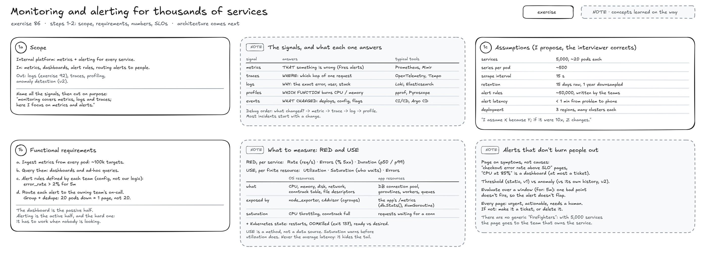
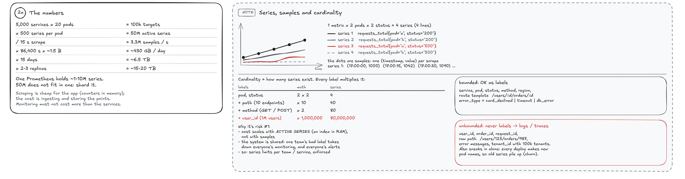
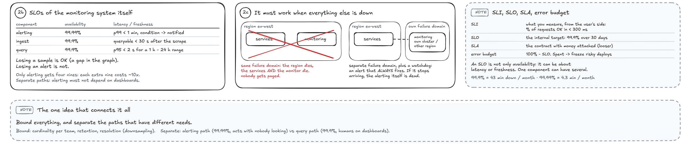
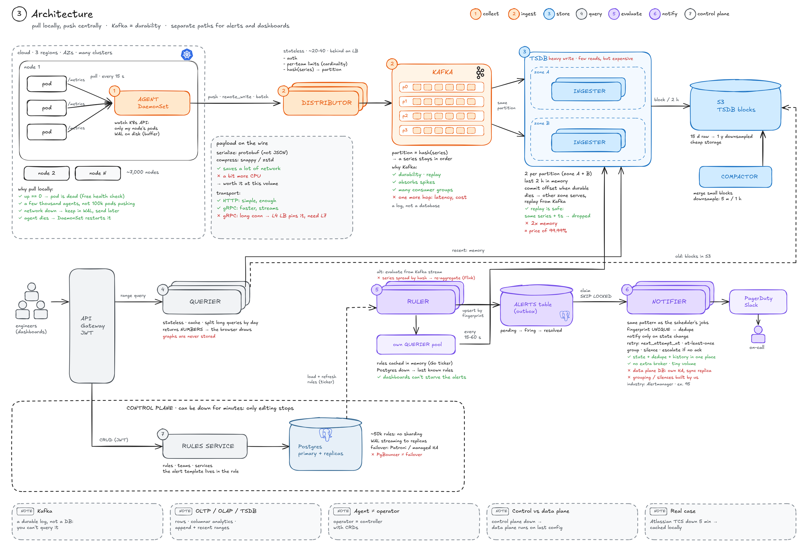

# Monitoring and alerting for thousands of services

> An internal platform that collects metrics from 100,000 pods, keeps them queryable for dashboards, and pages the right team in under a minute, even when part of the infrastructure it watches is down. Agents pull locally and push centrally, Kafka absorbs the writes, a TSDB serves the reads, and the alerting path is kept apart from everything else.

**What you'll learn**

- What gets measured (RED and USE), and why monitoring here means metrics only.
- What a series, a sample and cardinality are, and why cardinality is the risk that takes everything down.
- How to size it: 50M active series, 3.3M samples per second, and why one Prometheus isn't enough.
- SLOs for the monitoring system itself: why only alerting gets four nines, and why the monitor needs its own failure domain.
- The architecture: an agent per node, distributors, Kafka, ingesters, S3, queriers, a ruler and an alerts outbox.
- Control plane vs data plane: why the alerts keep working when the rules database is down.

**Before reading**: [Load balancers](../../platform-infra/05-load-balancers/README.md) (why gRPC needs L7 balancing), [Caching at scale](../04-caching-at-scale/README.md) (Atlassian caching its tenant directory locally) and [CDC and Kafka](../../database-internals/04-cdc-and-kafka/README.md) (offsets and at-least-once). The alerts outbox is the same pattern as the jobs table in my [distributed scheduler](https://github.com/JoelTeoGom/distributed-scheduler).

---

## 1. Scope and requirements



"Design a monitoring and alerting system for thousands of services" is vague on purpose. Monitoring covers **metrics, logs and traces** (and profiles), and each one has a different data shape, pipeline and store:

| Signal | Answers | Typical tools |
|---|---|---|
| Metrics | **That** something is wrong. Cheap numbers that fire the alerts | Prometheus, Mimir |
| Traces | **Where**: which hop of one request took the time | OpenTelemetry, Tempo |
| Logs | **Why**: the exact error, user, stack trace | Loki, Elasticsearch |
| Profiles | **Which function** burns the CPU or memory | pprof, Pyroscope |

Name all of them, then cut on purpose: this design covers **metrics and alerting**. Logs are another exercise (centralized logging); traces, profiling and anomaly detection are out of scope (anomalies would be a v2).

**Functional requirements**

1. Ingest metrics from every pod: about 100k targets.
2. Query them: dashboards and ad-hoc queries.
3. Teams define alert rules over a time window, like `error_rate > 2% for 5m`. Rules are configuration, not our logic.
4. Route each alert to the on-call of the team that owns the service. Group and dedupe: 20 pods down is one page, not twenty.

**Assumptions** (propose them, the interviewer corrects): 5,000 services with ~20 pods each, ~500 series per pod, a 15 s scrape interval, 15 days of raw data and 1 year downsampled, ~50,000 alert rules, under a minute from problem to phone, 3 regions with many clusters each. The sentence to use: *"I assume X because Y; if it were 10x, Z changes."*

**What to measure.** RED for every service: **R**ate (req/s), **E**rrors (% 5xx), **D**uration (p50 and p99, never the average). USE for every finite resource: **U**tilization, **S**aturation (who is waiting), **E**rrors. USE is a method, not a data source: it applies to OS resources (CPU, memory, disk, network, the conntrack table, file descriptors, exposed by `node_exporter` and cAdvisor) and to app resources (the DB connection pool, goroutines, internal queues, exposed by the app's own `/metrics`). Add the Kubernetes state: restarts, `OOMKilled`, ready vs desired replicas.

**Alerts that don't burn people out.** Page on symptoms, not causes: "checkout error rate above its SLO" pages, "CPU at 85%" is a dashboard. Every page must be urgent, actionable and need a human; if not, it's a ticket or it's deleted. Evaluating over a window (`for: 5m`) stops one bad point from firing and the alert from flapping.

## 2. The numbers, and cardinality



A **series** is one line on a graph: a metric name plus its labels. Change any label and it's another series. A **sample** is one point of that line, a `(timestamp, value)` pair, one per scrape. **Cardinality** is how many series exist.

```
requests_total{pod="a", status="200"}   ← series 1
requests_total{pod="a", status="500"}   ← series 2
requests_total{pod="b", status="200"}   ← series 3
requests_total{pod="b", status="500"}   ← series 4
series 1 samples: (17:00:00, 1000) (17:00:15, 1042) (17:00:30, 1090) ...
```

The estimate:

```
5,000 services × 20 pods     = 100k targets
× 500 series per pod         = 50M active series
/ 15 s scrape                ≈ 3.3M samples/s
× 86,400 s × ~1.5 B/sample   ≈ 430 GB/day
× 15 days                    ≈ 6.5 TB   (× 2–3 replicas ≈ 15–20 TB)
```

A single Prometheus is comfortable at 1–2M active series and tops out around 10M, because it keeps every **active series in memory** to ingest fast. Disk is never the limit: compressed samples take 1–2 bytes. It's also a single node with no replication. 50M series doesn't fit, and one node can't give four nines either, so the data has to be **sharded and replicated**.

**Why cardinality is the risk that takes everything down.** Every label multiplies the series count: `pod × status` is 4, add `path` (10 endpoints) and it's 40, add `method` and it's 80, add `user_id` with a million users and it's **80 million**. The cost scales with active series, not samples, and the system is shared: one team's bad label takes down everyone's monitoring, and everyone's alerts with it.

- **Bounded labels** are fine: service, pod, status, method, region, the route template `/users/:id`, `error_type` with a handful of values.
- **Unbounded ones** go to logs or traces, never to labels: `user_id`, `order_id`, `request_id`, the raw path `/users/123`, error messages. Churn sneaks in alone too: every deploy creates new pod names, and old series pile up for a while.
- So the system enforces **series limits per team or service** at the door.

## 3. SLOs, and surviving the outage it should report



An SLO isn't only availability; it can be about latency or freshness, and one component can have several.

| Component | Availability | Latency / freshness |
|---|---|---|
| Alerting | 99.99% | p99 < 1 min from condition to notification |
| Ingest | 99.9% | queryable < 30 s after the scrape |
| Query | 99.9% | p95 < 2 s for a 1 h – 24 h range |

**Losing a sample is OK** (a gap in a graph). **Losing an alert is not.** Each extra nine costs roughly 10x, so only alerting gets four, and the alerting path must not depend on the dashboard path.

The monitor also has to **work when everything else is down**. If it shares a cluster or a region with the services it watches, a regional outage takes down the services *and* the monitor, and nobody gets paged. It runs in its own failure domain, and a **watchdog alert** that always fires proves the alerting pipeline is alive: if it stops arriving, the alerting itself is dead.

## 4. The architecture



The whole design is **pull locally, push centrally**, with **Kafka as the durability layer** and **separate paths for alerts and dashboards**.

**1. Collect: an agent per node.** A DaemonSet runs one agent on every node (Prometheus in agent mode, Grafana Alloy or the OpenTelemetry Collector). It watches the Kubernetes API for the pods on its own node (`spec.nodeName`), scrapes their `/metrics` every 15 s, buffers the samples in a WAL on disk and pushes them in batches with `remote_write`.

- Pulling locally gives a free health signal: a failed scrape becomes `up == 0`, so a dead pod is visible. With pure push, silence is ambiguous: dead, or just idle?
- A few thousand agents talk to the centre instead of 100k pods each pushing on their own.
- If the network or the ingest is down, the agent keeps accumulating in the WAL and sends it later; it deletes only after the centre acknowledges. If the agent dies, the DaemonSet restarts it.

**The payload.** Batch, serialize with protobuf (not JSON), compress with snappy or zstd. It costs a little CPU and saves a lot of network, which is always worth it at this volume. The transport can be plain HTTP (what `remote_write` uses) or gRPC; gRPC keeps one long-lived HTTP/2 connection, so an L4 load balancer pins every agent to one distributor and you need L7 or client-side balancing.

**2. Ingest: distributors and Kafka.** Stateless distributors behind a load balancer (~20–40 instances) authenticate the agents, enforce the **per-team limits** (this is where cardinality explosions are stopped) and compute `hash(series)` to pick the Kafka partition. Agents never talk to Kafka directly: that would be thousands of producers holding connections to every broker, coupled to the partition layout, with limits spread over every node.

Partitioning by series hash keeps all the samples of a series in one partition, in order, so one consumer writes them into one shard of the TSDB. That is how 50M series get sharded. Kafka buys durability and replay, absorbs spikes and lets several consumer groups read the same data (the TSDB writers, and later anything else); the cost is one more hop, in latency, money and operations, which the 30 s freshness SLO can afford. Kafka is a log, not a database: you can't ask it for the p99 of the last hour.

**3. Store: ingesters, S3 and the compactor.** This is a TSDB, not OLTP (Postgres: rows and transactions) or OLAP (BigQuery: columnar analytics that take seconds and are billed per query). A TSDB appends points and reads recent ranges fast. Here the **ingesters are our own stateful service** with the TSDB library inside: each consumes its Kafka partitions, keeps the last ~2 h in memory, serves the recent queries and uploads a block to S3 every 2 h. A **compactor** merges small blocks and builds the downsampled versions (5 min, 1 h) for the year of history.

When an ingester dies, nothing is lost: another one takes the partition and replays from the last committed offset, and the offset is committed only once the data is durable. Replay is at-least-once, and that's safe because a sample with the same series and timestamp is dropped. But replaying two hours takes minutes, and during that time a slice of the series is blind to dashboards and alerts. So **two ingesters consume each partition, in different zones**: one dies, the other already has the data in memory. It costs twice the memory, which is the price of four nines. (Grafana Mimir now uses this Kafka-based design; the classic alternative writes from the distributors straight to three ingester replicas.)

The load is **write-heavy**: 3.3M samples per second whether anyone is looking or not. Reads are fewer but expensive, because one query can scan many series.

**4. Query.** Stateless queriers answer the dashboards: a range query goes in, numbers come out, and the browser draws the graph. Nothing is rendered or stored as an image. Queriers read recent data from the ingesters and older data from the S3 blocks, cache results and split long queries by day.

**5. Evaluate: the ruler.** The ruler holds every rule in memory, refreshed on a ticker from the rules database, and evaluates them every 15–60 s against its **own pool of queriers**, so a 30-day dashboard query can never starve the alerts. If the rules database is down, it keeps evaluating with the last rules it knew. Evaluating straight from the Kafka stream would be faster, but the partitions are split by series, so the 20 pods of one service are spread over 20 partitions and every rule would have to re-aggregate them across consumers, which means building a Flink job.

**6. Notify: an alerts table used as an outbox.** The hard part of notifying isn't sending, it's not sending too much: a rule that stays true for 20 minutes and is evaluated every 30 s would page 40 times. The ruler **upserts** each alert by its **fingerprint** (rule + labels, `UNIQUE`), so a still-firing alert only updates its `last_seen`. Notifier workers claim rows whose state changed and hasn't been notified yet with `SKIP LOCKED`, send them to PagerDuty or Slack, and retry with `next_attempt_at`: at-least-once, without double pages. Only transitions notify: `pending → firing`, and `firing → resolved`. Grouping, silences and escalation (no ack in 10 minutes, page the next person) are built on top.

A queue alone (RabbitMQ) would move the messages but wouldn't know whether an alert was already firing or already notified. The table keeps state, dedupe, retries and history in one place, and alerts are a tiny volume. It is, however, **data plane**: it needs real high availability (its own primary and a synchronous replica in another zone), not the rules database. In the industry this part is Alertmanager.

**7. Control plane: rules, teams and services.** A CRUD service behind the API gateway (JWT) stores teams, services, ownership (which team owns which service, needed for routing and for the limits) and the rules, with the alert template inside each rule (severity, summary, runbook). About 50k rules fit in one Postgres with replicas; there's nothing to shard. Failover is Patroni or a managed HA setup, not PgBouncer, which only pools connections.

The point is that **the control plane can be down for minutes and only editing stops**. The data plane keeps collecting, storing and alerting with the last configuration it knew, the same way pods keep running when the Kubernetes API server is down. Atlassian learned this when their tenant directory went down for five minutes and took Jira with it: they started caching it locally, for latency and for availability.

## 5. Failure modes so far

| What fails | What happens | Why it's fine |
|---|---|---|
| Rules database (Postgres) | Rules can't be edited for a few minutes | The ruler keeps evaluating with its local copy |
| Network between an agent and the centre | Samples pile up on the node | WAL on disk, sent when the network is back |
| An agent | Its node isn't scraped for a few seconds | The DaemonSet restarts it |
| An ingester | Its partitions are reassigned and replayed | Data is in Kafka; the replica in the other zone keeps serving |
| A team adds an unbounded label | Its series count explodes | Per-team limits at the distributor reject the excess |
| A whole region | The services there go down | The monitor lives in its own failure domain; the watchdog proves alerting is alive |

Still to cover: Kafka itself failing, the alerts database failing over, a querier overloaded by a huge dashboard query, and how to observe and operate the monitor itself.

All diagrams on one canvas: [`diagrams/monitoring-and-alerting.excalidraw`](diagrams/monitoring-and-alerting.excalidraw).

---

## Key takeaways

- Monitoring is metrics, logs, traces and profiles; each has its own data shape and store. Scope it before designing.
- A series is a metric name plus labels, a sample is one point, and cardinality is how many series exist. The cost scales with active series, so labels must be bounded and limited per team.
- 50M series don't fit in one Prometheus, and one node can't give four nines: shard by series hash and replicate.
- Only alerting gets four nines. Losing a sample is OK; losing an alert is not. Keep the alerting path separate from dashboards.
- Pull locally (free `up` health signal), push centrally (few connections, buffered in a WAL).
- Kafka is the durability layer, not a database; replay is safe because samples are idempotent by series and timestamp.
- The control plane can go down; the data plane runs on the last known configuration.
- Notifying is mostly about not notifying twice: state, fingerprint dedupe, grouping. An outbox table does it.

## Interview cheat sheet

**Q: Push or pull for metrics?**
A: Both: an agent per node pulls from the local pods, which gives a free health signal when a scrape fails, and pushes batches to the centre, so only a few thousand agents connect instead of every pod.

**Q: Why not just run Prometheus?**
A: It keeps active series in memory and tops out around 10M; we have 50M. It's also a single node with no replication, which can't give the alerting path four nines.

**Q: What is cardinality and why does it matter?**
A: The number of series, one per label combination. Cost scales with it, and one unbounded label like `user_id` can multiply it by millions and take down a shared system. Bound labels and enforce per-team limits at ingest.

**Q: Why put Kafka between the distributors and the storage?**
A: Durability and replay if a storage node dies, absorbing spikes, and several consumers on the same data. Partitioning by series hash keeps each series ordered and shards the storage. The price is an extra hop.

**Q: An ingester dies. What happens?**
A: Its partition is replayed from Kafka from the last committed offset; duplicates are dropped by series and timestamp. Because replay takes minutes, each partition is consumed by two ingesters in different zones so queries and alerts never go blind.

**Q: The rules database is down. Do alerts stop?**
A: No. The ruler keeps the rules in memory and keeps evaluating with the last version it loaded; only editing rules stops.

**Q: A rule stays true for 20 minutes. How many pages?**
A: One when it starts firing and one when it resolves. Alerts are deduplicated by a fingerprint and only state transitions notify.

**Q: Why does the monitor need its own failure domain?**
A: If it shares a region with the services, a regional outage takes both down and nobody is paged. A watchdog alert that always fires proves the pipeline is alive.

## Further reading

- [Google SRE book: Monitoring distributed systems](https://sre.google/sre-book/monitoring-distributed-systems/)
- [Prometheus: data model](https://prometheus.io/docs/concepts/data_model/)
- [Grafana Mimir architecture](https://grafana.com/docs/mimir/latest/get-started/about-grafana-mimir-architecture/) (distributors, ingesters, and the Kafka-based ingest storage)
- [Atlassian: Our not-so-magic journey scaling low latency, multi-region services on AWS](https://www.atlassian.com/blog/how-we-build/aws-scaling-multi-region-low-latency-service)
